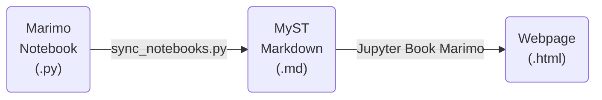

# Project Style Guide

This guide is the single reference for writing and revising the book's pages. It is written for the author and for any agent asked to improve a chapter.

If a question comes up that this guide does not settle, ask the author rather than inventing a convention. Many rules below are checked by `make check`; [Checking a Notebook](#checking-a-notebook) lists which.

## Contents

1. [Guiding Principles](#guiding-principles)
2. [How the Book Is Built](#how-the-book-is-built)
3. [Page Anatomy](#page-anatomy)
4. [Writing](#writing)
5. [Notation](#notation)
6. [Markdown Elements](#markdown-elements)
7. [Labels, Links, Terms, and Citations](#labels-links-terms-and-citations)
8. [Figures and Interactive Elements](#figures-and-interactive-elements)
9. [Code the Reader Sees](#code-the-reader-sees)
10. [Notebook Files](#notebook-files)
11. [Running Examples](#running-examples)
12. [Checking a Notebook](#checking-a-notebook)
13. [Decisions](#decisions)

---

## Guiding Principles

These come from the Guiding Principles in `notebooks/index.py` and are not negotiable.

1. **Concision, as the author defines it:** first include everything in the dependency hierarchy that the key concept is built on, with complete understanding and precise definitions. Only then use as few words as possible. Achieve concision through choice of concepts, organization, and wording; never through imprecision, approximation, or assumed knowledge.
2. **Definitions:** define every word whose meaning here is different from, or more specific than, its everyday meaning. Define it before its first use, and afterwards use it only with that meaning. A definition is a set of requirements that are necessary and sufficient for belonging to the category the word names.
3. **Dependency order:** nothing is used before it is introduced.
4. **Example first:** start with a concrete example, then generalize.
5. **Justification:** justify every step. Prove when possible; otherwise state the result precisely and cite or link a proof.
6. **Interactivity:** every page has at least one meaningful interactive element ([Interactive Elements](#interactive-elements)).
7. **Limits:** state assumptions, and what happens when they fail.
8. **Minimal prerequisites:** build concepts from the ground up. When a concept is not worth building in the book, link to a resource that does.

---

## How the Book Is Built

- All pages are written as [marimo notebooks](https://docs.marimo.io) (`notebooks/*.py`).
- `scripts/sync_notebooks.py` exports each notebook to [MyST Markdown](https://mystmd.org/guide) in `content/nb/*.md`. Plain markdown cells become plain text, and code cells become `{marimo}` [directives](https://mystmd.org/guide/directives) that run as [islands](https://docs.marimo.io/guides/island_example/) in the reader's browser. The script also rewrites some marimo syntax into MyST syntax (admonitions, glossary entries, frontmatter, `# jb:` options).
- `scripts/toc_generator.py` builds the table of contents page, `content/nb/toc.md`: every page in order with its headings, glossary terms, and results.
- Jupyter Book 2, with the [jupyter-book-marimo](https://marimo-team.github.io/jupyter-book-marimo) plugin, builds `content/` into a static site.



**Source of truth.** Edit only `notebooks/*.py`. `content/nb/` is generated and git-ignored; never edit it by hand. The order of the pages and the part titles live in `content/myst.yml`; each page's title and subtitle live in its notebook ([Skeleton](#skeleton)). The canonical numbers of the running examples live in `scripts/running_examples.toml` ([Running Examples](#running-examples)).

**Commands.** The ones used while writing are below; the comments in the `Makefile` describe the rest.

| Command | What it does |
|:---|:---|
| `make book-write` | Export, watch the notebooks, and serve with live reload |
| `make check` | Check every notebook against this guide's mechanical rules (about a second) |
| `make check-examples` | Run every notebook and check the running examples (a few minutes) |
| `make book-build` | Export and run a strict HTML build into `content/_build/html/` |
| `make preview` | Serve the last build at `http://localhost:8000` |

**Agent scope.** An agent assigned to a notebook may edit that `notebooks/*.py` file (its `notebooks/public/*.svg` figures are regenerated whenever it runs, and are git-ignored), and may add entries to `content/refs.bib` and to the `abbreviations` in `content/myst.yml` ([Frontmatter](#frontmatter)). Leave the rest of `content/myst.yml`, `scripts/`, other notebooks, and the rest of `content/` untouched unless asked.

---

## Page Anatomy

Every page after the Introduction has, in order:

1. **Prerequisites box** ([Admonitions](#admonitions)) listing exactly what the page uses, each item linked to the most specific target ([Cross-References](#cross-references)). It is the page's first prose cell.
2. **Opening paragraph:** the key concept and why it matters for filtering.
3. **Body:** `##` for sections, `###` for subsections. Never use `#` (the page title comes from `app_title`). Headings use title case.
4. **Summary** (`## Summary`): a short restatement of the key results.
5. **What's Next** (`## What's Next`), if the page sets up necessary content for another page: one paragraph linking to the next page and saying which question it answers.

A page *sets up necessary content* for another page when that page's Prerequisites box lists something from it, other than an item marked "(optional; ...)". `make check` reports a page that needs a What's Next section and has none. A page that no other page needs, such as an appendix that only deepens the main path, ends with its Summary, though it may still have a What's Next section that sends the reader back.

The Home page has neither Prerequisites, Summary, nor What's Next, and the Introduction has no Prerequisites box.

**Main path and appendices.** The main path never sacrifices precision: every definition is precise and every result is proved or cited. The appendices hold foundational material that many readers already know. When a main-path page relies on an appendix result, its Prerequisites box says so and links to the specific section.

---

## Writing

### Precise Language

Each rule below came up in proofreading. The examples are from earlier drafts.

1. **Use quantifier words that cannot be misread.** Write "every" or "each" for "for all", and "some" or "at least one" for "there exists". Do not use "any", which can be read either way.
   - Unclear: "pairwise disjoint if any two distinct members of $\mathcal A$ are disjoint"
   - Clear: "pairwise disjoint if every two distinct members of $\mathcal A$ are disjoint"
2. **Name every result you refer to.** Unless continuing a thought from the previous sentence, do not write "the lemma", "the next theorem", "the result above", or "this". Write the result's name, and link it ([Cross-References](#cross-references)).
   - Unclear: "the next theorem does this once for all models of this kind"
   - Clear: "the Discrete Probability Measures theorem below does this once for all models of this kind"
3. **Give every pronoun and abstract noun a clear antecedent.** "It", "this", "the connection", or "the result" must refer to something named in the same sentence or the one before. When a sentence asserts a relationship, it names both sides.
   - Unclear: "Chapter 6 proves the connection."
   - Clear: "Chapter 6 proves that, as the number $n$ of independent trials grows, the probability that an event's relative frequency differs from its probability by more than any fixed amount tends to $0$ (the weak law of large numbers)."
4. **Keep types straight.** Do not say that an object *is* something of a different kind: a question is not a set, and a function is not a number. Say what corresponds to what.
   - Unclear: "A question about its value, 'is $X$ in $B$?', is the set of outcomes $X^{-1}[B]$."
   - Clear: "The question 'is $X$ in $B$?' has the answer *yes* exactly for the outcomes in $X^{-1}[B]$."
5. **Only a definition may look like a definition.** A sentence of the form "*X* is a *Y*: ..." or "a *Y* is ..." reads as a definition of *Y*. When the sentence only describes a property of *X*, rephrase it so it cannot be read as defining *Y*. Italics in running text mark a word being defined in that sentence.
   - Unclear: "Every filter in this book is a *recursion*: it computes the estimate $\hat x_k$ from the previous estimate $\hat x_{k-1}$ and the newest measurement $z_k$."
   - Clear: "Every filter in this book computes the estimate $\hat x_k$ from the previous estimate $\hat x_{k-1}$ and the newest measurement $z_k$. A rule of this kind, which defines each term of a sequence from the one before, is called a recursion (made precise by the Recursion Theorem below)."
6. **Never leave the reader in suspense.** Every forward reference says what is coming and where.
   - Unclear: "Not every subset of $\mathbb R$ is a Borel set; we meet one below."
   - Clear: "Not every subset of $\mathbb R$ is a Borel set (the [Vitali set](#ch4-sec-vitali) is an example)."
7. **Use the imperative only for mathematical steps and thought experiments.** "Choose $p \in [0, 1]$", "Let $A \subseteq \Omega$", and "Imagine that you step on the scale" are fine. A way of thinking about something is described, not commanded.
   - Unclear: "Think of $p_n$ as a mass placed at the outcome $\omega_n$."
   - Clear: "$p_n$ can be thought of as a mass placed at the outcome $\omega_n$."
8. **Use logical connectives only in their logical sense.** "Conversely" introduces the converse of the statement just made, and the sentence says which statement that is. "So", "hence", and "therefore" introduce a consequence of what precedes them. "Similarly" means the same argument works with named changes.
   - Unclear: "Conversely, every probability measure on $(\Omega, \mathcal P(\Omega))$ with $\Omega$ countable arises this way."
   - Clear: "The converse of the Discrete Probability Measures theorem also holds: every probability measure on $(\Omega, \mathcal P(\Omega))$ with $\Omega$ countable arises this way."
9. **Do not claim that a step is obvious.** Do not use "clearly", "obviously", "trivially", or "it is easy to see" in place of a justification; give the one-line reason instead. (Describing the size of an observed effect, as in "the error is clearly larger", is fine.)
   - Unclear: "Axioms 1 and 2 clearly hold."
   - Clear: "Axiom 1 holds because each assigned value ($0$, $p$, $1 - p$, $1$) is nonnegative, and axiom 2 holds because $\mathbb P(\Omega) = 1$ was assigned directly."
10. **Explain unexpected generality on the spot.** When a statement is more general or weaker than the reader expects at that point, say why in the same place. For example, if a sum of probabilities is said to lie in $[0, \infty]$, say why the range is not yet known to be $[0, 1]$, and which fact narrows it.
11. **Answer the obvious question.** If a careful reader would stop and ask "why not just...?" or "is this the same as ...?", answer it where it arises, briefly, or link to where it is answered.

### Voice

- **Reasoning uses "we".** Derivations, proofs, claims, and choices are made by the author and reader together: "we choose", "we can confirm by substitution", "what we know before the data arrive".
  - Unclear: "You can confirm by substitution that these satisfy relations 1 and 2."
  - Clear: "Substituting them confirms that these satisfy relations 1 and 2."
- **"You" is for the reader's own situation.** A thought experiment or running example may use "you" when the second person motivates it better, because the reader is the person in it: "Imagine you step on the scale", "While bulking you might plan to gain 0.1 kg per day". Reasoning about the example still uses "we": "a constant intake cannot make the weight grow forever", not "cannot make you gain forever".
- "You" is also fine in directions about using the book itself: how to read an appendix, or what to do with an interactive element ("Move the slider to ...").

### Units and Numbers

- **SI units everywhere:** kg, m, s, m/s$^2$, rad/s, $\mu$T, and so on, together with units accepted for use with SI (minutes, hours, days, and degrees for angles). The one exception is food energy, which is in kcal, as on food labels. Never use pounds, feet, miles, or other non-SI units; `make check` reports them.
- Put a space between a number and its unit: "0.5 kg" in prose, `0.5\ \text{kg}` inside math.
- Separate thousands with commas: "20,000" in prose, `20{,}000` in math.
- Use the running examples' numbers exactly ([Running Examples](#running-examples)).

### Spelling and Terminology

- American spelling. Spell-check every page.
- "Fraenkel", not "Frankel". AHRS stands for *attitude and heading reference system*.
- Call $\hat x_k^-$ the **prediction** until Chapter 8, where *prior* is defined.
- Use "statement", not "proposition" ([Theorems, Lemmas, Corollaries, and Proofs](#theorems-lemmas-corollaries-and-proofs)).

---

## Notation

### Global Notation

| Symbol | Meaning | Introduced |
|:---|:---|:---:|
| $k \in \mathbb N$ | time step; measurements start at $k = 1$; $k = 0$ is the initial condition | Intro |
| $x_k$ | true value (state) at step $k$ (scalar in Parts I–II) | Intro |
| $z_k$ | measurement at step $k$ | Intro |
| $\hat x_k$ | estimate after incorporating $z_k$ | Intro |
| $\hat x_k^-$ | prediction: estimate of $x_k$ before $z_k$ is incorporated (**not** called "prior" until Ch 8) | Intro |
| $\tilde y_k := z_k - \hat x_k^-$ (later $z_k - h\hat x_k^-$, $\mathbf z_k - \mathbf H\hat{\mathbf x}_k^-$) | innovation | Intro |
| $\alpha$, later $K_k$ | gain; Ch 7 derives the optimal $\alpha$ and renames it $K_k$ | Intro / Ch 7 |
| $\Delta x_k$ | predicted change from step $k-1$ to $k$ | Intro |
| $e_k := \hat x_k - x_k$, $e_k^- := \hat x_k^- - x_k$ | estimation and prediction errors | Ch 7 |
| $v_k := z_k - x_k$ (or $z_k - h x_k$), $R$ | measurement noise and its variance | Ch 5 / Ch 7 |
| $w_k$, $Q$ | process noise and its variance | Ch 9 |
| $P_k$, $P_k^-$ | error variances of $\hat x_k$ and $\hat x_k^-$ | Ch 7 |
| $S_k$ | innovation variance (covariance) | Ch 9 |
| $(\Omega, \mathcal F, \mathbb P)$ | probability space; $\mathbb P$ is blackboard bold to avoid clashing with $P_k$ | Ch 4 |
| $\mathbb E$, $\operatorname{Var}$, $\operatorname{Cov}$ | expectation, variance, covariance | Ch 6 |
| $X, Y, Z$ | random variables are uppercase in Ch 4–6; Ch 7 explicitly switches to the filtering convention of lowercase $x_k, z_k, v_k$ for random quantities | Ch 5 / Ch 7 |
| $F_X$, $f_X$, $p_X$ | CDF, PDF, PMF of $X$ | Ch 5 |
| $\mathcal N(\mu, \sigma^2)$, $\mathcal N(\boldsymbol\mu, \boldsymbol\Sigma)$ | normal distribution | Ch 5 / Ch 12 |
| $\mathbb N = \{0, 1, 2, \ldots\}$, $\mathbb N^+ := \mathbb N \setminus \{0\}$ | natural numbers | Ch 2 / Ch 3 |
| $A^c := \Omega \setminus A$ | complement relative to an ambient set | Ch 3 |
| $f[A]$, $f^{-1}[B]$ | image and preimage of sets; square brackets distinguish them from $f(a)$ and the inverse function | Ch 3 |
| bold lowercase / bold uppercase | vectors / matrices (Part III on); scalars stay plain | Ch 12 |
| $\mathbf x_k, \mathbf P_k, \mathbf F, \mathbf B, \mathbf u_k, \mathbf H, \mathbf Q, \mathbf R, \mathbf K_k, \mathbf S_k, \mathbf I$ | Kalman filter quantities (Part III) | Ch 13 |
| $f(\cdot)$, $h(\cdot)$, $\mathbf F_k = \partial f/\partial \mathbf x$, $\mathbf H_k = \partial h/\partial \mathbf x$ | nonlinear process and measurement functions and their Jacobians | Ch 15 |
| $\alpha_{\text{UT}}, \beta_{\text{UT}}, \kappa, \lambda$ | unscented-transform parameters (subscripted so they don't clash with the gains $\alpha$, $\beta$) | Ch 16 |
| $\Delta t$ | sample period | Ch 10 |
| $[\mathbf a]_\times$ | skew-symmetric (cross-product) matrix: $[\mathbf a]_\times \mathbf b = \mathbf a \times \mathbf b$ | App D / Ch 17 |

### Orientation Conventions

Chapters 17–21 use these conventions, identically in every chapter.

- **Navigation frame $n$:** local-level ENU: $x$ = East, $y$ = North, $z$ = Up. Gravity $\mathbf g^n = [0, 0, -g]^\top$ with $g = 9.81\ \text{m/s}^2$.
- **Body frame $b$:** FLU: $x$ = forward, $y$ = left, $z$ = up. At zero attitude the body frame coincides with ENU, facing East.
- $\mathbf R^n_b$ maps body coordinates to navigation coordinates: $\mathbf v^n = \mathbf R^n_b \mathbf v^b$.
- **Euler angles, ZYX (yaw–pitch–roll):** $\mathbf R^n_b = \mathbf R_z(\psi)\,\mathbf R_y(\theta)\,\mathbf R_x(\phi)$, with roll $\phi$, pitch $\theta$, yaw $\psi$. Elementary rotations are active and right-handed.
- **Quaternions:** Hamilton convention, scalar-first, $q = [q_w, q_x, q_y, q_z]$; product $\otimes$. $q^n_b$ rotates body to navigation: $[0, \mathbf v^n] = q^n_b \otimes [0, \mathbf v^b] \otimes (q^n_b)^*$. Mention that the JPL convention differs.
- **Kinematics:**
  - $\dot{\mathbf R}^n_b = \mathbf R^n_b [\boldsymbol\omega^b]_\times$
  - $\dot q = \tfrac12\, q \otimes [0, \boldsymbol\omega^b]$
  - $\boldsymbol\omega^b$ is the body angular rate relative to the navigation frame. Earth rotation is neglected; say so.
- **Specific force:** $\mathbf f^b = (\mathbf R^n_b)^\top(\mathbf a^n - \mathbf g^n)$. At rest and level it reads $[0, 0, +g]$.
- **IMU models:**
  - $\boldsymbol\omega_m = \boldsymbol\omega^b + \mathbf b_g + \mathbf n_g$
  - $\mathbf f_m = \mathbf f^b + \mathbf b_a + \mathbf n_a$
  - magnetometer: $\mathbf m_m = (\mathbf R^n_b)^\top \mathbf m^n + \mathbf n_m$, with $\mathbf m^n$ pointing north and down ([Running Examples](#running-examples) gives its value)
- **Error-state attitude convention** (Ch 19 and Ch 21): right (body-frame) perturbation, $q = \hat q \otimes \delta q(\delta\boldsymbol\theta)$, $\mathbf R = \hat{\mathbf R}\,\operatorname{Exp}(\delta\boldsymbol\theta) \approx \hat{\mathbf R}(\mathbf I + [\delta\boldsymbol\theta]_\times)$.

---

## Markdown Elements

### Admonitions

Admonitions are written in marimo's `///` syntax so they render in the editor, and the sync script converts them to MyST. Each role below has exactly one form; do not use other admonition kinds without the author's approval.

| Role | marimo source | MyST output |
|:---|:---|:---|
| Definition | `/// note \| 📖 **Definition**` | `admonition` + `glossary` ([Definitions](#definitions)) |
| Key Idea | `/// attention \| 🗝️ **Key Idea**` | `attention` |
| Assumptions and Failure Modes | `/// caution \| ⚠️ **Assumptions and Failure Modes**` | `caution` |
| Tip (a skippable aside) | `/// tip \| **Title**` | `tip` |
| Prerequisites | `/// important \| 🔗 **Prerequisites**` | `important` |
| Theorem, Lemma, Corollary | `/// admonition \| 📐 **Theorem (Name)**` with class `theorem`, `lemma`, or `corollary` | `prf:theorem`, `prf:lemma`, `prf:corollary` |
| Proof | `/// admonition \| ✍️ **Proof**` with class `proof` | `prf:proof` |

The kinds are reserved for these roles: for example, use `caution` only for Assumptions and Failure Modes, and `important` only for Prerequisites.

**The `attrs` line** is optional and sits on the line after the title, indented 4 spaces: `    attrs: {class: <classes>, id: <label>}`. Either key may be left out.

- `class` is a space-separated list. A *role class* (`theorem`, `lemma`, `corollary`, `proof`) turns a `/// admonition` block into the matching `prf:` directive, and is required on every result and proof. Every other class is passed to MyST's `:class:` option. The only one in use is `dropdown`, which shows the box collapsed until the reader opens it. It is allowed on Proof and Tip boxes; ask before using it elsewhere.
- `id` is the block's label ([Labels](#labels)), exported as `:label:`. It is used on results.
- MyST icons are always off: the sync script adds `icon=false` to every admonition, so no class is needed for that.
- The script prints a warning for an unknown `attrs` key, a label not in the [Labels](#labels) format, a result title without a name or whose word does not match its role class, and a kind MyST does not support (such as `/// info`, which it leaves unconverted). Fix every warning.

Every block ends with `///` alone on a line.

- **Key Idea:** the one or two sentences a reader should remember from a section.
- **Assumptions and Failure Modes:** follows every major result (after its proof). It lists each assumption the result needs and what goes wrong when that assumption fails.
- **Tip:** material a reader can skip without losing the thread: notation in other texts, practical advice, a second route to a result.
- **Prerequisites:**

  ```
  /// important | 🔗 **Prerequisites**
  - [Chapter 6: Variance of a Linear Combination](#ch6-thm-variance-of-a-linear-combination): the variance of a weighted sum.
  - [Appendix C: Derivatives](#appc-sec-derivatives) (optional; only for the alternative derivation).
  ///
  ```

  Mark an item the page can do without "(optional; ...)": it does not count as a need ([Page Anatomy](#page-anatomy)).

Never nest admonitions: the sync regexes end a block at the first `///` line.

Do not wrap a heading in an invisible `:::{div}` (with classes such as `h-0 opacity-0`) to create a link target or a "On this page" entry, as early drafts did. The page outline then lists sections the reader cannot see, screen readers announce the invisible heading, the trick depends on the theme's utility classes, and marimo shows the raw directive. Use a label instead ([Labels](#labels)).

### Definitions

A definition is a glossary entry, so `{term}` references work across the book. The `<u>**Term**</u>` line is the first line of the body (right after the title line, or after the `attrs` line if there is one), followed by a blank line and the definition:

```
/// note | 📖 **Definition**
<u>**Covariance**</u>

The covariance of random variables $X$ and $Y$ with finite variances is
$$\operatorname{Cov}(X, Y) := \mathbb E\big[(X - \mathbb E X)(Y - \mathbb E Y)\big].$$
///
```

- The term is in sentence case (`Probability measure`), has no math, and is unique across the book ([Glossary Terms](#glossary-terms)).
- The definition is a necessary-and-sufficient test ([Guiding Principles](#guiding-principles)) and uses only words already defined.
- Related secondary terms defined in the same box (such as *pairwise disjoint* inside **Disjoint**) are italicized at their definition. They have no glossary entry of their own; link to them with the main term.

### Theorems, Lemmas, Corollaries, and Proofs

Labels:

- **Theorem:** a main result.
- **Lemma:** a result used mainly to prove another.
- **Corollary:** a result that follows from a preceding result by a short additional argument.
- Never use "Proposition": the logic chapter's word is "statement", and "proposition" would be ambiguous.

Every result has a name, in title case and in parentheses, so that it can be referred to by name ([Precise Language](#precise-language)). The proof follows its result immediately. When a proof is not given, the proof box says so and cites or links to one: "Not proved here; see [@rudin1976, Thm. 7.16]."

```
/// admonition | 📐 **Theorem (Optimal Gain)**
    attrs: {class: theorem, id: ch7-thm-optimal-gain}
Statement...
///

/// admonition | ✍️ **Proof**
    attrs: {class: proof dropdown}
Proof text... $\blacksquare$
///
```

The word before the parentheses in the title matches the role class (`Theorem` with `theorem`). The title is what the marimo editor shows; the sync script takes the name from inside the parentheses. The script exports the example above as:

```
:::{prf:theorem} Optimal Gain
:label: ch7-thm-optimal-gain
:enumerated: false
Statement...
:::

:::{prf:proof}
:class: dropdown
:enumerated: false
Proof text... $\blacksquare$
:::
```

Every proof ends with $\blacksquare$. MyST draws no end-of-proof mark of its own, so this is the only one, both on the site and in the marimo editor.

Results and proofs are not numbered (`:enumerated: false`; without it, MyST labels every proof "Proof 1", "Proof 2", ...). Results are always referred to by name ([Cross-References](#cross-references)), and a second, numeric way of referring to them would compete with that. MyST also restarts numbering on every page, so "Theorem 3" alone would not identify a result, and the marimo editor would not show the numbers anyway.

### Tables

- Every table's separator row has explicit alignment colons. Left-align columns of text (`:---`); center columns of short entries such as symbols, numbers, or yes/no (`:---:`).
- Keep cells short. When a cell has prose followed by a formula longer than a short expression, put `<br>` before the formula so that it starts on its own line and does not wrap mid-formula. MyST renders `<br>` in table cells as a line break.
- Every table is introduced by a sentence saying what it compares.

### Math

- Inline math `$...$`; display math `$$...$$`. A display equation is part of the sentence around it and carries its punctuation.
- Never use Unicode math characters (α, σ, Δ, ≤, ∈, ±, ×, μ, ...) anywhere in a notebook or in `content/myst.yml`. Write every mathematical symbol in LaTeX: in prose, headings, admonition titles, table cells, figure labels (matplotlib mathtext, `r"$\alpha$"`), and widget labels.
- Where LaTeX cannot render, spell the symbol's name in words. That covers `app_title` (also shown in the browser tab), the `description`, `content/myst.yml`, `{term}` link text, code ([Code the Reader Sees](#code-the-reader-sees)), and image `alt` text. For example: "The Optimal Alpha", `{term}`sigma-algebra``, `alpha`. Options of `mo.ui.dropdown` and `mo.ui.radio` are also plain text; write them in words or in ASCII notation, e.g. `"x^2 on [0, 1]"` or `"EMA, alpha_k = 0.2"`.
- Never put math inside `{term}` link text, because MyST renders it as raw source. Write the term's name in words: "a {term}`sigma-algebra` $\mathcal F$ on $\Omega$". Outside links, the symbol form ($\sigma$-algebra) is fine.
- Follow the [Notation](#notation). A page that needs a symbol not listed there defines it in the text before using it.

**LaTeX macros.** The book has four custom macros, `\existsin`, `\forallin`, `\existssubseteq`, and `\forallsubseteq`, used in Chapters 1–3 and Appendices A–B. They are defined once for the site, in `content/myst.yml` ([Frontmatter](#frontmatter)). A notebook that uses them also needs an `include=false` cell in `display_settings` that calls `mo.latex(...)` with the `\newcommand` definitions, then `mo.output.clear()`, so that the marimo editor renders them; copy the pattern in `notebooks/ch1_language_of_logic.py`. Do not add new macros.

### Footnotes

- A footnote (`[^name]`) is defined in the same `mo.md` cell that references it.
- Use footnotes for informal first uses of later terms ([Words Used Before Their Definition](#words-used-before-their-definition)) and for side remarks or fun facts that would interrupt the sentence. Anything the argument depends on belongs in the text.
- **Standard terms the main path does not need.** If a term is standard in the wider literature (for example *sentence* in formal logic), introduce it in the main text only if the main text uses it. Otherwise mention it in a footnote or in an appendix, so that the reader can connect the book to other texts without the flow being broken.

---

## Labels, Links, Terms, and Citations

### Labels

A label is a name for a page, a heading, or a result that links can point to. Labels are unique across the book.

- **Format:** `<page>-<kind>-<slug>`, lowercase ASCII with hyphens.
  - `<page>`: `index`, `intro`, `ch1` … `ch21`, `appa` … `appd`.
  - `<kind>`: `sec` (heading), `thm`, `lem`, `cor` (results), `fig`, `tbl`.
  - `<slug>`: the heading or result name, e.g. `ch4-sec-kolmogorovs-axioms`, `ch4-thm-discrete-probability-measures`, `appc-sec-series`.
- **Pages:** the `label` frontmatter key ([Frontmatter](#frontmatter)) is the bare `<page>`, e.g. `ch7`.
- **Headings, tables, and figures:** put an HTML comment on its own line immediately before the block, in the same `mo.md` cell:

  ```
  <!-- label: ch4-sec-kolmogorovs-axioms -->
  ## Kolmogorov's Axioms
  ```

  marimo hides the comment, and the sync script converts it to MyST's `(ch4-sec-kolmogorovs-axioms)=`. No figure or table has a label yet: the first time you label one, confirm that the strict build resolves a link to it. (Headings and results are confirmed to resolve across pages.)
- **Results:** the `id` in the `attrs` line ([Theorems, Lemmas, Corollaries, and Proofs](#theorems-lemmas-corollaries-and-proofs)).
- Every `##` and `###` heading in a prose cell has a label, and every result has an `id`. Labels work only in static prose cells (`def _(mo):` with a single `mo.md(r"""...""")`), not in computed markdown ([marimo Rules](#marimo-rules)).
- A label is derived once from the heading or result name and then never changes, even if the name is later edited, because other pages may link to it. Some labels therefore still name pounds (`ch4-sec-motivation-a-scale-reading-to-0-1-lb`, `ch11-sec-from-pounds-to-counts`); that is expected. Before removing a label, grep `notebooks/*.py` for links to it.

### Cross-References

- **Link to the most specific target** that contains what is referenced: the theorem, definition, or section, not its page. Link to a whole page (`[Chapter 7](#ch7)`) only when the whole page is meant. Link to a page by its label, never by its file name.
- **Syntax:** `[link text](#label)`, which works across pages. Always give link text; never `[](#label)`, which renders a page-relative number such as "Theorem 3".
- **Link text.** Between them, the link text and its sentence name both the target and, if it is on another page, that page. Three forms are used:
  - the link text names the target: "by the [Closure Properties lemma](#ch4-lem-closure-properties)", or "the [Recursion Theorem](#ch2-thm-recursion) of Chapter 2";
  - the link text names the page and the section: "[Appendix C: Series](#appc-sec-series)";
  - a parenthetical citation, where the sentence names the target and the link text names the page: "by linearity of expectation ([Chapter 6](#ch6-thm-linearity-and-positivity-of-expectation))".
- **Prerequisites items** link each listed concept to its target (a `{term}` for a defined term, a label otherwise). The leading "Chapter N" link points at the whole page when the item lists several concepts from it.
- **Definitions:** link to a defined term with `{term}`, not with a label.
- Until a target has a label, link to its page and name the section in the link text: `[Appendix C: Series](#appc)`.

### Glossary Terms

- Each term is defined exactly once in the book ([Definitions](#definitions)); every other page references it with `{term}`. Before defining a new term, check that it does not exist yet:

  ```sh
  grep -o '<u>\*\*[^*]*\*\*</u>' notebooks/*.py
  ```

  `make check` reports a term defined twice. The generated table of contents (`content/nb/toc.md`, built by `make sync-notebooks`) lists every term under the section that defines it.
- Reference a term with `` {term}`variance` `` or `` {term}`variances <variance>` ``. The part in angle brackets is the glossary term's name in lowercase, as on the existing pages.
- Link the first use of a term in each section. Do not link every use.
- Reference only terms that exist or that your page defines. The strict build fails on a reference to a term that does not exist.
- No math inside the link text. Spell the name in words: `{term}`sigma-algebra``, not `` {term}`$\sigma$-algebra <sigma-algebra>` `` ([Math](#math)).

### Words Used Before Their Definition

If a word must be used informally before its definition, mark the first informal use with a footnote that links to the definition:

```
[^informal-probability]: Used informally here; defined precisely in [Chapter 4: Kolmogorov's Axioms](#ch4-sec-kolmogorovs-axioms).
```

### Citations

- Cite every published work (book, paper, preprint, datasheet) by its `content/refs.bib` key, not with an inline link. Use the form that reads best:
  - `[@kalman1960]` renders as (Kalman, 1960). This is the usual form.
  - `@kalman1960` renders as Kalman (1960). Use it when the authors are part of the sentence.
  - `[@barshalom2002, Ch. 5]` or `@barshalom2002 [Ch. 5]` points to a chapter or section; `[see @kalman1960]` adds a lead-in.
  - `[@godel1938; @cohen1963]` cites several works together.
- Add a missing work to `content/refs.bib` before citing it, without changing other entries. Key it by first author and year (`kalman1960`); datasheets and undated works get a descriptive key (`avia_hx711_datasheet`).
- Take an entry's details from its DOI record or publisher, never from memory. Give the `doi` if there is one, otherwise a `url`.

### Web Links

Use an inline markdown link for web resources that are not published works (Wikipedia, software documentation, project websites). Link only URLs you have confirmed are correct.

---

## Figures and Interactive Elements

### Figures

- **Interactive figures:** build the matplotlib figure in a cell that reads the widget values and output `graphic(fig)`.
- **Static figures and diagrams:**
  - An `include=false` cell saves an SVG to `Path(__file__).parent / "public" / "<page>_<name>.svg"`, e.g. `ch7_gain_curve.svg`. The page prefix keeps one notebook from overwriting another's figure.
  - A separate prose cell shows it with ``. The `alt` text describes what the figure shows.
- **No captions.** Figures have no caption: the sentence before a figure says what it shows, as for tables, and the `alt` text describes it for readers who cannot see it.
- **Plot style:** default matplotlib style; axis labels with SI units ([Units and Numbers](#units-and-numbers)); `ax.grid(visible=True, alpha=0.9, linewidth=0.4)`; italic titles (`style='italic'`). Labels and legends use the same symbols as the text.
- **Color roles:**
  - measurements: hollow black circles, or C0 for dense streams
  - estimates: C1
  - truth: black solid line
  - predictions: red dotted line
  - ±2σ bands: C1 shading with `alpha=0.2`

### Interactive Elements

Every page has at least one interactive element that teaches something the static text cannot. Each interactive element:

- is introduced by a paragraph immediately before it that states (1) what it shows, (2) what each control changes, and (3) what to look for when changing it.
- shows only quantities defined in the text, labeled with the text's symbols.
- discloses anything random or arbitrary in it (for example "the intervals are chosen at random" or "the first 20 rationals in the enumeration above"), and how each displayed object relates to the others.
- is followed, where it helps, by a sentence stating the conclusion the reader should have reached.

If a reader cannot say what an interactive demonstrates after reading its introduction, rewrite the introduction or replace the interactive.

---

## Code the Reader Sees

Static `echo=true` source is not used: on the site it has no syntax highlighting and does not wrap lines. Show code in one of three ways.

- **Code the reader is invited to edit:** a normal code cell with `# jb: editor=true server-output=false`. Use it only for a cell that ends in an expression the reader sees (a printed check, a table, a figure), so that editing and re-running the cell visibly changes the result. On the page, the cell's output appears first and the editor follows it. Put this note in its own static prose cell immediately before every such cell, word for word, so that the reader knows the output comes from the editor and can be changed:

  ```python
  @app.cell(hide_code=True)
  def _(mo):
      mo.md(r"""
      **Editable code:** the output below is produced by the code in the editor that follows it. Edit the code and re-run the cell to see how the output changes.
      """)
      return
  ```
- **Code the reader reads** (reference implementations such as `kalman_filter(...)`, model definitions, simulators, data setup): a fenced copy of the code in a static prose cell, followed by the running cell with `# jb: include=false`, in the format below. A cell that only defines names belongs here even when a later figure uses those names, because editing it changes nothing the reader sees.
- **Code that is not run** (a fragment, pseudo-code, a comparison with another library, a snippet in a language other than Python): a fenced block in a static prose cell, e.g. ```` ```python ````.

**Format of a fenced copy.** The copy is its own prose cell, placed immediately before the running cell. Any sentence introducing the code stays in the preceding prose cell.

````python
@app.cell(hide_code=True)
def _(mo):
    mo.md("""
    ```python
    def ema(measurements, alpha):
        "\"\"Return the EMA estimates x_hat[1], ..., x_hat[k]."\"\"
        ...
    ```
    """)
    return


@app.cell
def _(np):
    # jb: include=false
    def ema(measurements, alpha):
        """Return the EMA estimates x_hat[1], ..., x_hat[k]."""
        ...

    return (ema,)
````

- Use a plain `"""` string, not `r"""`, and write every `"""` in the code as `"\"\"`. In a plain string this evaluates to `"""`, so the page shows the code as it runs. In an `r"""` string the backslashes would appear on the page.
- Because the string is not raw, the copied code must not contain a backslash. If it needs one, ask the author.
- The copy matches the running cell exactly, excluding the `# jb:` line and the cell's final `return` statement. Whoever edits either one updates the other in the same change; `make check` reports every copy that differs from its running cell.

Code the reader sees:

- uses ASCII only, in identifiers, comments, and docstrings, so it can be copied and typed: `x_hat`, `x_pred`, `delta_x_hat`, not `x̂` or `Δx̂`. In comments, write math the way code would, e.g. `x_hat[k]` or `P_pred`.
- uses names that match the text's symbols: `x_hat` for $\hat x_k$, `x_pred` for $\hat x_k^-$, `P_pred` for $P_k^-$, `K` for $K_k$, `y_tilde` for $\tilde y_k$.
- has a one-line docstring saying what the function returns, in terms of the text's quantities.
- is short. Each comment explains *why* a line exists or which equation it implements, not what Python does.

---

## Notebook Files

### Skeleton

Copy this exactly, changing only the title, the frontmatter values ([Frontmatter](#frontmatter)), and the dependencies.

```python
# /// script
# dependencies = [
#     "marimo>=0.25.1",
#     "matplotlib==3.11.2",
#     "numpy==2.5.3",
# ]
# ///

import marimo

__generated_with = "0.25.1"
app = marimo.App(app_title="7. The Optimal Alpha", css_file="notebook-styles.css")


@app.cell
def frontmatter(mo):
    mo.md(r"""
    <!-- jb-frontmatter
    subtitle: "Combining Two Noisy Estimates"
    description: "Derives the gain that minimizes the error variance when a noisy prediction and a noisy measurement are combined."
    label: ch7
    -->
    """)
    return


@app.cell
def imports():
    # jb: include=false
    import marimo as mo
    import numpy as np
    import matplotlib.pyplot as plt
    from textwrap import dedent
    from pathlib import Path

    return Path, dedent, mo, np, plt


@app.cell
def display_settings(dedent, mo, plt):
    # jb: include=false
    plt.style.use("default")

    def graphic(x):
        return mo.Html(dedent(f'''\
            <div class="graphic">
                {mo.as_html(x)}
            </div>
            '''))

    return (graphic,)


@app.cell(hide_code=True)
def _(mo):
    mo.md(r"""
    Prose goes here. One `mo.md` cell per subsection.
    """)
    return


if __name__ == "__main__":
    app.run()
```

- **File name:** `ch<n>_<slug>.py` for chapters and `appendix_<l>_<slug>.py` for appendices, where `<slug>` is the title in lowercase words joined by underscores, e.g. `ch7_optimal_alpha.py`, `appendix_c_calculus.py`.
- **Title:** `app_title` is the page title shown on the site. Chapters use `"<n>. <Title>"`, appendices `"Appendix <L>: <Title>"`; the other pages are `"Home"` and `"Introduction"`. Do not repeat the title as a `#` heading.
- **Frontmatter:** the first `<!-- jb-frontmatter ... -->` comment is merged into the page's YAML frontmatter by the sync script ([Frontmatter](#frontmatter)).
- **Dependencies:** list only what the notebook imports, with the exact specifiers in `ALLOWED_DEPENDENCIES` in `scripts/check_notebooks.py` (currently `marimo>=0.25.1`, `matplotlib==3.11.2`, `numpy==2.5.3`, `pandas==3.0.6`, `schemdraw==0.23`, `scipy==1.18.1`). `make check` reports a dependency outside that list, an import that is not listed, and a listed package that is never imported.
- **CSS:** keep `css_file="notebook-styles.css"`; the sync script comments it out of the exported frontmatter.

### Frontmatter

A page's [frontmatter](https://mystmd.org/guide/frontmatter) comes from three places. Each key is set in exactly one of them.

| Source | Keys |
|:---|:---|
| `app_title` ([Skeleton](#skeleton)) | `title` |
| `content/myst.yml`, under `project:` | `numbering`, `math`, `abbreviations`, `license`, and the book's own `title`, `authors`, and `abstract` |
| The `jb-frontmatter` comment | `subtitle`, `short_title`, `description`, `label`, and rarely `abbreviations` (table below) |

MyST merges `numbering`, `math`, and `abbreviations` from `content/myst.yml` into every page key by key, so a page never repeats them.

**Page keys.** Write them in this order:

| Key | Required | Rule |
|:---|:---:|:---|
| `subtitle` | every page except Home | Title case. |
| `short_title` | when the title is longer than 40 characters | At most 40 characters. The sidebar and the previous/next links show it instead of the title (currently "19. AHRS" and "Appendix B: Number Systems"). |
| `description` | every page | One plain-text sentence of at most 160 characters saying what the page covers. Link previews and search results show it. No markdown, math, or HTML; spell symbols in words ([Math](#math)). |
| `label` | every page | The page's `<page>` label from [Labels](#labels): `index`, `intro`, `ch1` … `ch21`, `appa` … `appd`. Links to the whole page use it ([Cross-References](#cross-references)). |
| `abbreviations` | no | Only for an abbreviation that must not apply on other pages. The Home page's demonstration is the only one. |

- Quote every string value with double quotes; indent nested keys by 2 spaces.
- Never set any other key on a page without the author's approval. In particular, never set `title`, `numbering`, or `math` on a page.

**Abbreviations.** On the site, hovering over an abbreviation shows its expansion.

- Every abbreviation is defined once, in `content/myst.yml`, and applies on every page. Keep the list alphabetical (ignoring case) with one expansion per abbreviation.
- MyST matches each abbreviation as a case-sensitive string anywhere in the prose, including headings, admonition titles, and the inside of longer words. It skips code, math, link text, and citations. Longer keys are matched first, and a key whose value is `null` claims its text without showing anything. That is why `diff: null`, `Diff: null`, and `Mifflin: null` are in the list: they keep `iff` from matching inside "different", "Differentiable", and "Mifflin".
- After adding an abbreviation, run `make sync-notebooks`. The script warns about every word the abbreviation would match inside; add a `null` entry for that word. A trailing plural *s* ("IMUs") is fine.

**Sync warnings.** The sync script warns about a key not in the table above, a missing required key, a page label that differs from [Labels](#labels), a title longer than 40 characters without a `short_title`, a description over 160 characters or with markup, a page abbreviation already in `content/myst.yml`, and an abbreviation matched inside a longer word. Fix every warning.

### Named Cells

Every notebook has these named cells, in this order, at the top:

| Cell name | Contents | `# jb:` option |
|:---|:---|:---:|
| `frontmatter` | The `jb-frontmatter` comment | none |
| `imports` | Every import in the notebook, and nothing else | `include=false` |
| `display_settings` | `plt.style.use`, the `graphic` helper, and any other display-only setup (for example the LaTeX-macro cell, [Math](#math)) | `include=false` |

Hidden setup that later cells depend on (generated data, constants, helper functions the reader does not need to read) goes in `include=false` cells with descriptive names such as `data`, `simulator`, or `plot_helpers`. Prefer one `data` cell for a page's generated data.

### Cell Options

The sync script turns cells into `{marimo}` directives. marimo-native settings (`hide_code`, cell name, `disabled`, column) are exported automatically. The others are set with a `# jb:` comment on the first line of the cell:

```python
# jb: option1=value1 option2=value2
```

| Option | Default | Effect | Use in this book |
|:---|:---:|:---|:---|
| `include` | `true` | Keep this cell's node in the page | `include=false` for imports, display settings, data, figure-saving cells, and the running cell behind a fenced copy ([Code the Reader Sees](#code-the-reader-sees)) |
| `editor` | `false` | Show the source in an editable marimo editor | Only cells the reader is invited to edit that show their own output ([Code the Reader Sees](#code-the-reader-sees)) |
| `server-output` | `true` | Include build-time output in the island | `server-output=false` on every `editor=true` cell, to avoid duplicated output when the reader re-runs the cell |
| `echo` | `false` | Show the source as static text | **Do not use** ([Code the Reader Sees](#code-the-reader-sees)) |
| `eval` | `true` | Run the cell during the build | Leave at the default |
| `output` | `true` | Render the output island | Leave at the default |
| `error` | `true` | Render errors instead of failing | Leave at the default |
| `hide-output` | `false` | Hide the rendered output | Leave at the default |
| `unparsable` | `false` | Skip parsing invalid code | Leave at the default |

Apart from the uses above, avoid `# jb:` comments.

### marimo Rules

- Every global name is defined in exactly one cell.
- Use `_`-prefixed names for cell-local variables (`_fig`, `_ax`).
- A cell's signature lists every global it reads, and its `return` tuple lists every global other cells use.
- Use raw strings (`r"""`) for anything with backslashes.
- In `rf"""` strings, double literal braces (`{{ }}`); LaTeX braces count.
- **Prose cells:** `@app.cell(hide_code=True)`, `def _(mo):`, `mo.md(r""" ... """)`, content indented 4 spaces. They are exported as plain MyST text. Use one cell per subsection.
- **Computed markdown:** an `mo.md` cell whose text depends on other variables (an `rf"""` string with live values) is exported as a marimo code cell and rendered by marimo, not MyST. In such cells, `{term}` references, `[@cite]` citations, footnotes, labels, and cross-reference links do not work on the site. Keep computed cells to plain text and math, keep them small, and put everything else in static cells whose only parameter is `mo`.
- **Interactive widgets:** create the `mo.ui` element in one cell and read `.value` in a different cell. Display the element with its output, e.g. `mo.vstack([slider, graphic(fig)])`.

### Determinism, Speed, and Safety

- Seed every random generator: `rng = np.random.default_rng(<fixed seed>)`. Use the seeds in [Running Examples](#running-examples) for the running examples.
- Keep each notebook's total run time under about 20 s: vectorize, and keep Monte Carlo sizes modest.
- Never call `eval` or `exec` on user input. Parse it with a small purpose-built parser.

### Adding a Page

1. Create the notebook from the [Skeleton](#skeleton), with its file name, `app_title`, `subtitle`, `description`, and `label`.
2. Ask the author to add it to the table of contents in `content/myst.yml` (agents do not edit it).
3. Write its Prerequisites box, and make sure every page it lists has a What's Next section; update the What's Next section of the page before it to point to the new page ([Page Anatomy](#page-anatomy)).
4. Run the [checks](#checking-a-notebook).

---

## Running Examples

Reuse these examples exactly so that numbers agree from page to page. Their numbers live in `scripts/running_examples.toml`, the single source of truth; read them there. `make check-examples` runs every notebook and compares its data and constants with that file, so a page that drifts from it fails.

- **Bathroom scale** (Intro, Ch 2–9): a person standing still on a scale with an HX711 load-cell amplifier read at 10 samples/s, Gaussian measurement noise, 3 s of data. Pages that use it define the readings as `scale_z`.
- **Bulking** (Intro, Ch 6, 9, 10, 13): daily weigh-ins over four weeks while gaining weight at a constant rate; the daily reading noise is dominated by water and food. The person's age, height, sex (male), and activity multiplier feed the Mifflin–St Jeor BMR [@mifflin1990], and energy turns into weight at a fixed number of kcal per kg [@wishnofsky1958]. Pages that use the canonical data define them as `bulk_z`. Pages that need a different truth (such as Ch 13's diet change) still use the same seed for the measurement noise. In Ch 10, TDEE is linear in weight, so the model is $x_k = a x_{k-1} + b u_k + c$ with $u_k$ the daily energy intake.
- **Load-cell counts** (Ch 11–13): raw counts $z = h x + c + v$, with a sensitivity, an offset, noise in counts, and four calibration plates.
- **1-D cart** (Ch 14): a position sensor plus an accelerometer used as the control input; foreshadows Part VI.
- **Pendulum** (Ch 15–16): a damped pendulum with state $[\theta, \omega]$, truth integrated with RK4, and the bob's horizontal position $L\sin\theta$ as the measurement.
- **IMU** (Ch 19–21): gyroscope, accelerometer, and magnetometer with white noise and constant (or slowly wandering) biases, in the [Orientation Conventions](#orientation-conventions). The gait simulator is written in Ch 20 and copied verbatim into Ch 21 (each notebook is self-contained).

---

## Checking a Notebook

Run these from the project root after every change, and fix the notebook until all of them pass.

```sh
make check                                          # this guide's mechanical rules, every notebook (about a second)
uv run marimo check --strict notebooks/<file>.py    # marimo's structural checks
uv run python notebooks/<file>.py                   # runs every cell; must finish without errors in about 20 s
make check-examples                                 # runs every notebook and checks the running examples (a few minutes)
make book-build                                     # exports all notebooks and runs a strict HTML build
```

`make check` (that is, `scripts/check_notebooks.py`) reports an **error** for each broken rule below. It also prints **notes** for "clearly", "obviously", "trivially", and "it is easy to see", which are fine when they describe the size of an effect ([Precise Language](#precise-language)); read each one.

| Rule | Section |
|:---|:---|
| Every fenced copy matches its running cell | [Code the Reader Sees](#code-the-reader-sees) |
| Every `editor=true` cell has `server-output=false` and follows the editable-code note | [Code the Reader Sees](#code-the-reader-sees) |
| No `echo=true` | [Cell Options](#cell-options) |
| Prerequisites first; Summary last, or Summary then What's Next; What's Next on every page another page needs | [Page Anatomy](#page-anatomy) |
| Every `##` and `###` heading has a label | [Labels](#labels) |
| Every glossary term is defined once | [Glossary Terms](#glossary-terms) |
| No Unicode math characters | [Math](#math) |
| No "proposition" | [Theorems, Lemmas, Corollaries, and Proofs](#theorems-lemmas-corollaries-and-proofs) |
| No non-SI units | [Units and Numbers](#units-and-numbers) |
| Dependencies from the allowed list, matching the imports | [Skeleton](#skeleton) |
| (`make check-examples`) Running-example data and constants match `scripts/running_examples.toml` | [Running Examples](#running-examples) |

**Exception: MF007 on fenced copies.** `marimo check --strict` reports `warning[markdown-indentation]` (MF007) on every fenced-copy cell whose code contains `"""` ([Code the Reader Sees](#code-the-reader-sees)). This warning is expected and is the only one allowed. marimo's editor writes `"""` inside a markdown cell as `"\"\"`, but `marimo check` compares the cell with a canonical form that writes it as `"\""`. Both render as `"""`. Do not run `marimo check --fix` on a notebook with fenced copies, because it rewrites them to the other form. Every other warning must be fixed.

On Windows, set `PYTHONUTF8=1` first (the Makefile sets it for `make` targets), because the notebooks contain non-ASCII characters. The strict build fails on unresolved `{term}` references, cross-reference labels, and citations. Running a notebook rewrites its SVGs in `notebooks/public/`; that is expected.

Then read the rendered page (`make preview`) and check, by eye:

- every admonition rendered as a box, not as raw `///` text
- every link and `{term}` reference goes to the right place
- tables, math, and figures display without wrapping or overflow
- every interactive element works and matches its introduction

---

## Decisions

A record of settled questions, so they are not reopened by accident.

- **Heading labels** use an HTML comment converted by the sync script, not a raw `(label)=` line, so that labels are invisible in the marimo editor ([Labels](#labels)).
- **Glossary terms whose names contain a symbol** are linked by their names in words, e.g. `{term}`sigma-algebra`` ([Math](#math)).
- **No Unicode math anywhere.** Where LaTeX cannot render, symbols are spelled in words ([Math](#math)). This keeps one way of writing each symbol, and avoids the publishing problems Unicode has caused before.
- **Results are not numbered** ([Theorems, Lemmas, Corollaries, and Proofs](#theorems-lemmas-corollaries-and-proofs)), because they are always referred to by name.
- **Theorems and proofs use `/// admonition` with role classes**, which leaves `important` free for Prerequisites ([Admonitions](#admonitions)).
- **Fenced copies of running code** are allowed when kept identical to the running cell, which `make check` enforces ([Code the Reader Sees](#code-the-reader-sees)).
- **`editor=true` is reserved for code the reader is invited to edit** and that shows its own output. Reference implementations and other definitions are shown as fenced copies of an `include=false` cell ([Code the Reader Sees](#code-the-reader-sees)).
- **Shared frontmatter lives in `content/myst.yml`.** Equation numbering, the LaTeX macros, and every abbreviation are set once for the book, not per page ([Frontmatter](#frontmatter)). This keeps one expansion per abbreviation and removes the per-page copies that had drifted apart.
- **Every page has a `label`, and links to whole pages use it** rather than the file name ([Cross-References](#cross-references)), so that every cross-reference has the same form.
- **Licenses:** code is MIT, and text and figures are CC-BY-4.0 (set in `content/myst.yml`). Both let anyone reuse the work for any purpose with attribution.
- **SI units everywhere, with kcal for food energy.** The running examples were converted from pounds to round SI values (70 kg, $\sigma = 0.5$ kg, 0.1 kg/day) that halve every deviation and quarter every variance, so gains and other dimensionless results stayed the same ([Units and Numbers](#units-and-numbers)).
- **Reasoning uses "we"**; "you" is kept for the reader's own situation in thought experiments and examples, and for directions about using the book ([Voice](#voice)).
- **What's Next is required exactly when another page needs this one**, as its Prerequisites boxes show ([Page Anatomy](#page-anatomy)).
- **This guide keeps no copies of what the notebooks already say.** Page titles and subtitles live in the notebooks (the generated `toc.md` lists them), glossary terms are found with a grep or in `toc.md`, and the running examples' numbers live in `scripts/running_examples.toml`. Tables of these in the guide had to be kept in sync by hand, and nothing checked them.
- **Headings in this guide are unnumbered** and linked by name, so that adding a section does not change every link after it.
