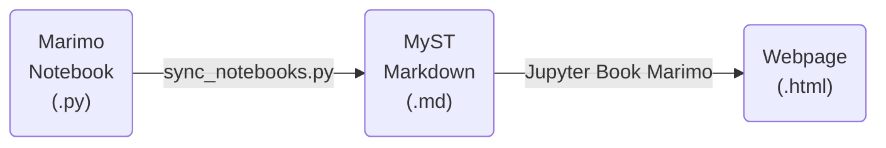
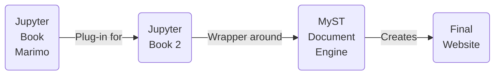

# Project Style Guide

## Writing Book Pages as Marimo Notebook Files

- All pages are written as [marimo notebooks](https://docs.marimo.io) (which are stored as .py files).
- Then when the book is being built, `scripts/sync_notebooks.py` exports the notebooks to [MySTmd format](https://mystmd.org/guide) (stored as .md files), where any content in plain markdown cells becomes plain text, and python code cells are converted to [directives](https://mystmd.org/guide/directives), which then run as [islands](https://docs.marimo.io/guides/island_example/) in the browser.
- These files are then ready to be built into a static site by Jupyter-Book-2, using the MySTmd engine with the [Jupyter-Book-Marimo](https://marimo-team.github.io/jupyter-book-marimo) plug-in for code to run in the browser.



The build tools look like:



`sync_notebooks.py` turns notebook code cells into the following directive syntax in .md files:

````
```{marimo} python
:option1: value1
:option2: value2
# code
```
````

The options are:

|Option | Type | Default Value | Behavior | sync_notebooks.py Comment Option |
|-------|------|---------|----------|-----------------------|
| `:eval:` | boolean | `true` | Execute the cell during the build | Yes|
| `:echo:` | boolean | `false` | Render source as static code | Yes|
| `:editor:` | boolean | `false` | Render source in a marimo code editor | Yes|
| `:output:` | boolean | `true` | Render the browser output island | Yes|
| `:server-output:` | boolean | `true` | Include build-time preview HTML in the output island | Yes|
| `:error:` | boolean | `true` | Render marimo error output instead of failing on error MIME output | Yes|
| `:include:` | boolean | `true` | Keep this cell's visible node in the page | Yes|
| `:hide-code:` | boolean | `false` | Hide rendered source when page defaults would show it | No |
| `:hide-output:` | boolean | `false` | Hide rendered output when page defaults would show it | Yes|
| `:disabled:` | boolean | `false` | Skip execution and keep optional visible source | No |
| `:unparsable:` | boolean | `false` | Skip parsing intentionally invalid code | Yes|
| `:name:` | string | none | Set the marimo cell name | No |
| `:column:` | number | none | Set the marimo column index | No |

Many option can be changed directly in the marimo syntax and are exported by default (these options have comment option "No" in the table above). To add any other directive options to a code cell, place a comment at the top of the cell:

```py
# jb: option1=value1 option2=value2
```

On export, `sync_notebooks.py` will convert this to the corresponding syntax in the .md file.

Use `# jb: include=false` whenever code does not need to run in the reader's browser. This includes:

- Building static images, then saving them to /public to be included in markdown cells (as a reference to the saved file). This is how all static plots and diagrams should be formatted.
- Any python imports (all dependecies for the page get automatically added to a {marimo-config}, so imports are not necessary to run in the reader's browser). For organizational purposes, all imports should be included in a single code cell named "imports".
- Any display settings, such as `plt.style.use("default")`, or functions used to make rendering look better in the marimo notebook for development. These should be included in a single code cell named "display_settings".
- Any data creation or variable initialization (including initializing mo.ui elements, so that their values can be accessed in future cells) which will be used in later interactive visualizations, but which the reader does not need to see. All this should be included in a cell named "data".

Use `# jb: editor=true` whenever creating an interactive example where the reader can edit the code and see the result it produces. This should usually be used in combination with `server-output=false` in order to prevent multiple output rendering bugs when the reader re-runs the code.

Apart from these uses, `# jb:` comments should generally be avoided.

Here is a skeleton notebook example:

```python
# /// script
# dependencies = [
#     "marimo>=0.25.1",
#     "matplotlib==3.11.2",
#     "numpy==2.5.3",
# ]
# ///

import marimo

__generated_with = "0.25.1"
app = marimo.App(app_title="The Optimal α", css_file="notebook-styles.css")


@app.cell
def frontmatter(mo):
    mo.md(r"""
    <!-- jb-frontmatter
    subtitle: "Combining Two Noisy Estimates"
    abbreviations:
      iff: if and only if
      diff: null
    numbering:
      equations: false
    -->
    """)
    return


@app.cell
def imports():
    # jb: include=false
    import marimo as mo
    import numpy as np
    import matplotlib.pyplot as plt
    from textwrap import dedent
    from pathlib import Path

    return Path, dedent, mo, np, plt


@app.cell
def display_settings(dedent, mo, plt):
    # jb: include=false
    plt.style.use("default")

    def graphic(x):
        return mo.Html(dedent(f'''\
            <div class="graphic">
                {mo.as_html(x)}
            </div>
            '''))

    return (graphic,)


@app.cell(hide_code=True)
def _(mo):
    mo.md(r"""
    Prose goes here. One `mo.md` cell per subsection.
    """)
    return


if __name__ == "__main__":
    app.run()
```

- **Interactive widgets:** define the UI element in its own cell, which may be `hide_code=True`. Read `.value` in a *different* cell, and display element and figure together with `mo.vstack([slider, graphic(fig)])` or `mo.hstack`.
- **marimo rules:**
  - Every global name is defined in exactly one cell.
  - Use `_`-prefixed names for cell-local variables (e.g. `_fig, _ax`).
  - The function signature must list every global the cell reads, and `return (a, b)` must list every global other cells use.
  - Use raw strings for anything with backslashes.
  - In `rf"""` strings, double literal braces (`{{ }}`), and remember that LaTeX braces count. Prefer small separate `mo.md(rf"...")` cells for dynamic numbers.
- **Computed markdown:** an `mo.md` cell whose text depends on other variables (an `rf"""` string with live values) is exported as a marimo code cell and rendered by marimo, not MyST. Inside such cells, `{term}` references, `[@cite]` citations, footnotes, and relative `.md` links will not work on the site. Keep computed cells to plain text and math, and put those features in static `mo.md(r"""...""")` cells whose only parameter is `mo`.
- **Determinism:** `rng = np.random.default_rng(<fixed seed>)`. Keep each notebook's runtime under about 20 s: vectorize, keep Monte Carlo sizes modest.
- **Never** call `eval`/`exec` on user input.
- **Interactive figures:** render inline: build the matplotlib figure and output `graphic(fig)`.
- **Static figures and diagrams:** follow the existing convention.
  - An `include=false` cell saves an SVG to `Path(__file__).parent / "public" / "<chapter>_<name>.svg"`, e.g. `ch7_gain_curve.svg`. Start each name with the chapter, so no notebook overwrites another's figure in `public/`.
  - A separate `hide_code=True` markdown cell shows it with ``.
- **Plot style:** default matplotlib style; axis labels with units; `ax.grid(visible=True, alpha=0.9, linewidth=0.4)`; italic titles (`style='italic'`).
- **Colour roles:**
  - measurements: hollow black circles, or C0 for dense streams
  - estimates: C1
  - truth: black solid line
  - predictions: red dotted
  - ±2σ bands: shaded C1 with alpha 0.2
- **Prose:** any prose in plain markdown (`@app.cell(hide_code=True)` + `def _(mo):` + `mo.md(r""" ... """)`, content is indented 4 spaces inside the string; marimo dedents it on export) will be exported directly into the .md file without a wrapper.
- Footnotes (`[^name]`) must be defined in the same `mo.md` cell that references them.

### Admonitions (exact format; the sync regexes depend on it)

**Definition** (established). This becomes a MyST glossary entry, so `{term}` references work book-wide. The `<u>**Term**</u>` line must come immediately after the `attrs` line:

```
/// note | 📖 **Definition**
    attrs: {class: no-icon}
<u>**Covariance**</u>

The covariance of random variables $X$ and $Y$ with finite variances is
$$\operatorname{Cov}(X, Y) := \mathbb E\big[(X - \mathbb E X)(Y - \mathbb E Y)\big].$$
///
```

**Key Idea** (established): `/// attention | 🗝️ **Key Idea**` + `attrs: {class: no-icon}`.

**Tip** (established): `/// tip | **Title**` + `attrs: {class: no-icon}`.

**Theorem, Lemma, Corollary** **(proposed):**

```
/// important | 📐 **Theorem (Optimal Gain)**
    attrs: {class: no-icon}
Statement...
///

/// admonition | ✍️ **Proof**
    attrs: {class: no-icon}
Proof text... $\blacksquare$
///
```

Use the label `Theorem` for main results, `Lemma` for helper results, and `Corollary` for immediate consequences. **Do not use "Proposition" as a label**, because "statement" is the logic term and "proposition" would be ambiguous. When a proof is not given, the proof box says so and links to one.

**Prerequisites** **(proposed):** at the very top of every main-path chapter after the Introduction, list exactly what the chapter uses, with links:

```
/// seealso | 🔗 **Prerequisites**
    attrs: {class: no-icon}
- [Chapter 6](ch6_expectation_and_variance.md): variance of a weighted sum.
- [Appendix C: Derivatives](appendix_c_calculus.md) (optional; only for the alternative derivation).
///
```

**Assumptions and failure modes** **(proposed):** every major result gets one of these, stating its assumptions and what happens when each fails (the index's Understanding principle):

```
/// caution | ⚠️ **Assumptions and Failure Modes**
    attrs: {class: no-icon}
...
///
```

### Links, terms, citations

- **Cross-chapter links:** use relative file links such as `[Chapter 7](ch7_optimal_alpha.md)` or `[Appendix D: Trace](appendix_d_linear_algebra.md)`. Do not use heading anchors or `(label)=` targets.
- **Glossary references:** use `{term}`variance`` or `{term}`variances <variance>``. Only reference terms that exist in the allocation table (§4) or that you define yourself.
- **Words used before their formal definition:** mark the first informal use with a footnote such as `[^informal-probability]: Used informally here; defined precisely in [Chapter 4](ch4_probability_spaces.md).`
- **Citations:**
  - Cite every published work (book, paper, preprint, datasheet) by its `content/refs.bib` key, not with an inline link to the work. Use whichever form reads best in the sentence:
    - `[@kalman1960]` renders as (Kalman, 1960). This is the usual form.
    - `@kalman1960` renders as Kalman (1960). Use it when the authors are part of the sentence.
    - `[@barshalom2002, Ch. 5]` or `@barshalom2002 [Ch. 5]` points to a chapter or section, and `[see @kalman1960]` adds a lead-in.
    - `[@godel1938; @cohen1963]` cites several works together.
  - Add a missing work to `content/refs.bib` before citing it, and leave the other entries as they are. Name the key after the first author and year (`kalman1960`); datasheets and undated works take a descriptive key (`avia_hx711_datasheet`).
  - Take an entry's details from its DOI record or publisher, never from memory. Give the `doi` if there is one, otherwise a `url`.
- **Web links:** use an inline markdown link for web resources that are not published works (Wikipedia, software and project websites). Only link URLs you are confident are correct.

### Writing principles (from `index.py`; non-negotiable)

1. **Concision, as the author defines it:** first include everything in the dependency hierarchy the key concept is built on, with complete understanding and precise definitions. Only then use as few words as possible. Never trade precision or completeness for brevity.
2. Define every word before it is used, and use it only with that meaning afterwards. A glossary definition must be a necessary-and-sufficient test.
3. Order concepts by dependency; nothing is used before it is introduced.
4. Start with a concrete example, then generalize.
5. Justify every step. Prove when possible; otherwise state precisely and link to a proof.
6. Give every chapter at least one meaningful interactive element.
7. State assumptions, and what happens when they fail.
8. Open each chapter with its key concept and why it matters for filtering. Close it with a short **Summary** and a **What's Next** paragraph linking to the next chapter.
9. Spell-check. Use American spelling. Use "Fraenkel", not "Frankel". AHRS = *attitude and heading reference system*.

## Global notation

| Symbol | Meaning | Introduced |
|---|---|---|
| $k \in \mathbb N$ | time step; measurements start at $k = 1$; $k = 0$ is the initial condition | Intro |
| $x_k$ | true value (state) at step $k$ (scalar in Parts 1–2) | Intro |
| $z_k$ | measurement at step $k$ | Intro |
| $\hat x_k$ | estimate after incorporating $z_k$ | Intro |
| $\hat x_k^-$ | prediction: estimate of $x_k$ before $z_k$ is incorporated (**not** called "prior" until Ch 8) | Intro |
| $\tilde y_k := z_k - \hat x_k^-$ (later $z_k - h\hat x_k^-$, $\mathbf z_k - \mathbf H\hat{\mathbf x}_k^-$) | innovation | Intro |
| $\alpha$, later $K_k$ | gain; Ch 7 shows the optimal α and renames it $K_k$ | Intro / Ch 7 |
| $\Delta x_k$ | predicted change from step $k-1$ to $k$ | Intro |
| $e_k := \hat x_k - x_k$, $e_k^- := \hat x_k^- - x_k$ | estimation and prediction errors | Ch 7 |
| $v_k := z_k - x_k$ (or $z_k - h x_k$), $R$ | measurement noise and its variance | Ch 5 / Ch 7 |
| $w_k$, $Q$ | process noise and its variance | Ch 9 |
| $P_k$, $P_k^-$ | error variances of $\hat x_k$ and $\hat x_k^-$ | Ch 7 |
| $S_k$ | innovation variance (covariance) | Ch 9 |
| $(\Omega, \mathcal F, \mathbb P)$ | probability space; $\mathbb P$ is blackboard bold to avoid clashing with $P_k$ | Ch 4 |
| $\mathbb E$, $\operatorname{Var}$, $\operatorname{Cov}$ | expectation, variance, covariance | Ch 6 |
| $X, Y, Z$ | random variables are uppercase in Ch 4–6; Ch 7 explicitly switches to the filtering convention of lowercase $x_k, z_k, v_k$ for random quantities | Ch 5 / Ch 7 |
| $F_X$, $f_X$, $p_X$ | CDF, PDF, PMF of $X$ | Ch 5 |
| $\mathcal N(\mu, \sigma^2)$, $\mathcal N(\boldsymbol\mu, \boldsymbol\Sigma)$ | normal distribution | Ch 5 / Ch 12 |
| $\mathbb N = \{0, 1, 2, \ldots\}$, $\mathbb N^+ := \mathbb N \setminus \{0\}$ | natural numbers | Ch 2 / Ch 3 |
| $A^c := \Omega \setminus A$ | complement relative to an ambient set | Ch 3 |
| $f[A]$, $f^{-1}[B]$ | image and preimage of sets; square brackets distinguish them from $f(a)$ and the inverse function | Ch 3 |
| bold lowercase / bold uppercase | vectors / matrices (Part 3 on); scalars stay plain | Ch 12 |
| $\mathbf x_k, \mathbf P_k, \mathbf F, \mathbf B, \mathbf u_k, \mathbf H, \mathbf Q, \mathbf R, \mathbf K_k, \mathbf S_k, \mathbf I$ | KF quantities (Part 3) | Ch 13 |
| $f(\cdot)$, $h(\cdot)$, $\mathbf F_k = \partial f/\partial \mathbf x$, $\mathbf H_k = \partial h/\partial \mathbf x$ | nonlinear process and measurement functions and their Jacobians | Ch 15 |
| $\alpha_{\text{UT}}, \beta_{\text{UT}}, \kappa, \lambda$ | unscented-transform parameters (subscripted so they don't clash with gains α, β) | Ch 16 |
| $\Delta t$ | sample period | Ch 10 |
| $[\mathbf a]_\times$ | skew-symmetric (cross-product) matrix: $[\mathbf a]_\times \mathbf b = \mathbf a \times \mathbf b$ | App D / Ch 17 |

### Orientation conventions (Ch 17–21; must be identical in every chapter)

- **Navigation frame $n$:** local-level ENU: $x$ = East, $y$ = North, $z$ = Up. Gravity $\mathbf g^n = [0, 0, -g]^\top$ with $g = 9.81\ \text{m/s}^2$.
- **Body frame $b$:** FLU: $x$ = forward, $y$ = left, $z$ = up. At zero attitude the body frame coincides with ENU, facing East.
- $\mathbf R^n_b$ maps body coordinates to navigation coordinates: $\mathbf v^n = \mathbf R^n_b \mathbf v^b$.
- **Euler angles, ZYX (yaw–pitch–roll):** $\mathbf R^n_b = \mathbf R_z(\psi)\,\mathbf R_y(\theta)\,\mathbf R_x(\phi)$, with roll φ, pitch θ, yaw ψ. Elementary rotations are active and right-handed.
- **Quaternions:** Hamilton convention, scalar-first, $q = [q_w, q_x, q_y, q_z]$; product $\otimes$. $q^n_b$ rotates body to nav: $[0, \mathbf v^n] = q^n_b \otimes [0, \mathbf v^b] \otimes (q^n_b)^*$. Mention that the JPL convention differs.
- **Kinematics:**
  - $\dot{\mathbf R}^n_b = \mathbf R^n_b [\boldsymbol\omega^b]_\times$
  - $\dot q = \tfrac12\, q \otimes [0, \boldsymbol\omega^b]$
  - $\boldsymbol\omega^b$ is the body angular rate relative to the navigation frame (Earth rotation is neglected; say so).
- **Specific force:** $\mathbf f^b = (\mathbf R^n_b)^\top(\mathbf a^n - \mathbf g^n)$. At rest and level it reads $[0, 0, +g]$.
- **IMU models:**
  - $\boldsymbol\omega_m = \boldsymbol\omega^b + \mathbf b_g + \mathbf n_g$
  - $\mathbf f_m = \mathbf f^b + \mathbf b_a + \mathbf n_a$
  - Magnetometer: $\mathbf m_m = (\mathbf R^n_b)^\top \mathbf m^n + \mathbf n_m$, with $\mathbf m^n = [0, 22, -42]^\top\ \mu\text{T}$ (points North and down).
- **Error-state attitude convention** (Ch 19 and Ch 21): right/body-frame perturbation, $q = \hat q \otimes \delta q(\delta\boldsymbol\theta)$, $\mathbf R = \hat{\mathbf R}\,\operatorname{Exp}(\delta\boldsymbol\theta) \approx \hat{\mathbf R}(\mathbf I + [\delta\boldsymbol\theta]_\times)$.
- **Default IMU parameters:**
  - 100 Hz
  - gyro white-noise σ = 0.01 rad/s, gyro bias 0.01 rad/s per axis (constant or slow random walk)
  - accelerometer white-noise σ = 0.05 m/s², accelerometer bias 0.05 m/s² per axis
  - magnetometer noise σ = 0.5 μT

- **Glossary-term allocation:** Each term is defined **exactly once**, in the chapter listed. Other chapters reference it with `{term}`.

- **Book Structure:** The main path never sacrifices precision: every definition is precise and every result is proven or explicitly cited. The appendices hold *foundational* material that a reader may already know. A main-path chapter that relies on an appendix result says so in its Prerequisites box and links to the section by name.