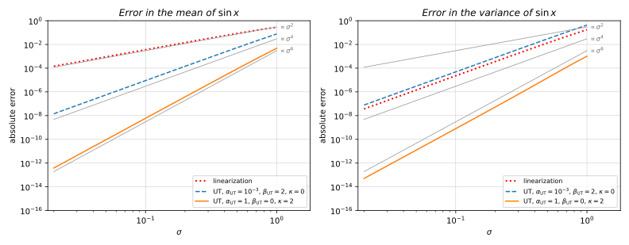
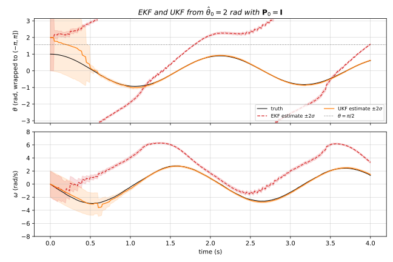

```{marimo-config}
---
pyproject: |-
  dependencies = [
      "marimo>=0.25.1",
      "matplotlib==3.11.2",
      "numpy==2.5.3",
      "scipy==1.18.1",
  ]
---
```

```{marimo} python
:name: imports
:include: false

import marimo as mo
import numpy as np
import matplotlib.pyplot as plt
from scipy.stats import chi2
from textwrap import dedent
from pathlib import Path
```

```{marimo} python
:name: display_settings
:include: false

plt.style.use("default")
IMAGES_DIR = Path(__file__).parent.parent / "notebooks" / "public"
IMAGES_DIR.mkdir(parents=True, exist_ok=True)

def graphic(x):
    return mo.Html(dedent(f'''\
        <div class="graphic">
            {mo.as_html(x)}
        </div>
        '''))

def ellipse_points(mean, cov, k2=5.991):
    """Boundary of {x : (x - mean)^T cov^-1 (x - mean) <= k2}; k2 = 5.991 gives 95% in 2-D."""
    _w, _V = np.linalg.eigh(cov)
    _t = np.linspace(0, 2 * np.pi, 200)
    return np.asarray(mean)[:, None] + _V @ (np.sqrt(k2 * np.clip(_w, 0, None))[:, None] * np.vstack([np.cos(_t), np.sin(_t)]))

def wrap_for_plot(angles):
    """Wrap angles to (-pi, pi] and insert NaN where the wrap jumps, for line plots."""
    _wrapped = np.angle(np.exp(1j * np.asarray(angles)))
    _jumps = np.abs(np.diff(_wrapped, prepend=_wrapped[0])) > np.pi
    return np.where(_jumps, np.nan, _wrapped)
```

:::{seealso icon=false} 🔗 **Prerequisites**
- [Chapter 8](ch8_bayesian_view_v2.md): the Bayes filter, likelihoods, and posteriors (for particle filters).
- [Chapter 12](ch12_vectors_matrices_covariance_v2.md): covariance matrices, multivariate normal distributions, and confidence ellipses.
- [Chapter 13](ch13_kalman_filter_v2.md): the Kalman filter, the Covariance Rules, and the Gaussian-conditioning form of the update.
- [Chapter 14](ch14_kalman_filters_in_practice_v2.md): NEES consistency tests.
- [Chapter 15](ch15_extended_kalman_filter_v2.md): nonlinear systems, linearization, the extended Kalman filter, and the pendulum example, including the Mean Error of the Tangent Line lemma.
- [Appendix C: Taylor's Theorem](appendix_c_calculus_v2.md): the Lagrange form of the remainder.
- [Appendix D: Trace](appendix_d_linear_algebra_v2.md), [Appendix D: Symmetric and Positive Definite Matrices](appendix_d_linear_algebra_v2.md), and [Appendix D: Cholesky Decomposition](appendix_d_linear_algebra_v2.md).
:::
  
[Chapter 15](ch15_extended_kalman_filter_v2.md)'s extended Kalman filter approximates each nonlinear *function* by its linearization. It needs Jacobians, it misses the shift in the mean that curvature causes, and on the pendulum it became overconfident and diverged when the initial uncertainty was large.

This chapter's key concept turns the approximation around: approximate the *distribution* instead of the function. Choose a few points, called **sigma points**, whose weighted mean and covariance equal the distribution's. Push each one through the exact nonlinear function, and compute the weighted mean and covariance of the results. This is the **unscented transform**, and a Kalman filter that uses it in place of linearization is the **unscented Kalman filter** (UKF). It needs no derivatives, and its mean is correct to higher order than the EKF's at about the same cost. At the end of the chapter, **particle filters** drop the Gaussian summary altogether, which is what an ambiguous measurement like the pendulum's fold requires.

:::{attention icon=false} 🗝️ **Key Idea**
It is easier to approximate a probability distribution than an arbitrary nonlinear function. A handful of deterministically chosen points that share the distribution's mean and covariance, pushed through the exact function, capture the mean and covariance of the result more accurately than a linearization does.
:::
  
## Sigma Points

### A Scalar Example

Let $x \sim \mathcal N(\mu, \sigma^2)$ and fix any $s > 0$. The three points and weights

$$\chi_0 = \mu, \quad \chi_1 = \mu + s\sigma, \quad \chi_2 = \mu - s\sigma, \qquad W_0 = 1 - \frac1{s^2}, \quad W_1 = W_2 = \frac1{2s^2}$$

have the same mean and variance as $x$:

$$\sum_{i=0}^2 W_i = 1, \qquad \sum_{i=0}^2 W_i\chi_i = \mu + \frac{s\sigma - s\sigma}{2s^2} = \mu, \qquad \sum_{i=0}^2 W_i(\chi_i - \mu)^2 = 2\cdot\frac{s^2\sigma^2}{2s^2} = \sigma^2.$$

Now push them through $\phi(x) = x^2$ and take the weighted mean:

$$\sum_{i=0}^2 W_i\chi_i^2 = \Big(1 - \frac1{s^2}\Big)\mu^2 + \frac{(\mu + s\sigma)^2 + (\mu - s\sigma)^2}{2s^2} = \Big(1 - \frac1{s^2}\Big)\mu^2 + \frac{\mu^2 + s^2\sigma^2}{s^2} = \mu^2 + \sigma^2.$$

That is exactly $\mathbb E[x^2] = \mu^2 + \sigma^2$, for every $s$. The tangent line of Chapter 15 gives $\mu^2$ and misses the $\sigma^2$ entirely. Three function evaluations captured the curvature that a derivative at one point cannot see.

### Matrix Square Roots

In $n$ dimensions we need points spread "one standard deviation" along enough directions to reproduce a covariance matrix $\boldsymbol\Sigma$. In this chapter a **matrix square root** of $\boldsymbol\Sigma$ means any $n \times n$ matrix $\mathbf A$ with $\mathbf A\mathbf A^\top = \boldsymbol\Sigma$. (Some texts instead use the symmetric $\mathbf A$ with $\mathbf A^2 = \boldsymbol\Sigma$; any $\mathbf A$ with $\mathbf A\mathbf A^\top = \boldsymbol\Sigma$ works below.) Its columns $\mathbf a_1, \ldots, \mathbf a_n$ carry the covariance in the following sense.

:::{important icon=false} 📐 **Lemma (Outer-Product Expansion)**
For every $n \times n$ matrix $\mathbf A$ with columns $\mathbf a_1, \ldots, \mathbf a_n$,
$$\mathbf A\mathbf A^\top = \sum_{j=1}^n \mathbf a_j\mathbf a_j^\top.$$
:::

:::{admonition icon=false} ✍️ **Proof**
Entry $(r, s)$ of $\mathbf A\mathbf A^\top$ is $\sum_j A_{rj}(\mathbf A^\top)_{js} = \sum_j A_{rj}A_{sj}$. Entry $(r, s)$ of $\mathbf a_j\mathbf a_j^\top$ is $(\mathbf a_j)_r(\mathbf a_j)_s = A_{rj}A_{sj}$; summing over $j$ gives the same number. $\blacksquare$
:::

For a symmetric {term}`positive definite` $\boldsymbol\Sigma$, the {term}`Cholesky decomposition` ([Appendix D: Cholesky Decomposition](appendix_d_linear_algebra_v2.md)) provides one: the unique lower-triangular $\mathbf L$ with positive diagonal and $\mathbf L\mathbf L^\top = \boldsymbol\Sigma$. It costs about $n^3/3$ multiplications, and `np.linalg.cholesky` computes it. We use $\mathbf A = \mathbf L$.
  
### Sigma Points in General

::::{admonition icon=false} 📖 **Definition**
:::{glossary}
Sigma points
: For a vector $\boldsymbol\mu \in \mathbb R^n$ and a {term}`covariance matrix` $\boldsymbol\Sigma \in \mathbb R^{n \times n}$, a finite list of points $\boldsymbol\chi_0, \ldots, \boldsymbol\chi_{N-1} \in \mathbb R^n$ together with *mean weights* $W_0^{(m)}, \ldots, W_{N-1}^{(m)}$ and *covariance weights* $W_0^{(c)}, \ldots, W_{N-1}^{(c)}$ such that
  $$\sum_{i} W_i^{(m)} = 1, \qquad \sum_{i} W_i^{(m)}\boldsymbol\chi_i = \boldsymbol\mu, \qquad \sum_{i} W_i^{(c)}(\boldsymbol\chi_i - \boldsymbol\mu)(\boldsymbol\chi_i - \boldsymbol\mu)^\top = \boldsymbol\Sigma.$$
:::
::::

The weights need not be positive, and the points are chosen deterministically, not sampled. (We write $W$ for weights because $\mathbf w_k$ is the process noise.) The standard construction is the *scaled* sigma points of [Julier (2002), *The Scaled Unscented Transformation*](https://doi.org/10.1109/ACC.2002.1025369), in the parametrization of [Wan & van der Merwe (2000), *The Unscented Kalman Filter for Nonlinear Estimation*](https://doi.org/10.1109/ASSPCC.2000.882463). It has three parameters, $\alpha_{\text{UT}} > 0$, $\beta_{\text{UT}}$, and $\kappa$ with $n + \kappa > 0$, and defines

$$\lambda := \alpha_{\text{UT}}^2(n + \kappa) - n, \qquad\text{so that}\qquad n + \lambda = \alpha_{\text{UT}}^2(n + \kappa) > 0.$$

With $\mathbf a_1, \ldots, \mathbf a_n$ the columns of the Cholesky factor of $\boldsymbol\Sigma$, the $2n + 1$ points and their weights are

$$\boldsymbol\chi_0 = \boldsymbol\mu, \qquad \boldsymbol\chi_j = \boldsymbol\mu + \sqrt{n + \lambda}\,\mathbf a_j, \qquad \boldsymbol\chi_{n+j} = \boldsymbol\mu - \sqrt{n + \lambda}\,\mathbf a_j \qquad (j = 1, \ldots, n),$$

$$W_0^{(m)} = \frac{\lambda}{n + \lambda}, \qquad W_0^{(c)} = \frac{\lambda}{n + \lambda} + 1 - \alpha_{\text{UT}}^2 + \beta_{\text{UT}}, \qquad W_i^{(m)} = W_i^{(c)} = \frac{1}{2(n + \lambda)} \quad (i = 1, \ldots, 2n).$$

For $n = 1$ these are the scalar example with $s = \sqrt{1 + \lambda}$. The subscript UT keeps $\alpha_{\text{UT}}$ and $\beta_{\text{UT}}$ apart from the gains $\alpha$ and $\beta$ of the alpha-beta filter.

:::{important icon=false} 📐 **Lemma (Scaled Sigma Points)**
For every $\boldsymbol\mu$, every symmetric positive definite $\boldsymbol\Sigma$, and all parameters with $n + \kappa > 0$, the scaled points and weights above are sigma points for $\boldsymbol\mu$ and $\boldsymbol\Sigma$.
:::

:::{admonition icon=false} ✍️ **Proof**
Write $c := \sqrt{n + \lambda}$. The mean weights sum to $\frac{\lambda}{n + \lambda} + \frac{2n}{2(n + \lambda)} = \frac{\lambda + n}{n + \lambda} = 1$. In $\sum_i W_i^{(m)}\boldsymbol\chi_i$, the terms $\pm c\,\mathbf a_j$ of each pair $\boldsymbol\chi_j, \boldsymbol\chi_{n+j}$ have equal weights and cancel, leaving $\boldsymbol\mu\sum_i W_i^{(m)} = \boldsymbol\mu$. In the covariance sum the $i = 0$ term vanishes because $\boldsymbol\chi_0 - \boldsymbol\mu = \mathbf 0$, whatever $W_0^{(c)}$ is; each pair contributes $2 \cdot \frac{1}{2c^2}\,c^2\,\mathbf a_j\mathbf a_j^\top = \mathbf a_j\mathbf a_j^\top$. By the Outer-Product Expansion, the total is $\sum_j\mathbf a_j\mathbf a_j^\top = \mathbf L\mathbf L^\top = \boldsymbol\Sigma$. $\blacksquare$
:::

The proof used only $\mathbf L\mathbf L^\top = \boldsymbol\Sigma$, so any matrix square root would do; Cholesky is simply the cheapest.

**What the parameters do.**

- $\alpha_{\text{UT}}$ sets the spread. The points sit $\sqrt{n + \lambda} = \alpha_{\text{UT}}\sqrt{n + \kappa}$ "standard deviations" from the mean along each column $\mathbf a_j$. A small $\alpha_{\text{UT}}$ keeps them near the mean, where only the local shape of the function matters.
- $\kappa$ is a second spread parameter. With $\alpha_{\text{UT}} = 1$ and $\kappa = 3 - n$, the points sit at $\sqrt 3$ standard deviations. Then the fourth moment of the points along each column, $\sum_i W_i^{(m)}\xi_{ij}^4 = 2\cdot\frac{(n+\lambda)^2}{2(n+\lambda)} = n + \lambda = 3$ (with $\xi_{ij}$ the coordinate of $\boldsymbol\chi_i - \boldsymbol\mu$ along $\mathbf a_j$), matches the fourth moment $3$ of a standard normal variable.
- $\beta_{\text{UT}}$ changes only $W_0^{(c)}$. Increasing it by $b$ adds $b\,(\mathbf y_0 - \bar{\mathbf y})(\mathbf y_0 - \bar{\mathbf y})^\top$ to the transformed covariance defined below, where $\mathbf y_0 - \bar{\mathbf y}$ is the gap between the image of the mean and the transformed mean. That gap is a curvature effect, so $\beta_{\text{UT}}$ tunes a fourth-order correction (see the Squared Gaussian lemma below).

Two choices are common. [Wan & van der Merwe (2000)](https://doi.org/10.1109/ASSPCC.2000.882463) suggest a small $\alpha_{\text{UT}}$ (such as $10^{-3}$), $\kappa = 0$, and $\beta_{\text{UT}} = 2$. The original unscented transform of Julier and Uhlmann ([Julier & Uhlmann (2004), *Unscented Filtering and Nonlinear Estimation*](https://doi.org/10.1109/JPROC.2003.823141)) corresponds to $\alpha_{\text{UT}} = 1$, $\beta_{\text{UT}} = 0$, $\kappa = 3 - n$. This chapter uses the second for the two-state pendulum: $\lambda = 1$, $W_0 = 1/3$, and $W_i = 1/6$, all positive.

```{marimo} python
:name: sigma_points_impl
:echo: true

def merwe_sigma_points(mu, Sigma, alpha=1.0, beta=0.0, kappa=None):
    """Scaled sigma points for mean mu and covariance Sigma.

    Returns chi (shape (n, 2n+1), one point per column), the mean weights Wm,
    and the covariance weights Wc. kappa defaults to 3 - n.
    """
    mu = np.atleast_1d(np.asarray(mu, dtype=float))
    Sigma = np.atleast_2d(np.asarray(Sigma, dtype=float))
    n = mu.size
    kappa = 3.0 - n if kappa is None else kappa
    lam = alpha**2 * (n + kappa) - n
    L = np.linalg.cholesky(Sigma)                   # L @ L.T == Sigma
    spread = np.sqrt(n + lam) * L
    chi = np.column_stack([mu, mu[:, None] + spread, mu[:, None] - spread])
    Wm = np.full(2 * n + 1, 1.0 / (2 * (n + lam)))
    Wc = Wm.copy()
    Wm[0] = lam / (n + lam)
    Wc[0] = lam / (n + lam) + 1.0 - alpha**2 + beta
    return chi, Wm, Wc
```

## The Unscented Transform

::::{admonition icon=false} 📖 **Definition**
:::{glossary}
Unscented transform
: Given a random vector $\mathbf x$ with mean $\boldsymbol\mu$ and covariance $\boldsymbol\Sigma$, a function $\phi: \mathbb R^n \to \mathbb R^m$, and {term}`sigma points` $(\boldsymbol\chi_i, W_i^{(m)}, W_i^{(c)})$ for $\boldsymbol\mu$ and $\boldsymbol\Sigma$, the unscented transform approximates the mean of $\phi(\mathbf x)$, the covariance of $\phi(\mathbf x)$, and the cross-covariance $\operatorname{Cov}(\mathbf x, \phi(\mathbf x))$ by
  $$\bar{\mathbf y} := \sum_i W_i^{(m)}\mathbf y_i, \qquad \mathbf P_{yy} := \sum_i W_i^{(c)}(\mathbf y_i - \bar{\mathbf y})(\mathbf y_i - \bar{\mathbf y})^\top, \qquad \mathbf P_{xy} := \sum_i W_i^{(c)}(\boldsymbol\chi_i - \boldsymbol\mu)(\mathbf y_i - \bar{\mathbf y})^\top,$$
  where $\mathbf y_i := \phi(\boldsymbol\chi_i)$.
:::
::::

The cost is $2n + 1$ evaluations of $\phi$ and one Cholesky factorization, with no derivatives. In code, `phi` receives all the points at once as the columns of an array.

```{marimo} python
:name: unscented_transform_impl
:echo: true

def unscented_transform(chi, Wm, Wc, phi):
    """Unscented transform of the sigma points chi (columns) through phi.

    phi maps an (n, N) array of points to an (m, N) array.
    Returns the mean y_bar, the covariance P_yy, and the cross-covariance P_xy.
    """
    Y = phi(chi)
    y_bar = Y @ Wm
    dY = Y - y_bar[:, None]
    dX = chi - (chi @ Wm)[:, None]       # chi @ Wm is the mean mu
    P_yy = (Wc * dY) @ dY.T
    P_xy = (Wc * dX) @ dY.T
    return y_bar, P_yy, P_xy
```

### How Accurate Is It?

The scalar example generalizes into a precise statement. Call the distribution of $\mathbf x$ *symmetric about* $\boldsymbol\mu$ if $\mathbf x - \boldsymbol\mu$ and $\boldsymbol\mu - \mathbf x$ have the same distribution; every {term}`multivariate normal distribution` is symmetric about its mean.

:::{important icon=false} 📐 **Theorem (Exactness of the Unscented Transform)**
Let $\mathbf x$ have mean $\boldsymbol\mu$ and symmetric positive definite covariance $\boldsymbol\Sigma$, and use the scaled sigma points for $\boldsymbol\mu$ and $\boldsymbol\Sigma$.

1. If $\phi(\mathbf x) = \mathbf F\mathbf x + \mathbf b$ is affine, the unscented transform returns exactly $\mathbb E[\phi(\mathbf x)] = \mathbf F\boldsymbol\mu + \mathbf b$, $\operatorname{Cov}(\phi(\mathbf x)) = \mathbf F\boldsymbol\Sigma\mathbf F^\top$, and $\operatorname{Cov}(\mathbf x, \phi(\mathbf x)) = \boldsymbol\Sigma\mathbf F^\top$.
2. If the distribution of $\mathbf x$ is symmetric about $\boldsymbol\mu$ with finite third moments, and every component of $\phi$ is a polynomial of degree at most 3, then $\bar{\mathbf y} = \mathbb E[\phi(\mathbf x)]$.
:::

:::{admonition icon=false} ✍️ **Proof**
Write $\boldsymbol\delta := \mathbf x - \boldsymbol\mu$ and $\boldsymbol\delta_i := \boldsymbol\chi_i - \boldsymbol\mu$, so $\boldsymbol\delta_0 = \mathbf 0$ and $\boldsymbol\delta_{n+j} = -\boldsymbol\delta_j$.

*Part 1.* By the Scaled Sigma Points lemma, $\bar{\mathbf y} = \mathbf F\sum_i W_i^{(m)}\boldsymbol\chi_i + \mathbf b\sum_i W_i^{(m)} = \mathbf F\boldsymbol\mu + \mathbf b$. Then $\mathbf y_i - \bar{\mathbf y} = \mathbf F\boldsymbol\delta_i$, so $\mathbf P_{yy} = \mathbf F\big(\sum_i W_i^{(c)}\boldsymbol\delta_i\boldsymbol\delta_i^\top\big)\mathbf F^\top = \mathbf F\boldsymbol\Sigma\mathbf F^\top$ and $\mathbf P_{xy} = \big(\sum_i W_i^{(c)}\boldsymbol\delta_i\boldsymbol\delta_i^\top\big)\mathbf F^\top = \boldsymbol\Sigma\mathbf F^\top$. Chapter 13's Covariance Rules give the same true values: $\operatorname{Cov}(\mathbf F\mathbf x + \mathbf b) = \mathbf F\boldsymbol\Sigma\mathbf F^\top$ and $\operatorname{Cov}(\mathbf x, \mathbf F\mathbf x + \mathbf b) = \operatorname{Cov}(\mathbf x, \mathbf x)\mathbf F^\top = \boldsymbol\Sigma\mathbf F^\top$.

*Part 2.* Fix a component $\phi_l$. Expanding every monomial of $\phi_l(\boldsymbol\mu + \boldsymbol\delta)$ and grouping terms by their degree in $\boldsymbol\delta$ gives
$$\phi_l(\boldsymbol\mu + \boldsymbol\delta) = c + \mathbf g^\top\boldsymbol\delta + \boldsymbol\delta^\top\mathbf M\boldsymbol\delta + t(\boldsymbol\delta),$$
with a constant $c$, a constant vector $\mathbf g$, a constant symmetric matrix $\mathbf M$ (a quadratic form's coefficient matrix can always be symmetrized), and a polynomial $t$ whose terms all have degree 3, so $t(-\boldsymbol\delta) = -t(\boldsymbol\delta)$. Both $\mathbb E$ and the weighted sum $\sum_i W_i^{(m)}(\cdot)$ are linear, so compare them term by term.

- *Constant:* $\sum_i W_i^{(m)}c = c = \mathbb E[c]$.
- *Linear:* $\sum_i W_i^{(m)}\mathbf g^\top\boldsymbol\delta_i = \mathbf g^\top\big(\sum_i W_i^{(m)}\boldsymbol\chi_i - \boldsymbol\mu\big) = 0 = \mathbf g^\top\,\mathbb E[\boldsymbol\delta]$.
- *Quadratic:* $\boldsymbol\delta^\top\mathbf M\boldsymbol\delta = \operatorname{tr}(\mathbf M\boldsymbol\delta\boldsymbol\delta^\top)$ by the cyclic property of the {term}`trace` ([Appendix D: Trace](appendix_d_linear_algebra_v2.md)), and the trace is linear, so $\mathbb E[\boldsymbol\delta^\top\mathbf M\boldsymbol\delta] = \operatorname{tr}(\mathbf M\boldsymbol\Sigma)$. For the sigma points, $\sum_i W_i^{(m)}\boldsymbol\delta_i^\top\mathbf M\boldsymbol\delta_i = \operatorname{tr}\big(\mathbf M\sum_i W_i^{(m)}\boldsymbol\delta_i\boldsymbol\delta_i^\top\big)$. Since $W_i^{(m)} = W_i^{(c)}$ for $i \ge 1$ and $\boldsymbol\delta_0 = \mathbf 0$, the inner sum equals $\sum_i W_i^{(c)}\boldsymbol\delta_i\boldsymbol\delta_i^\top = \boldsymbol\Sigma$, so this term is $\operatorname{tr}(\mathbf M\boldsymbol\Sigma)$ as well.
- *Cubic:* $t(\boldsymbol\delta_0) = t(\mathbf 0) = 0$, and the terms of each pair cancel: $t(\boldsymbol\delta_j) + t(-\boldsymbol\delta_j) = 0$. On the other side, $\boldsymbol\delta$ and $-\boldsymbol\delta$ have the same distribution, so $\mathbb E[t(\boldsymbol\delta)] = \mathbb E[t(-\boldsymbol\delta)] = -\mathbb E[t(\boldsymbol\delta)]$, which forces $\mathbb E[t(\boldsymbol\delta)] = 0$; the expectation exists because the third moments are finite.

Adding the four terms gives $\bar y_l = \mathbb E[\phi_l(\mathbf x)]$. $\blacksquare$
:::

Compare the tangent line: its mean is $\phi_l(\boldsymbol\mu) = c$, which misses $\operatorname{tr}(\mathbf M\boldsymbol\Sigma)$, the same curvature term as the scalar example's $\sigma^2$. For smooth functions that are not polynomials, the theorem turns into an error bound.

:::{important icon=false} 📐 **Corollary (Mean Error of the Unscented Transform)**
Let $x \sim \mathcal N(\mu, \sigma^2)$ be scalar, and let $\phi: \mathbb R \to \mathbb R$ be four times continuously differentiable with $|\phi^{(4)}(t)| \le M$ for all $t$. With the scaled sigma points ($n = 1$),
$$\big|\bar y - \mathbb E[\phi(x)]\big| \le \frac{M\big(1 + \lambda + 3\big)}{24}\,\sigma^4.$$
:::

:::{admonition icon=false} ✍️ **Proof**
Let $T$ be the Taylor polynomial of degree 3 of $\phi$ at $\mu$ and $r := \phi - T$. By [Taylor's theorem](appendix_c_calculus_v2.md) with the Lagrange remainder, $|r(t)| \le \frac{M}{24}(t - \mu)^4$ for every $t$, so $\mathbb E[\phi(x)]$ exists. The weighted sum $\bar y = \sum_i W_i^{(m)}\phi(\chi_i)$ is linear in $\phi$, and by Part 2 of the theorem it is exact for $T$, so
$$\bar y - \mathbb E[\phi(x)] = \sum_i W_i^{(m)}r(\chi_i) - \mathbb E[r(x)].$$
Here $r(\chi_0) = r(\mu) = 0$, and the other two points have the positive weight $\frac{1}{2(1+\lambda)}$ and lie at distance $\sqrt{1 + \lambda}\,\sigma$ from $\mu$, so $\big|\sum_i W_i^{(m)}r(\chi_i)\big| \le 2\cdot\frac{1}{2(1+\lambda)}\cdot\frac{M}{24}(1+\lambda)^2\sigma^4 = \frac{M(1+\lambda)}{24}\sigma^4$. A normal variable has $\mathbb E[(x - \mu)^4] = 3\sigma^4$ ([Wikipedia: Normal distribution, Moments](https://en.wikipedia.org/wiki/Normal_distribution#Moments)), so $\big|\mathbb E[r(x)]\big| \le \frac{3M}{24}\sigma^4$. Add the two bounds. $\blacksquare$
:::

So as $\sigma \to 0$, the unscented mean's error shrinks like $\sigma^4$, while Chapter 15's Mean Error of the Tangent Line lemma only guarantees $\sigma^2$ for linearization. The covariance needs one more ingredient, the fourth moment, and that is where $\beta_{\text{UT}}$ enters.

:::{important icon=false} 📐 **Lemma (Squared Gaussian)**
Let $x \sim \mathcal N(\mu, \sigma^2)$ be scalar and $\phi(x) = x^2$. The unscented transform with the scaled sigma points gives $\bar y = \mu^2 + \sigma^2$ and
$$P_{yy} = 4\mu^2\sigma^2 + \big(\alpha_{\text{UT}}^2\kappa + \beta_{\text{UT}}\big)\sigma^4,$$
while $\operatorname{Var}(x^2) = 4\mu^2\sigma^2 + 2\sigma^4$. So the unscented variance is exact if and only if $\alpha_{\text{UT}}^2\kappa + \beta_{\text{UT}} = 2$.
:::

:::{admonition icon=false} ✍️ **Proof**
The mean follows from Part 2 of the theorem. Let $c^2 := 1 + \lambda = \alpha_{\text{UT}}^2(1 + \kappa)$. The points are $\mu$ and $\mu \pm c\sigma$, so $y_0 - \bar y = -\sigma^2$ and $y_\pm - \bar y = \pm 2\mu c\sigma + (c^2 - 1)\sigma^2$. Hence
$$P_{yy} = W_0^{(c)}\sigma^4 + \frac{1}{2c^2}\Big[\big(2\mu c\sigma + (c^2-1)\sigma^2\big)^2 + \big({-2\mu c\sigma} + (c^2-1)\sigma^2\big)^2\Big] = W_0^{(c)}\sigma^4 + 4\mu^2\sigma^2 + \frac{(c^2-1)^2}{c^2}\sigma^4.$$
With $W_0^{(c)} = \frac{c^2 - 1}{c^2} + 1 - \alpha_{\text{UT}}^2 + \beta_{\text{UT}}$, the coefficient of $\sigma^4$ is $\frac{(c^2-1)(1 + c^2 - 1)}{c^2} + 1 - \alpha_{\text{UT}}^2 + \beta_{\text{UT}} = c^2 - \alpha_{\text{UT}}^2 + \beta_{\text{UT}} = \alpha_{\text{UT}}^2\kappa + \beta_{\text{UT}}$. For the true variance, the normal moments $\mathbb E[x^2] = \mu^2 + \sigma^2$ and $\mathbb E[x^4] = \mu^4 + 6\mu^2\sigma^2 + 3\sigma^4$ (same reference) give $\operatorname{Var}(x^2) = \mathbb E[x^4] - (\mathbb E[x^2])^2 = 4\mu^2\sigma^2 + 2\sigma^4$. $\blacksquare$
:::

Both common parameter choices satisfy the condition: $\kappa = 0$ with $\beta_{\text{UT}} = 2$ (for any $\alpha_{\text{UT}}$), which is the source of the often-quoted rule that "$\beta_{\text{UT}} = 2$ is optimal for Gaussians", and $\alpha_{\text{UT}} = 1$, $\kappa = 3 - 1 = 2$, $\beta_{\text{UT}} = 0$. Linearization gives variance $4\mu^2\sigma^2$, missing the $2\sigma^4$ term for every $\mu$.
  
For general smooth functions and input distributions, [Julier & Uhlmann (2004)](https://doi.org/10.1109/JPROC.2003.823141) show that the unscented transform computes the mean and covariance of $\phi(\mathbf x)$ correctly up to the second-order terms of $\phi$'s Taylor series, whereas linearization is correct only up to the first-order terms ([Wan & van der Merwe (2000)](https://doi.org/10.1109/ASSPCC.2000.882463) make the same comparison). The theorem and corollary make the statement about the mean precise. The figure below demonstrates both statements for $\phi = \sin$ at $\mu = 0.8$, using the exact values $\mathbb E[\sin x] = e^{-\sigma^2/2}\sin\mu$ and $\operatorname{Var}(\sin x) = \tfrac12\big(1 - e^{-2\sigma^2}\cos 2\mu\big) - e^{-\sigma^2}\sin^2\mu$ for $x \sim \mathcal N(\mu, \sigma^2)$, which follow from the normal distribution's characteristic function ([Wikipedia: Normal distribution](https://en.wikipedia.org/wiki/Normal_distribution)). Both axes are logarithmic, so an error proportional to $\sigma^p$ appears as a straight line of slope $p$.



```{marimo} python
:name: make_accuracy_fig
:include: false

_mu = 0.8
_sigmas = np.logspace(np.log10(0.02), 0, 30)
_exact_mean = np.exp(-_sigmas**2 / 2) * np.sin(_mu)
_exact_var = 0.5 * (1 - np.exp(-2 * _sigmas**2) * np.cos(2 * _mu)) - np.exp(-_sigmas**2) * np.sin(_mu) ** 2
_lin_mean = np.full_like(_sigmas, np.sin(_mu))
_lin_var = np.cos(_mu) ** 2 * _sigmas**2

def _ut(alpha, beta, kappa):
    _m, _v = [], []
    for _s in _sigmas:
        _chi, _Wm, _Wc = merwe_sigma_points([_mu], [[_s**2]], alpha, beta, kappa)
        _ym, _Pyy, _ = unscented_transform(_chi, _Wm, _Wc, np.sin)
        _m.append(_ym[0])
        _v.append(_Pyy[0, 0])
    return np.array(_m), np.array(_v)

_ut_julier = _ut(1.0, 0.0, 2.0)
_ut_small = _ut(1e-3, 2.0, 0.0)

_fig, _axes = plt.subplots(1, 2, figsize=(11, 4.3))
for _ax, _exact, _lin, _j, _sm, _title in [
    (_axes[0], _exact_mean, _lin_mean, _ut_julier[0], _ut_small[0], r"Error in the mean of $\sin x$"),
    (_axes[1], _exact_var, _lin_var, _ut_julier[1], _ut_small[1], r"Error in the variance of $\sin x$"),
]:
    _ax.loglog(_sigmas, np.abs(_lin - _exact), "r:", linewidth=2, label="linearization")
    _ax.loglog(_sigmas, np.abs(_sm - _exact), "C0--", linewidth=1.5,
               label=r"UT, $\alpha_{\mathrm{UT}} = 10^{-3}$, $\beta_{\mathrm{UT}} = 2$, $\kappa = 0$")
    _ax.loglog(_sigmas, np.abs(_j - _exact), "C1-", linewidth=1.5,
               label=r"UT, $\alpha_{\mathrm{UT}} = 1$, $\beta_{\mathrm{UT}} = 0$, $\kappa = 2$")
    for _p, _c in [(2, 0.3), (4, 0.03), (6, 0.003)]:
        _ax.loglog(_sigmas, _c * _sigmas**_p, color="0.6", linewidth=0.8)
        _ax.annotate(rf"$\propto\sigma^{_p}$", (_sigmas[-1], _c), fontsize=8, color="0.4",
                     xytext=(3, 0), textcoords="offset points", va="center")
    _ax.set_xlabel(r"$\sigma$")
    _ax.set_ylabel("absolute error")
    _ax.set_xlim(0.018, 1.8)
    _ax.set_ylim(1e-16, 1)
    _ax.set_title(_title, style="italic")
    _ax.grid(visible=True, alpha=0.9, linewidth=0.4, which="major")
    _ax.legend(loc="lower right", fontsize=8)
_fig.tight_layout()
_fig.savefig(IMAGES_DIR / "ch16_ut_accuracy_v2.svg")
plt.close(_fig)
```

For the mean, linearization's error falls like $\sigma^2$ and both unscented transforms fall like $\sigma^4$ or faster, as the corollary guarantees; with $\alpha_{\text{UT}} = 1$ and $\kappa = 2$ it falls like $\sigma^6$, because these points also match the normal distribution's fourth moment. For the variance, linearization and the small-$\alpha_{\text{UT}}$ transform both fall like $\sigma^4$, and at this $\mu$ the small-$\alpha_{\text{UT}}$ transform's constant is about twice linearization's. The reason is visible in the expansion $\operatorname{Var}(\phi(x)) = \phi'(\mu)^2\sigma^2 + \big(\tfrac12\phi''(\mu)^2 + \phi'(\mu)\phi'''(\mu)\big)\sigma^4 + O(\sigma^6)$ for normal $x$, which follows from the normal moments. Linearization keeps only the first term. The small-$\alpha_{\text{UT}}$ transform also reproduces the second-order part $\tfrac12\phi''^2\sigma^4$, but not the third-order part $\phi'\phi'''\sigma^4$; for $\sin$ at $\mu = 0.8$ the two parts have opposite signs and partly cancel, so dropping both, as linearization does, happens to be closer. "Correct to second order" is a statement about which Taylor terms are reproduced; it does not promise that every neglected term is smaller. The parameter choice matters, and the explorer below lets you see by how much.

```{marimo} python
:name: pendulum_model
:include: false

# Copied verbatim from Chapter 15 (notebooks are self-contained).
PEND_L = 1.0    # rod length L (m)
GRAV = 9.81     # gravitational acceleration g (m/s^2)
DAMP_C = 0.1    # damping rate c (1/s)
DT = 0.01       # time step (s)

def pendulum_rhs(x):
    """a(x): time derivative of the state x = [theta, omega]."""
    theta, omega = x[0], x[1]
    return np.array([omega, -(GRAV / PEND_L) * np.sin(theta) - DAMP_C * omega])

def pendulum_rhs_jacobian(x):
    """A(x): Jacobian of a at a single state x."""
    return np.array([[0.0, 1.0],
                     [-(GRAV / PEND_L) * np.cos(x[0]), -DAMP_C]])

def f_pendulum(x):
    """f(x): one RK4 step of length DT."""
    k1 = pendulum_rhs(x)
    k2 = pendulum_rhs(x + 0.5 * DT * k1)
    k3 = pendulum_rhs(x + 0.5 * DT * k2)
    k4 = pendulum_rhs(x + DT * k3)
    return x + DT / 6 * (k1 + 2 * k2 + 2 * k3 + k4)

def F_pendulum(x):
    """Jacobian of the RK4 step at x, by the chain rule through its stages."""
    I = np.eye(2)
    k1 = pendulum_rhs(x)
    k2 = pendulum_rhs(x + 0.5 * DT * k1)
    k3 = pendulum_rhs(x + 0.5 * DT * k2)
    K1 = pendulum_rhs_jacobian(x)
    K2 = pendulum_rhs_jacobian(x + 0.5 * DT * k1) @ (I + 0.5 * DT * K1)
    K3 = pendulum_rhs_jacobian(x + 0.5 * DT * k2) @ (I + 0.5 * DT * K2)
    K4 = pendulum_rhs_jacobian(x + DT * k3) @ (I + DT * K3)
    return I + DT / 6 * (K1 + 2 * K2 + 2 * K3 + K4)

def h_pendulum(x):
    """h(x): horizontal position of the bob (m), as a 1-vector."""
    return np.array([PEND_L * np.sin(x[0])])

def H_pendulum(x):
    """Jacobian of h at a single state x."""
    return np.array([[PEND_L * np.cos(x[0]), 0.0]])
```

```{marimo} python
:name: ekf_impl
:include: false

# Copied verbatim from Chapter 15 (notebooks are self-contained).
def ekf_predict(x, P, f, F_jac, Q):
    """Predict: x^- = f(x),  P^- = F P F^T + Q with F the Jacobian at x."""
    F = F_jac(x)
    return f(x), F @ P @ F.T + Q

def ekf_update(x_pred, P_pred, z, h, H_jac, R):
    """Update with H the Jacobian at the prediction; Joseph-form covariance."""
    H = H_jac(x_pred)
    y = z - h(x_pred)                         # innovation
    S = H @ P_pred @ H.T + R                  # innovation covariance
    K = np.linalg.solve(S, H @ P_pred).T      # K = P^- H^T S^-1
    I_KH = np.eye(len(x_pred)) - K @ H
    P = I_KH @ P_pred @ I_KH.T + K @ R @ K.T  # Joseph form
    return x_pred + K @ y, P

def run_ekf(zs, x0_hat, P0, Q, R, F_jac=F_pendulum, H_jac=H_pendulum):
    """Run the EKF on the pendulum. zs[k] is the measurement at step k, or NaN.

    Returns the estimates (shape (len(zs), 2)) and covariances (len(zs), 2, 2);
    row 0 holds the initial estimate and covariance.
    """
    x, P = np.asarray(x0_hat, float), np.asarray(P0, float)
    xs_hat, Ps = [x], [P]
    for k in range(1, len(zs)):
        x, P = ekf_predict(x, P, f_pendulum, F_jac, Q)
        if not np.isnan(zs[k]):
            x, P = ekf_update(x, P, np.array([zs[k]]), h_pendulum, H_jac, R)
        xs_hat.append(x)
        Ps.append(P)
    return np.array(xs_hat), np.array(Ps)
```

```{marimo} python
:name: simulation
:include: false

# Same simulation settings as Chapter 15.
Q_INTENSITY = 0.01                      # q (rad^2/s^3)
Q_PEND = Q_INTENSITY * np.array([[DT**3 / 3, DT**2 / 2], [DT**2 / 2, DT]])
SIGMA_Z = 0.05                          # measurement noise std (m)
R_PEND = np.array([[SIGMA_Z**2]])
MEAS_EVERY = 5                          # 20 Hz measurements at 100 Hz steps
X0_TRUE = np.array([1.0, 0.0])

def simulate_truth(x0, n_steps, rng, n_runs=None):
    """Truth x_k = f(x_{k-1}) + w_k. With n_runs, simulate that many runs at
    once; the result then has shape (n_steps + 1, 2, n_runs)."""
    _chol = np.linalg.cholesky(Q_PEND)
    _shape = (2,) if n_runs is None else (2, n_runs)
    _x = np.array(x0, float) if n_runs is None else np.repeat(np.asarray(x0, float)[:, None], n_runs, axis=1)
    _out = [_x]
    for _ in range(n_steps):
        _x = f_pendulum(_x) + _chol @ rng.standard_normal(_shape)
        _out.append(_x)
    return np.array(_out)

def measure(xs, sigma_z, unit_noise):
    """Measurements at every MEAS_EVERY-th step, NaN elsewhere."""
    _zs = np.full(len(xs), np.nan)
    _idx = np.arange(MEAS_EVERY, len(xs), MEAS_EVERY)
    _zs[_idx] = PEND_L * np.sin(xs[_idx, 0]) + sigma_z * unit_noise[: _idx.size]
    return _zs

def nees_series(xs, xs_hat, Ps):
    """NEES e^T P^-1 e at every step."""
    _e = xs_hat - xs
    return np.einsum("ki,kij,kj->k", _e, np.linalg.inv(Ps), _e)
```

### Unscented Transform Explorer

The explorer below pushes a two-dimensional Gaussian through a chosen nonlinear function three ways: by Monte Carlo with 20,000 samples (black, the reference), by linearization (red dotted), and by the unscented transform (orange; the transformed sigma points are the orange dots). Each ellipse is a 95% {term}`confidence ellipse` computed from the corresponding mean and covariance. The functions are:

- **Polar to Cartesian:** a range $r$ and bearing $b$ become $(r\cos b,\ r\sin b)$, as when a radar or lidar reports a target position. The input has mean $(1\ \text{m}, \pi/2)$ and standard deviations $(0.05\ \text{m}, 0.5\ \text{rad})$.
- **Pendulum after 1 s:** the pendulum state $[\theta, \omega]$ moved through 100 steps of Chapter 15's $f$. The input has mean $[1, 0]^\top$ and standard deviations $(0.3, 0.3)$.
- **Parabola:** $(x, y) \mapsto (x,\ y + x^2)$, a quadratic, so Part 2 of the theorem applies. The input has mean $(0.5, 0)$ and standard deviations $(0.5, 0.2)$.

The *spread* multiplies both standard deviations. The default parameters are this chapter's choice, $\alpha_{\text{UT}} = 1$, $\beta_{\text{UT}} = 0$, $\kappa = 3 - n = 1$.

```{marimo} python
:hide-code: true

ut_function_dropdown = mo.ui.dropdown(
    options=["Polar to Cartesian", "Pendulum after 1 s", "Parabola"],
    value="Polar to Cartesian",
    label="function",
)
ut_spread_slider = mo.ui.slider(0.1, 2.0, 0.1, value=1.0, label="spread", show_value=True)
ut_alpha_slider = mo.ui.slider(0.05, 1.0, 0.05, value=1.0, label=r"$\alpha_{\text{UT}}$", show_value=True)
ut_beta_slider = mo.ui.slider(0.0, 4.0, 0.5, value=0.0, label=r"$\beta_{\text{UT}}$", show_value=True)
ut_kappa_slider = mo.ui.slider(-1.0, 3.0, 0.5, value=1.0, label=r"$\kappa$", show_value=True)
```

```{marimo} python
:name: explorer_setup
:include: false

def _polar(X):
    return np.vstack([X[0] * np.cos(X[1]), X[0] * np.sin(X[1])])

def _pendulum_1s(X):
    for _ in range(100):
        X = f_pendulum(X)
    return X

def _parabola(X):
    return np.vstack([X[0], X[1] + X[0] ** 2])

explorer_cases = {
    "Polar to Cartesian": (_polar, np.array([1.0, np.pi / 2]), np.array([0.05, 0.5]), ("range $r$ (m)", "bearing $b$ (rad)"), ("$x$ (m)", "$y$ (m)")),
    "Pendulum after 1 s": (_pendulum_1s, np.array([1.0, 0.0]), np.array([0.3, 0.3]), (r"$\theta$ (rad)", r"$\omega$ (rad/s)"), (r"$\theta$ (rad)", r"$\omega$ (rad/s)")),
    "Parabola": (_parabola, np.array([0.5, 0.0]), np.array([0.5, 0.2]), ("$x$", "$y$"), ("$x$", "$y + x^2$")),
}
explorer_normals = np.random.default_rng(16).standard_normal((2, 20_000))

def numerical_jacobian_batch(phi, x, eps=1e-6):
    """Central-difference Jacobian of a batch function phi at the single point x."""
    _cols = []
    for _j in range(x.size):
        _e = np.zeros(x.size)
        _e[_j] = eps
        _cols.append((phi((x + _e)[:, None]) - phi((x - _e)[:, None]))[:, 0] / (2 * eps))
    return np.column_stack(_cols)
```

```{marimo} python
:hide-code: true

_phi, _mu, _sd, _in_labels, _out_labels = explorer_cases[ut_function_dropdown.value]
_Sigma = np.diag((ut_spread_slider.value * _sd) ** 2)

# Monte Carlo reference
_X = _mu[:, None] + np.linalg.cholesky(_Sigma) @ explorer_normals
_Y = _phi(_X)
_mc_mean, _mc_cov = _Y.mean(axis=1), np.cov(_Y)

# Linearization (Jacobian by central differences)
_J = numerical_jacobian_batch(_phi, _mu)
_lin_mean, _lin_cov = _phi(_mu[:, None])[:, 0], _J @ _Sigma @ _J.T

# Unscented transform
_chi, _Wm, _Wc = merwe_sigma_points(_mu, _Sigma, ut_alpha_slider.value, ut_beta_slider.value, ut_kappa_slider.value)
_ut_mean, _ut_cov, _ = unscented_transform(_chi, _Wm, _Wc, _phi)
_ut_points = _phi(_chi)

_fig, (_ax1, _ax2) = plt.subplots(1, 2, figsize=(11, 4.6))
_ax1.plot(_X[0, ::10], _X[1, ::10], ".", color="0.65", ms=1.5, label="samples")
_e = ellipse_points(_mu, _Sigma)
_ax1.plot(_e[0], _e[1], "k-", linewidth=1.2, label="95% ellipse")
_ax1.plot(_chi[0], _chi[1], "o", color="C1", ms=6, label="sigma points")
_ax1.set_xlabel(_in_labels[0])
_ax1.set_ylabel(_in_labels[1])
_ax1.set_title("Input distribution", style="italic")

_ax2.plot(_Y[0, ::10], _Y[1, ::10], ".", color="0.65", ms=1.5, label="transformed samples")
for _m, _P, _style, _label in [
    (_mc_mean, _mc_cov, dict(color="k", linestyle="-", linewidth=1.4), "Monte Carlo"),
    (_lin_mean, _lin_cov, dict(color="r", linestyle=":", linewidth=2.2), "linearization"),
    (_ut_mean, _ut_cov, dict(color="C1", linestyle="-", linewidth=1.6), "unscented transform"),
]:
    _e = ellipse_points(_m, _P)
    _ax2.plot(_e[0], _e[1], label=_label, **_style)
    _ax2.plot(*_m, marker="x", ms=9, mew=2, color=_style["color"], linestyle="none")
_ax2.plot(_ut_points[0], _ut_points[1], "o", color="C1", ms=5)
_ax2.set_xlabel(_out_labels[0])
_ax2.set_ylabel(_out_labels[1])
_ax2.set_title("Transformed distribution", style="italic")
for _ax in (_ax1, _ax2):
    _ax.grid(visible=True, alpha=0.9, linewidth=0.4)
    _ax.legend(loc="best", fontsize=8)
_fig.tight_layout()

_mc_inv = np.linalg.inv(_mc_cov)

def _scores(m, P):
    _d = m - _mc_mean
    _ratio = np.sort(np.linalg.eigvals(_mc_inv @ P).real)
    return np.sqrt(_d @ _mc_inv @ _d), _ratio

_lin_d, _lin_r = _scores(_lin_mean, _lin_cov)
_ut_d, _ut_r = _scores(_ut_mean, _ut_cov)
_n = _mu.size
_lam = ut_alpha_slider.value**2 * (_n + ut_kappa_slider.value) - _n
_table = mo.md(rf"""
| | mean error (Monte Carlo standard deviations) | covariance size relative to Monte Carlo (1 = exact) |
|---|---|---|
| linearization | {_lin_d:.3f} | {_lin_r[0]:.2f}, {_lin_r[1]:.2f} |
| unscented transform | {_ut_d:.3f} | {_ut_r[0]:.2f}, {_ut_r[1]:.2f} |

With these parameters $\lambda = {_lam:.3f}$, $W_0^{{(m)}} = {_Wm[0]:.3f}$, and $W_0^{{(c)}} = {_Wc[0]:.3f}$.
""")

mo.vstack([
    mo.hstack([ut_function_dropdown, ut_spread_slider], justify="start", gap=2),
    mo.hstack([ut_alpha_slider, ut_beta_slider, ut_kappa_slider], justify="start", gap=2),
    graphic(_fig),
    _table,
])
```

The *mean error* is the {term}`Mahalanobis distance` between the approximate mean and the Monte Carlo mean, measured with the Monte Carlo covariance. The two *covariance size* numbers are the eigenvalues of $\mathbf P_{\text{MC}}^{-1}\mathbf P$; both equal 1 exactly when $\mathbf P = \mathbf P_{\text{MC}}$. (The Monte Carlo values themselves carry a sampling error of roughly 1%.)

Things to try:

- **Polar to Cartesian.** The samples bend into an arc, and their mean lies *inside* the arc, closer to the origin than the point $(0, 1)$ where linearization puts it, because averaging points on a circle pulls the average inward. The unscented mean lands close to the Monte Carlo mean, and linearization's ellipse is far too thin in the $y$ direction. Shrink the spread to 0.1 and all three agree.
- **Parabola.** The unscented mean is exact for every spread and every parameter choice (Part 2 of the theorem; the small error shown is the Monte Carlo sampling error), while linearization's mean error grows with the spread.
- **Parameters.** On the parabola, set $\alpha_{\text{UT}} = 0.05$ and $\kappa = 0$, then vary $\beta_{\text{UT}}$. The mean does not change, because only $W_0^{(c)}$ depends on $\beta_{\text{UT}}$. The covariance does: with $\beta_{\text{UT}} = 0$ it is as poor as linearization's, with $\beta_{\text{UT}} = 2$ it is nearly exact (the Squared Gaussian lemma at work), and with $\beta_{\text{UT}} = 4$ it is too large along the direction of the mean shift. Note that $W_0^{(m)}$ is then a large negative number; negative weights are allowed.

:::{attention icon=false} 🗝️ **Key Idea**
The unscented transform pushes $2n + 1$ sigma points through the exact function. Its mean captures the curvature term that linearization misses, and it is exact for affine functions and, for symmetric inputs, for polynomials of degree at most 3. Its covariance depends on the parameters through the fourth-order terms.
:::

:::{caution icon=false} ⚠️ **Assumptions and Failure Modes**
- **$\boldsymbol\Sigma$ must be symmetric positive definite** for the Cholesky factorization. Rounding can make a computed covariance slightly asymmetric or indefinite, and then `np.linalg.cholesky` fails. Symmetrize, $\tfrac12(\mathbf P + \mathbf P^\top)$, after each update and, if necessary, add a tiny multiple of $\mathbf I$. Square-root versions of the UKF propagate the Cholesky factor itself and avoid the problem.
- **Negative weights.** When $\lambda < 0$, $W_0^{(m)}$ is negative (and $W_0^{(c)}$ may be), and $\mathbf P_{yy}$ can fail to be positive semidefinite even though $\boldsymbol\Sigma$ is. For large $n$ the choice $\kappa = 3 - n$ is negative and causes exactly this, which is why the scaled form was introduced.
- **Only two moments.** The transform reports a mean and a covariance. A transformed distribution that is strongly skewed or has several peaks is still summarized by an ellipse.
- **Quantities that wrap around.** Averaging is wrong for angles near the wrap point: sigma points at bearings $179°$ and $-179°$ average to $0°$, not $180°$. Angles need a circular mean and wrapped differences, which matters in Parts 5 and 6.
- **The guarantees are local.** Exactness holds for polynomials of degree at most 3 (mean) and for affine functions (covariance). Far from those, as with a spread of 2 in the explorer, the unscented transform can also be badly wrong; it is usually just less wrong than linearization.
:::
  
## The Unscented Kalman Filter

We use the {term}`nonlinear system` model and the assumptions of [Chapter 15](ch15_extended_kalman_filter_v2.md): $\mathbf x_k = f(\mathbf x_{k-1}, \mathbf u_k) + \mathbf w_k$ and $\mathbf z_k = h(\mathbf x_k) + \mathbf v_k$, with Chapter 13's (A1)–(A5) and Chapter 15's independence assumption (E1). Chapter 15's smoothness assumption (E2) is not needed: the UKF only evaluates $f$ and $h$. The EKF used linearization twice, to compute the mean and covariance of the prediction and to compute the joint moments of state and measurement for the update. The UKF uses the unscented transform for both.

**Predict.** Suppose that, given $\mathbf z_1, \ldots, \mathbf z_{k-1}$, the state $\mathbf x_{k-1}$ has mean $\hat{\mathbf x}_{k-1}$ and covariance $\mathbf P_{k-1}$. Form sigma points $\boldsymbol\chi_i$ for $\hat{\mathbf x}_{k-1}$ and $\mathbf P_{k-1}$, and apply the unscented transform with $\phi = f(\cdot, \mathbf u_k)$. Since $\mathbf w_k$ is independent of $\mathbf x_{k-1}$, the Covariance Rules of Chapter 13 add $\mathbf Q$ to the covariance:

$$\hat{\mathbf x}_k^- := \sum_i W_i^{(m)} f(\boldsymbol\chi_i, \mathbf u_k), \qquad \mathbf P_k^- := \sum_i W_i^{(c)}\big(f(\boldsymbol\chi_i, \mathbf u_k) - \hat{\mathbf x}_k^-\big)\big(f(\boldsymbol\chi_i, \mathbf u_k) - \hat{\mathbf x}_k^-\big)^\top + \mathbf Q.$$

**Update.** Chapter 13 showed that the Kalman update is Gaussian conditioning: if $\mathbf x$ and $\mathbf z$ are jointly normal, then given $\mathbf z = \boldsymbol\zeta$, $\mathbf x$ has mean $\boldsymbol\mu_x + \boldsymbol\Sigma_{xz}\boldsymbol\Sigma_{zz}^{-1}(\boldsymbol\zeta - \boldsymbol\mu_z)$ and covariance $\boldsymbol\Sigma_{xx} - \boldsymbol\Sigma_{xz}\boldsymbol\Sigma_{zz}^{-1}\boldsymbol\Sigma_{xz}^\top$. The UKF applies this formula with the joint moments of $(\mathbf x_k, \mathbf z_k)$ estimated by the unscented transform. Form new sigma points $\boldsymbol\chi_i$ for $\hat{\mathbf x}_k^-$ and $\mathbf P_k^-$, apply the transform with $\phi = h$, and set

$$\hat{\mathbf z}_k := \sum_i W_i^{(m)} h(\boldsymbol\chi_i), \qquad \mathbf S_k := \sum_i W_i^{(c)}\big(h(\boldsymbol\chi_i) - \hat{\mathbf z}_k\big)\big(h(\boldsymbol\chi_i) - \hat{\mathbf z}_k\big)^\top + \mathbf R, \qquad \mathbf P_{xz,k} := \sum_i W_i^{(c)}\big(\boldsymbol\chi_i - \hat{\mathbf x}_k^-\big)\big(h(\boldsymbol\chi_i) - \hat{\mathbf z}_k\big)^\top.$$

These approximate $\mathbb E[\mathbf z_k]$, $\operatorname{Cov}(\mathbf z_k) = \operatorname{Cov}(h(\mathbf x_k)) + \mathbf R$, and $\operatorname{Cov}(\mathbf x_k, \mathbf z_k) = \operatorname{Cov}(\mathbf x_k, h(\mathbf x_k))$; the last two equalities hold because $\mathbf v_k$ is independent of $\mathbf x_k$. The conditioning formula then gives

$$\mathbf K_k := \mathbf P_{xz,k}\mathbf S_k^{-1}, \qquad \hat{\mathbf x}_k := \hat{\mathbf x}_k^- + \mathbf K_k\big(\mathbf z_k - \hat{\mathbf z}_k\big), \qquad \mathbf P_k := \mathbf P_k^- - \mathbf K_k\mathbf S_k\mathbf K_k^\top,$$

where $\mathbf K_k\mathbf S_k\mathbf K_k^\top = \mathbf P_{xz,k}\mathbf S_k^{-1}\mathbf P_{xz,k}^\top$ is the conditioning formula's correction term. The innovation is $\tilde{\mathbf y}_k := \mathbf z_k - \hat{\mathbf z}_k$, the measurement minus a predicted measurement that, unlike the EKF's $h(\hat{\mathbf x}_k^-)$, includes the curvature term. Drawing fresh sigma points for the update, rather than reusing the propagated ones, makes them account for $\mathbf Q$.

:::{important icon=false} 📐 **Lemma (The UKF Generalizes the Kalman Filter)**
If $f(\mathbf x, \mathbf u) = \mathbf F\mathbf x + \mathbf B\mathbf u$ and $h(\mathbf x) = \mathbf H\mathbf x$, then for every choice of $\alpha_{\text{UT}}$, $\beta_{\text{UT}}$, $\kappa$ the UKF's equations give exactly the Kalman filter's $\hat{\mathbf x}_k^-$, $\mathbf P_k^-$, $\mathbf K_k$, $\hat{\mathbf x}_k$, and $\mathbf P_k$.
:::

:::{admonition icon=false} ✍️ **Proof**
By Part 1 of the Exactness theorem, the prediction gives $\hat{\mathbf x}_k^- = \mathbf F\hat{\mathbf x}_{k-1} + \mathbf B\mathbf u_k$ and $\mathbf P_k^- = \mathbf F\mathbf P_{k-1}\mathbf F^\top + \mathbf Q$, and the update gives $\hat{\mathbf z}_k = \mathbf H\hat{\mathbf x}_k^-$, $\mathbf S_k = \mathbf H\mathbf P_k^-\mathbf H^\top + \mathbf R$, and $\mathbf P_{xz,k} = \mathbf P_k^-\mathbf H^\top$. Hence $\mathbf K_k = \mathbf P_k^-\mathbf H^\top\mathbf S_k^{-1}$, the Kalman gain, and the state update is Chapter 13's. Finally $\mathbf K_k\mathbf S_k\mathbf K_k^\top = \mathbf P_k^-\mathbf H^\top\mathbf S_k^{-1}\mathbf H\mathbf P_k^- = \mathbf K_k\mathbf H\mathbf P_k^-$, so $\mathbf P_k = (\mathbf I - \mathbf K_k\mathbf H)\mathbf P_k^-$. $\blacksquare$
:::

::::{admonition icon=false} 📖 **Definition**
:::{glossary}
Unscented Kalman filter
: For a {term}`state-space model` $\mathbf x_k = f(\mathbf x_{k-1}, \mathbf u_k) + \mathbf w_k$, $\mathbf z_k = h(\mathbf x_k) + \mathbf v_k$ with noise covariances $\mathbf Q$ and $\mathbf R$, the {term}`filter` that starts from $\hat{\mathbf x}_0$ and $\mathbf P_0$ and, for each $k \ge 1$, (1) applies the {term}`unscented transform` with $\phi = f(\cdot, \mathbf u_k)$ to {term}`sigma points` for $\hat{\mathbf x}_{k-1}$ and $\mathbf P_{k-1}$, giving $\hat{\mathbf x}_k^-$ and $\mathbf P_k^-$ (the transformed covariance plus $\mathbf Q$); (2) applies the unscented transform with $\phi = h$ to sigma points for $\hat{\mathbf x}_k^-$ and $\mathbf P_k^-$, giving $\hat{\mathbf z}_k$, $\mathbf S_k$ (the transformed covariance plus $\mathbf R$), and $\mathbf P_{xz,k}$; and (3) sets $\mathbf K_k = \mathbf P_{xz,k}\mathbf S_k^{-1}$, $\hat{\mathbf x}_k = \hat{\mathbf x}_k^- + \mathbf K_k(\mathbf z_k - \hat{\mathbf z}_k)$, and $\mathbf P_k = \mathbf P_k^- - \mathbf K_k\mathbf S_k\mathbf K_k^\top$.
:::
::::

The implementation mirrors the definition. Following Chapter 13, the gain comes from a linear solve: $\mathbf S_k$ is symmetric, so $\mathbf K_k^\top = \mathbf S_k^{-1}\mathbf P_{xz,k}^\top$. The last line symmetrizes $\mathbf P_k$, which rounding would otherwise make slightly asymmetric, and the next Cholesky factorization would notice.

```{marimo} python
:name: ukf_impl
:echo: true

def ukf_predict(x, P, f, Q, alpha=1.0, beta=0.0, kappa=None):
    """Predict: unscented transform of f, plus Q."""
    chi, Wm, Wc = merwe_sigma_points(x, P, alpha, beta, kappa)
    x_pred, P_pred, _ = unscented_transform(chi, Wm, Wc, f)
    return x_pred, P_pred + Q

def ukf_update(x_pred, P_pred, z, h, R, alpha=1.0, beta=0.0, kappa=None):
    """Update: Gaussian conditioning with moments from the unscented transform of h."""
    chi, Wm, Wc = merwe_sigma_points(x_pred, P_pred, alpha, beta, kappa)
    z_pred, P_zz, P_xz = unscented_transform(chi, Wm, Wc, h)
    S = P_zz + R                                # innovation covariance
    K = np.linalg.solve(S, P_xz.T).T            # K = P_xz S^-1
    x = x_pred + K @ (z - z_pred)
    P = P_pred - K @ S @ K.T
    return x, 0.5 * (P + P.T)

def run_ukf(zs, x0_hat, P0, Q, R, alpha=1.0, beta=0.0, kappa=None):
    """Run the UKF on the pendulum. zs[k] is the measurement at step k, or NaN."""
    x, P = np.asarray(x0_hat, float), np.asarray(P0, float)
    xs_hat, Ps = [x], [P]
    for k in range(1, len(zs)):
        x, P = ukf_predict(x, P, f_pendulum, Q, alpha, beta, kappa)
        if not np.isnan(zs[k]):
            x, P = ukf_update(x, P, np.array([zs[k]]), h_pendulum, R, alpha, beta, kappa)
        xs_hat.append(x)
        Ps.append(P)
    return np.array(xs_hat), np.array(Ps)
```

:::{caution icon=false} ⚠️ **Assumptions and Failure Modes**
- **Same model assumptions as the EKF**, except differentiability. Correlated noise, a wrong model, or a wrong $\mathbf Q$ or $\mathbf R$ affect the UKF exactly as they affect the Kalman filter (Chapter 13).
- **The Gaussian summary remains.** After each step the UKF keeps only a mean and a covariance. A posterior with two peaks, such as the pendulum's two mirror-image angles, cannot be represented, and the UKF can still lock onto the wrong one (see Particle Filters below).
- **Positive definiteness.** Every step needs Cholesky factorizations of $\mathbf P_{k-1}$ and $\mathbf P_k^-$. A covariance that loses positive definiteness, through rounding or negative weights, stops the filter; symmetrize, and consider square-root implementations.
- **Cost.** Each step evaluates $f$ and $h$ at $2n + 1$ points and factors two $n \times n$ matrices. For the pendulum this costs about the same as the EKF; for large $n$ with cheap analytic Jacobians, the EKF is cheaper.
:::

### The Pendulum Again

Here is the same pendulum as in Chapter 15, with the same truth, noise, and measurements, and with $\alpha_{\text{UT}} = 1$, $\beta_{\text{UT}} = 0$, $\kappa = 1$. Start with one run on the wrong side of the fold, but with an honest, wide covariance: $\hat{\mathbf x}_0 = [2, 0]^\top$ and $\mathbf P_0 = \mathbf I$, so the truth $[1, 0]^\top$ is one standard deviation away.

```{marimo} python
:name: single_run
:include: false

_rng = np.random.default_rng(3)          # same seed as Chapter 15
SR_STEPS = 400                           # 4 s
sr_truth = simulate_truth(X0_TRUE, 1000, _rng)[: SR_STEPS + 1]
sr_unit_noise = _rng.standard_normal(200)
sr_zs = measure(sr_truth, SIGMA_Z, sr_unit_noise)
SR_X0_HAT = np.array([2.0, 0.0])
SR_P0 = np.eye(2)
sr_ekf = run_ekf(sr_zs, SR_X0_HAT, SR_P0, Q_PEND, R_PEND)
sr_ukf = run_ukf(sr_zs, SR_X0_HAT, SR_P0, Q_PEND, R_PEND)
SR_TIMES = DT * np.arange(SR_STEPS + 1)

# Anatomy of the first update (step 5): both filters predict 5 steps from the same start.
_x, _P = SR_X0_HAT.copy(), SR_P0.copy()
_xu, _Pu = SR_X0_HAT.copy(), SR_P0.copy()
for _k in range(1, 6):
    _F = F_pendulum(_x)
    _x, _P = f_pendulum(_x), _F @ _P @ _F.T + Q_PEND
_z = sr_zs[5]
_H = H_pendulum(_x)
_S = _H @ _P @ _H.T + R_PEND
_K = np.linalg.solve(_S, _H @ _P).T
first_update = {
    "z": _z,
    "ekf_theta_pred": _x[0],
    "ekf_z_pred": h_pendulum(_x)[0],
    "ekf_gain": _K[0, 0],
    "ekf_step": (_K @ (np.array([_z]) - h_pendulum(_x)))[0],
}
for _k in range(1, 6):
    _xu, _Pu = ukf_predict(_xu, _Pu, f_pendulum, Q_PEND)
_chi, _Wm, _Wc = merwe_sigma_points(_xu, _Pu)
_zp, _Pzz, _Pxz = unscented_transform(_chi, _Wm, _Wc, h_pendulum)
_Ku = np.linalg.solve(_Pzz + R_PEND, _Pxz.T).T
first_update["ukf_theta_pred"] = _xu[0]
first_update["ukf_z_pred"] = _zp[0]
first_update["ukf_gain"] = _Ku[0, 0]
first_update["ukf_step"] = (_Ku @ (np.array([_z]) - _zp))[0]
```

```{marimo} python
:name: make_single_run_fig
:include: false

_fig, _axes = plt.subplots(2, 1, figsize=(9, 6), sharex=True)
for _i, (_ax, _label, _unit) in enumerate(zip(_axes, [r"\theta", r"\omega"], ["rad, wrapped to $(-\\pi, \\pi]$", "rad/s"])):
    _ax.plot(SR_TIMES, sr_truth[:, _i], "k-", linewidth=1, label="truth")
    for (_xs, _Ps), _style, _name in [(sr_ekf, dict(color="C3", linestyle="--"), "EKF"),
                                      (sr_ukf, dict(color="C1", linestyle="-"), "UKF")]:
        _c = wrap_for_plot(_xs[:, 0]) if _i == 0 else _xs[:, 1]
        _sd = np.sqrt(_Ps[:, _i, _i])
        _ax.fill_between(SR_TIMES, _c - 2 * _sd, _c + 2 * _sd, color=_style["color"], alpha=0.15)
        _ax.plot(SR_TIMES, _c, linewidth=1.3, label=rf"{_name} estimate $\pm 2\sigma$", **_style)
    _ax.set_ylabel(rf"${_label}$ ({_unit})")
    _ax.grid(visible=True, alpha=0.9, linewidth=0.4)
_axes[0].axhline(np.pi / 2, color="0.4", linestyle=":", linewidth=1, label=r"$\theta = \pi/2$")
_axes[0].set_ylim(-np.pi, np.pi)
_axes[1].set_ylim(-8, 8)
_axes[0].legend(loc="lower right", fontsize=8, ncol=2)
_axes[1].set_xlabel("time (s)")
_axes[0].set_title(r"EKF and UKF from $\hat\theta_0 = 2$ rad with $\mathbf{P}_0 = \mathbf{I}$", style="italic")
_fig.tight_layout()
_fig.savefig(IMAGES_DIR / "ch16_ekf_vs_ukf_single_v2.svg")
plt.close(_fig)
```



```{marimo} python
:hide-code: true

_f = first_update
mo.md(rf"""
The UKF recovers and the EKF does not. The first update, at $t = 0.05$ s, shows why. Both filters predict $\hat\theta^- \approx {_f['ekf_theta_pred']:.2f}$ rad, and the measurement is $z = {_f['z']:.2f}$ m.

- The EKF predicts the measurement $h(\hat{{\mathbf x}}^-) = L\sin\hat\theta^- = {_f['ekf_z_pred']:.2f}$ m, slightly *above* $z$, and its gain on $\theta$ is ${_f['ekf_gain']:.2f}$ rad/m because $\cos\hat\theta^- < 0$. The update moves $\hat\theta$ by ${_f['ekf_step']:+.2f}$ rad, away from the truth.
- The UKF's sigma points lie at $\hat\theta^- \pm \sqrt 3$ rad (and at $\hat\theta^-$), on both sides of the fold. Averaging $h$ over them gives $\hat z = {_f['ukf_z_pred']:.2f}$ m, well *below* $z$: the curvature term pulls the predicted measurement down. The innovation therefore has the opposite sign, the gain on $\theta$ is ${_f['ukf_gain']:.2f}$ rad/m, and the update moves $\hat\theta$ by ${_f['ukf_step']:+.2f}$ rad, toward the truth.

One run is an anecdote, so the next experiment repeats it many times.
""")
```

### Monte Carlo Comparison

As in Chapter 15, each run draws its initial estimate from $\mathcal N(\mathbf x_0, \mathbf P_0)$ with $\mathbf P_0 = \sigma_0^2\mathbf I$, so the initial covariance is honest, and runs both filters on the same measurements for 3 s. A run counts as converged if its RMS angle error over the last 0.5 s is below 0.2 rad. Panel (a) shows the average {term}`normalized estimation error squared` over the runs where both filters converged, with Chapter 14's 95% band for a consistent filter; panel (b) shows the RMS angle error over the same runs. Use the slider to change $\sigma_0$.

```{marimo} python
:hide-code: true

sigma0_slider = mo.ui.slider(0.1, 1.0, 0.1, value=0.6, label=r"initial standard deviation $\sigma_0$", show_value=True)
```

```{marimo} python
:hide-code: true

_sigma0 = sigma0_slider.value
_n_runs, _n_steps = 40, 300
_rng = np.random.default_rng(23)
_truths = simulate_truth(X0_TRUE, _n_steps, _rng, n_runs=_n_runs)
_P0 = _sigma0**2 * np.eye(2)
_results = {"EKF": [], "UKF": []}
for _r in range(_n_runs):
    _xs = _truths[:, :, _r]
    _zs = measure(_xs, SIGMA_Z, _rng.standard_normal(_n_steps))
    _x0_hat = X0_TRUE + _sigma0 * _rng.standard_normal(2)
    for _name, _run in (("EKF", run_ekf), ("UKF", run_ukf)):
        _xh, _Ph = _run(_zs, _x0_hat, _P0, Q_PEND, R_PEND)
        _err = np.angle(np.exp(1j * (_xh[:, 0] - _xs[:, 0])))
        _ok = np.sqrt(np.mean(_err[-50:] ** 2)) < 0.2
        _results[_name].append((_ok, nees_series(_xs, _xh, _Ph), _err**2))
_conv = {_k: np.array([_v[0] for _v in _vals]) for _k, _vals in _results.items()}
_both = _conv["EKF"] & _conv["UKF"]
_t = DT * np.arange(_n_steps + 1)

_fig, (_ax1, _ax2) = plt.subplots(1, 2, figsize=(11, 4.2))
if _both.sum() > 0:
    _lo = chi2.ppf(0.025, 2 * _both.sum()) / _both.sum()
    _hi = chi2.ppf(0.975, 2 * _both.sum()) / _both.sum()
    _ax1.axhspan(_lo, _hi, color="0.85", label=f"95% band ({_both.sum()} runs)")
    for _name, _style in (("EKF", dict(color="C3", linestyle="--")), ("UKF", dict(color="C1", linestyle="-"))):
        _nees = np.mean([_results[_name][_i][1] for _i in np.flatnonzero(_both)], axis=0)
        _mse = np.mean([_results[_name][_i][2] for _i in np.flatnonzero(_both)], axis=0)
        _ax1.plot(_t, _nees, linewidth=1.3, label=_name, **_style)
        _ax2.semilogy(_t, np.sqrt(_mse), linewidth=1.3, label=_name, **_style)
_ax1.set_ylim(0, 8)
_ax1.set_ylabel("average NEES")
_ax1.set_title("(a) Consistency", style="italic")
_ax2.set_ylabel("RMS angle error (rad)")
_ax2.set_title("(b) Accuracy", style="italic")
for _ax in (_ax1, _ax2):
    _ax.set_xlabel("time (s)")
    _ax.grid(visible=True, alpha=0.9, linewidth=0.4)
    _ax.legend(loc="upper right", fontsize=8)
_fig.tight_layout()

_half = int(round(0.5 / DT))
_summary = mo.md(
    rf"With $\sigma_0 = {_sigma0:.1f}$: the EKF converged in {_conv['EKF'].sum()} of {_n_runs} runs and the UKF in {_conv['UKF'].sum()}."
    + (
        rf" Over the {_both.sum()} runs where both converged, the average NEES during the first 0.5 s was "
        rf"{np.mean([_results['EKF'][_i][1][:_half] for _i in np.flatnonzero(_both)]):.1f} for the EKF and "
        rf"{np.mean([_results['UKF'][_i][1][:_half] for _i in np.flatnonzero(_both)]):.1f} for the UKF (a consistent filter gives about 2)."
        if _both.sum() > 0 else ""
    )
)
mo.vstack([sigma0_slider, graphic(_fig), _summary])
```

With a narrow prior ($\sigma_0 \le 0.3$) the two filters are nearly indistinguishable: once the uncertainty is small, linearization is accurate and the extra sigma points add little. As $\sigma_0$ grows, the UKF converges more often, and during the transient the EKF's NEES rises well above the band while the UKF's stays near it. Panel (b) shows that, in the runs where both converge, the EKF's errors during the transient are no larger than the UKF's; its high NEES comes from a covariance that is too *small*. The EKF is overconfident, and an overconfident filter gives too little weight to later measurements, which makes it slow to correct an estimate that has gone wrong. After convergence both filters are equally accurate. That is the typical picture: the UKF's advantage lies in the large-uncertainty part of a problem, which is often exactly where a filter is most likely to fail.

Neither filter converges every time at large $\sigma_0$. When the initial estimate lands far on the wrong side of the fold, the measurements are equally consistent with two different states, and any filter that summarizes its belief by one mean and one covariance must eventually pick one.
  
## Particle Filters

The EKF and the UKF both summarize the state's distribution by a mean and a covariance. Some distributions are nothing like a Gaussian. Suppose the pendulum's initial estimate is the mirror image of the truth, $\hat\theta_0 = \pi - 1 \approx 2.14$ rad, with $\mathbf P_0 = 0.7^2\,\mathbf I$, so the truth is about 1.6 standard deviations away. The first camera reading, about $0.84$ m, is explained equally well by $\theta \approx 1$ and by $\theta \approx 2.14$. After it, the {term}`posterior` of $\theta$ ([Chapter 8](ch8_bayesian_view_v2.md)) has two separate peaks, and its mean, between them, is a value the state almost certainly does not have. A Gaussian filter has to commit to one peak.

A particle filter represents the posterior by many random samples instead of a mean and a covariance. The simplest version is the *bootstrap* filter of [Gordon, Salmond & Smith (1993), *Novel Approach to Nonlinear/Non-Gaussian Bayesian State Estimation*](https://doi.org/10.1049/ip-f-2.1993.0015). It keeps $N$ particles $\mathbf x_k^{(i)}$ with weights $W_k^{(i)} \ge 0$ that sum to 1:

1. **Initialize.** Draw $\mathbf x_0^{(i)}$ from the initial distribution and set $W_0^{(i)} = 1/N$.
2. **Predict.** Move every particle through the process model with its own noise: $\mathbf x_k^{(i)} = f(\mathbf x_{k-1}^{(i)}, \mathbf u_k) + \mathbf w_k^{(i)}$, with independent draws $\mathbf w_k^{(i)} \sim \mathcal N(\mathbf 0, \mathbf Q)$.
3. **Update.** Multiply each weight by the {term}`likelihood` of the measurement, $W_k^{(i)} \propto W_{k-1}^{(i)}\,p(\mathbf z_k \mid \mathbf x_k^{(i)})$, and rescale so the weights sum to 1. For Gaussian measurement noise, $p(\mathbf z_k \mid \mathbf x) \propto \exp\big(-\tfrac12(\mathbf z_k - h(\mathbf x))^\top\mathbf R^{-1}(\mathbf z_k - h(\mathbf x))\big)$.
4. **Resample.** When the weights concentrate on a few particles, measured by the *effective sample size* $N_{\text{eff}} := 1/\sum_i (W_k^{(i)})^2$ falling below $N/2$, draw $N$ new particles from the current ones with probabilities $W_k^{(i)}$ and reset all weights to $1/N$.

Any summary of the weighted particles can serve as the estimate; the weighted mean $\sum_i W_k^{(i)}\mathbf x_k^{(i)}$ is the usual one, though for a two-peaked posterior the peaks themselves are more informative.

Steps 2 and 3 are the two halves of [Chapter 8](ch8_bayesian_view_v2.md)'s {term}`Bayes filter`. If the weighted particles approximate the posterior at step $k-1$, then moving each one by sampling from the process model approximates the predicted density, and multiplying by the likelihood is Bayes' rule applied particle by particle. Resampling discards particles with negligible weight and duplicates heavy ones, without changing the represented distribution on average. Under mild conditions, the weighted particles converge to the exact Bayes-filter posterior as $N \to \infty$ ([Crisan & Doucet (2002), *A Survey of Convergence Results on Particle Filtering Methods for Practitioners*](https://doi.org/10.1109/78.984773)).

::::{admonition icon=false} 📖 **Definition**
:::{glossary}
Particle filter
: A {term}`filter` that approximates the {term}`Bayes filter`'s posterior distribution of the state by a finite set of random samples (particles) with nonnegative weights that sum to 1, and updates the set at each step by drawing new particles using the process model (predict) and reweighting them in proportion to the {term}`likelihood` of the new measurement (update).
:::
::::

The implementation below follows the four steps. It works with the logarithms of the weights, because likelihoods of particles far from the measurement underflow to zero in floating point, and it uses *systematic* resampling, which draws one uniform number and places $N$ evenly spaced pointers into the cumulative weights.

```{marimo} python
:name: particle_filter_impl
:echo: true

def particle_filter(zs, x0_mean, P0, Q, R, n_particles, rng, keep_every=5):
    """Bootstrap particle filter for the pendulum.

    Returns the weighted-mean estimate at every step and a dict
    {step: (particles, weights)} for every keep_every-th step.
    """
    chol_Q = np.linalg.cholesky(Q)
    X = np.asarray(x0_mean, float)[:, None] + np.linalg.cholesky(P0) @ rng.standard_normal((2, n_particles))
    log_W = np.full(n_particles, -np.log(n_particles))
    means, clouds = [X.mean(axis=1)], {0: (X, np.exp(log_W))}
    for k in range(1, len(zs)):
        # Predict: each particle follows the process model with its own noise.
        X = f_pendulum(X) + chol_Q @ rng.standard_normal((2, n_particles))
        if not np.isnan(zs[k]):
            # Update: multiply each weight by the likelihood p(z_k | particle).
            innovation = zs[k] - h_pendulum(X)[0]
            log_W = log_W - 0.5 * innovation**2 / R[0, 0]
            m = log_W.max()
            log_W -= m + np.log(np.sum(np.exp(log_W - m)))      # weights sum to 1
            # Resample (systematic) when the effective sample size drops below N/2.
            W = np.exp(log_W)
            if 1.0 / np.sum(W**2) < n_particles / 2:
                positions = (rng.random() + np.arange(n_particles)) / n_particles
                idx = np.minimum(np.searchsorted(np.cumsum(W), positions), n_particles - 1)
                X, log_W = X[:, idx], np.full(n_particles, -np.log(n_particles))
        W = np.exp(log_W)
        means.append(X @ W)
        if k % keep_every == 0:
            clouds[k] = (X, W)
    return np.array(means), clouds
```

```{marimo} python
:name: pf_demo
:include: false

_rng = np.random.default_rng(3)          # same truth and noise as the single run above
PF_STEPS = 300                           # 3 s
pf_truth = simulate_truth(X0_TRUE, 1000, _rng)[: PF_STEPS + 1]
pf_zs = measure(pf_truth, SIGMA_Z, _rng.standard_normal(200))
PF_X0_HAT = np.array([np.pi - 1.0, 0.0])
PF_P0 = 0.7**2 * np.eye(2)
PF_N = 2000
pf_means, pf_clouds = particle_filter(pf_zs, PF_X0_HAT, PF_P0, Q_PEND, R_PEND, PF_N, np.random.default_rng(5))
pf_ekf = run_ekf(pf_zs, PF_X0_HAT, PF_P0, Q_PEND, R_PEND)
pf_ukf = run_ukf(pf_zs, PF_X0_HAT, PF_P0, Q_PEND, R_PEND)
```

```{marimo} python
:name: make_pf_fig
:include: false

_dt = 0.01
_t = _dt * np.arange(len(pf_truth))
_fig, (_ax1, _ax2) = plt.subplots(1, 2, figsize=(11.5, 4.6), gridspec_kw={"width_ratios": [1.6, 1]})
_sub = np.random.default_rng(0).choice(next(iter(pf_clouds.values()))[0].shape[1], 150, replace=False)
for _k, (_X, _W) in pf_clouds.items():
    _ax1.plot(np.full(_sub.size, _k * _dt), wrap_for_plot(_X[0, _sub]), ".", color="0.6", ms=1.2,
              label="particles (subsample)" if _k == 0 else None)
_ax1.plot(_t, pf_truth[:, 0], "k-", linewidth=1.2, label="truth")
_ax1.plot(_t, wrap_for_plot(pf_ekf[0][:, 0]), color="C3", linestyle="--", linewidth=1.2, label="EKF")
_ax1.plot(_t, wrap_for_plot(pf_ukf[0][:, 0]), color="C0", linestyle="-.", linewidth=1.2, label="UKF")
_ax1.plot(_t, pf_means[:, 0], "C1-", linewidth=1.6, label="particle filter (weighted mean)")
_ax1.set_ylim(-np.pi, np.pi)
_ax1.set_xlabel("time (s)")
_ax1.set_ylabel(r"$\theta$ (rad, wrapped to $(-\pi, \pi]$)")
_ax1.set_title(r"Starting from the mirror image $\hat\theta_0 = \pi - 1$", style="italic")
_ax1.legend(loc="lower right", fontsize=8)
_ax1.grid(visible=True, alpha=0.9, linewidth=0.4)

_bins = np.linspace(-1.0, 4.0, 81)
for _k, _c in zip([0, 5, 25, 100], ["0.6", "C0", "C2", "C1"]):
    _X, _W = pf_clouds[_k]
    _ax2.hist(_X[0], bins=_bins, weights=_W, histtype="step", linewidth=1.5, color=_c, density=True,
              label=f"t = {_k * _dt:.2f} s")
    _ax2.plot(pf_truth[_k, 0], 0, marker="^", color=_c, ms=10, clip_on=False, zorder=5)
_ax2.plot([], [], marker="^", color="k", linestyle="none", label="true angle at that time")
_ax2.set_xlabel(r"$\theta$ (rad)")
_ax2.set_ylabel("weighted particle density")
_ax2.set_title("Particle distribution of the angle", style="italic")
_ax2.legend(loc="upper right", fontsize=8)
_ax2.grid(visible=True, alpha=0.9, linewidth=0.4)
_fig.tight_layout()
_fig.savefig(IMAGES_DIR / "ch16_particle_filter_v2.svg")
plt.close(_fig)
```


```{marimo} python
:hide-code: true

_X5, _W5 = pf_clouds[5]
_wrong = np.sum(_W5[_X5[0] > np.pi / 2])
_X50, _W50 = pf_clouds[50]
_wrong50 = np.sum(_W50[_X50[0] > np.pi / 2])
_late = slice(100, None)
_rmse = np.sqrt(np.mean((pf_means[_late, 0] - pf_truth[_late, 0]) ** 2))
_wrong50_text = f"{100 * _wrong50:.1f}%" if _wrong50 >= 1e-3 else "below 0.1%"
mo.md(rf"""
Both Gaussian filters lock onto the mirror image and then spin, as the EKF did in Chapter 15. The particle filter, with $N = {PF_N}$ particles drawn from the same initial distribution, does not have to choose. Right after the first measurement ($t = 0.05$ s), {100 * _wrong:.0f}% of its weight sits on the wrong side of the fold, $\theta > \pi/2$. The two groups of particles then follow different dynamics: the mirror-image states would swing quite differently from the true one, so later measurements give them almost no weight. By $t = 0.5$ s the weight above $\pi/2$ is {_wrong50_text}, and from $t = 1$ s on the weighted mean's RMS angle error is {_rmse:.3f} rad.
""")
```

For a gentle, readable development of particle filters, including other resampling schemes and the effective sample size, see the particle filter chapter (`12-Particle-Filters.ipynb`) of [Roger Labbe, *Kalman and Bayesian Filters in Python*](https://github.com/rlabbe/Kalman-and-Bayesian-Filters-in-Python), the book that inspired this one.

:::{caution icon=false} ⚠️ **Assumptions and Failure Modes**
- **Dimension.** The particles must cover the region where the posterior has mass. The number needed grows rapidly with the dimension of the state, so bootstrap particle filters are practical mainly for low-dimensional states; larger problems need better proposal distributions or structure that can be exploited.
- **Weight degeneracy.** Without resampling, after a few updates nearly all the weight sits on one particle. Resampling fixes this but adds noise.
- **Sample impoverishment.** Resampling duplicates particles. If the process noise is very small, duplicates stay nearly identical and the cloud collapses onto a few points; adding a little artificial noise ("roughening") is a common remedy.
- **Randomness and cost.** Results vary from run to run, and each step costs $N$ evaluations of $f$ and $h$, where the EKF and UKF need about $1$ and $2n + 1$.
- **Summaries.** For a multimodal posterior, the weighted mean can lie between the peaks, where the state is unlikely to be. Report the peaks, or the whole cloud, when that matters.
:::
  
## Choosing a Filter

| Filter | Represents the state's distribution by | Requires | Work per step | Use when |
|---|---|---|---|---|
| Kalman filter (Ch 13) | mean and covariance, exact for linear-Gaussian models | linear $f$ and $h$ | products of $n \times n$ matrices | the model is linear |
| EKF (Ch 15) | mean and covariance, via Jacobians | differentiable $f$, $h$, and their Jacobians | one evaluation of $f$ and $h$, plus Jacobians | the uncertainty is small compared with the curvature, for example in error-state filters |
| UKF | mean and covariance, via $2n + 1$ sigma points | $f$ and $h$ only | $2n + 1$ evaluations of $f$ and $h$, plus two Cholesky factorizations | nonlinearity is stronger, Jacobians are hard to derive, or the EKF fails its consistency tests |
| Particle filter | $N$ weighted samples | ability to sample the process noise and evaluate the likelihood | $N$ evaluations of $f$ and $h$, with $N$ growing quickly with $n$ | the posterior may be multimodal or far from Gaussian, and the state is low-dimensional |

In practice:

1. If the model is linear, use the Kalman filter. With Gaussian noise no other filter does better (Chapter 13); with other noise it is still the best linear filter.
2. Otherwise, start with the simplest nonlinear filter that could work, usually the EKF. Check its Jacobians numerically (Chapter 15) and run Monte Carlo NEES and NIS tests with *realistic* initial errors (Chapter 14).
3. If the EKF is inconsistent during transients or Jacobians are impractical, try the UKF. On the pendulum it cost about the same and was consistent where the EKF was not.
4. If the measurements can be explained by several distinct states (ambiguities, symmetric sensors, unknown data association), no Gaussian filter is safe; use a particle filter, or remove the ambiguity with better initialization or another sensor.

Often the best fix is not a different filter but a better *problem*: a state in which the errors stay small. That is the idea behind the error-state filters of Parts 5 and 6, which apply an EKF to the small error of an attitude or navigation solution rather than to the attitude itself, so that linearization is accurate and the EKF's low cost is kept.

:::{attention icon=false} 🗝️ **Key Idea**
Linear model: Kalman filter. Mild nonlinearity with small uncertainty: EKF. Strong nonlinearity or large uncertainty with a single-peaked posterior: UKF. Multiple peaks: particle filter. Whatever you choose, verify consistency with Monte Carlo tests.
:::
  
## Summary

- {term}`Sigma points` are weighted points whose weighted mean and covariance equal a given mean and covariance. The scaled sigma points use a Cholesky factor and three parameters $\alpha_{\text{UT}}$, $\beta_{\text{UT}}$, $\kappa$ (with $\lambda = \alpha_{\text{UT}}^2(n + \kappa) - n$).
- The {term}`unscented transform` pushes sigma points through the exact function. It is exact for affine functions and, for symmetric inputs, its mean is exact for polynomials of degree at most 3; for smooth scalar functions its mean error is $O(\sigma^4)$ against linearization's $O(\sigma^2)$. The fourth-order part of the covariance depends on the parameters, as the Squared Gaussian lemma shows.
- The {term}`unscented Kalman filter` replaces both linearizations of the EKF with unscented transforms and uses Gaussian conditioning for the update. It equals the Kalman filter for linear models. On the pendulum it converged more often than the EKF and stayed consistent during the transient.
- A {term}`particle filter` represents the posterior by weighted samples and can follow a multimodal posterior that defeats every Gaussian filter, at a cost that grows quickly with the state dimension.

## What's Next

Part 5 turns to the nonlinearity that matters most in navigation: orientation. [Chapter 17](ch17_rotations_v2.md) develops rotation matrices, Euler angles, and the angular velocity, and shows why every three-number description of orientation has singularities. Those singularities, and the fact that orientations cannot be averaged like vectors, are the reason Parts 5 and 6 use quaternions and error-state Kalman filters.