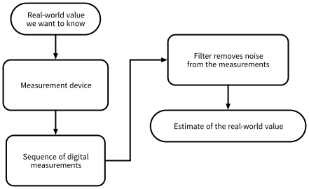
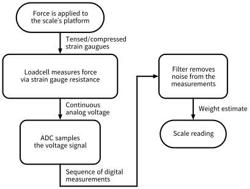
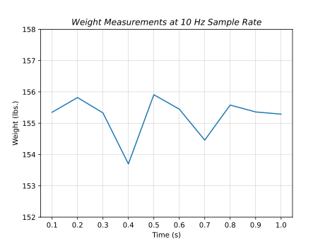
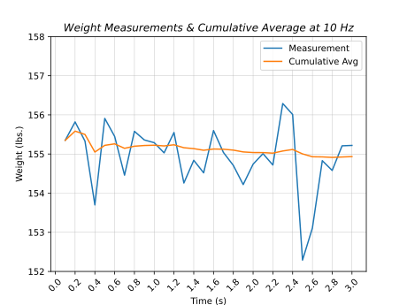
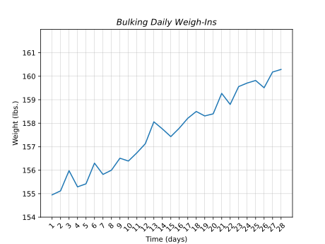

```{marimo-config}
:eval: false
---
pyproject: |-
  dependencies = [
      "marimo>=0.9.0",
      "matplotlib==3.11.1",
      "numpy==2.5.2",
      "pandas==3.0.5",
      "schemdraw[matplotlib,svgmath]==0.23",
  ]
  requires-python = ">=3.13"
---
```

```{marimo} python
:name: imports
:include: false

import marimo as mo
import numpy as np
import pandas as pd
import schemdraw
from schemdraw import flow
from textwrap import dedent
import matplotlib.pyplot as plt
from pathlib import Path
```

```{marimo} python
:name: display_settings
:include: false

plt.style.use('default')
schemdraw.use("svg")
```

```{marimo} python
:name: my_functions
:include: false

def graphic(x):
    return mo.Html(
        dedent(f'''\
        <div class="graphic">
            {mo.as_html(x)}
        </div>
        ''')
    )

def gaussian_noise(
    mean=0.,
    std_dev=1.,
    Hz=1.,
    duration=10.,
    seed=1,
):
    rng = np.random.default_rng(seed=seed)

    n = int(Hz * duration)
    measurements = rng.normal(
        loc=mean,
        scale=std_dev,
        size=n,
    )
    return measurements

def cumulative_average(measurements):
    x_k_minus_one = 0
    output = []
    for k, z in enumerate(measurements, start=1):
        x_k = x_k_minus_one + (1/k)*(z - x_k_minus_one)
        output.append(x_k)
        x_k_minus_one = x_k
    return output

def ema(alpha, measurements):
    x_k_minus_one = 0
    ema_output = []
    for k, z in enumerate(measurements, start=1):
        if k == 1:
            x_k_minus_one = z
        x_k = x_k_minus_one + alpha*(z - x_k_minus_one)
        ema_output.append(x_k)
        x_k_minus_one = x_k
    return ema_output

def mifflin_st_jeor(
    age = 25,
    height_cm = 175,
    weight = 154.88,
    sex = "M",
    unit = "lbs",
):
    if unit == "lbs":
        weight = weight * 0.45359237

    bmr = 10*weight + 6.25*height_cm -5*age
    if sex.lower() == "m":
        return  bmr + 5

    elif sex.lower() == "f":
        return bmr - 161

    else:
        return -1
```

```{marimo} python
:name: my_variables
:include: false

IMAGES_DIR = Path(__file__).parent / "public"

# EMA
weight = 155
Hz = 10
dur = 3

ema_noise = gaussian_noise(
    mean=0.,
    std_dev=1.,
    Hz=Hz,
    duration=dur,
).round(2)

ema_measurements = ema_noise + weight
ten_measurements = ema_measurements[:10]

ten_measurements_df = pd.DataFrame(
    {
        "time_s": np.arange(.1, 1.1, .1),
        "weight_lbs": ten_measurements,
    }
)
```

Every time we want to know a real-world value, we must measure it. Since our measurements always have limited precision, we can often combine multiple measurements to get a better estimate of our real world value.

:::{attention icon=false} 🗝️ **Key Idea**
More measurements can allow for better estimates, even if *none* of the measurements are 100% precise.
:::
  
This can work for all sorts of measurements, from spedometers, to pacemakers, to AHRS. To see how this might work, imagine that we are building a digital bathroom scale to measure your body weight. Body weight provides a simple example because:

1. We can assume your weight does not change over short periods of time.
2. Your weight can be represented by a single number.
  
## Measurements and Definitions
  
When you step on a bathroom scale, a sensor—called a strain gauge load cell[^loadcell]—underneath the platform measures your downward force. The loadcell outputs an analog voltage that is then converted to a digital measurement via the ADC. A typical ADC such as the HX711 will sample the voltage signal between 10-80 Hz [@avia_hx711_datasheet]. Since the output from the loadcell and the output from the ADC can both be represented as funtions over time, we call both of them "**signals**".

[^loadcell]: A strain gauge load cell is an electronic component that converts force into proportional resistance change using metal foil grids (called strain gauges) which change resistance under load (increasing under tension and decreasing under compression). They are used in almost all digital bathroom scales because they are thin, accurate (relatively), mass-producible, and have no moving parts to wear out.
  
:::{div}
:class: h-0 overflow-hidden opacity-0 m-0 p-0 pointer-events-none

### Signals
:::

::::{admonition icon=false} 📖 **Definition**
:::{glossary}
Signal
: Any {term}`function` that represents how a quantity varies over time or space.
:::
::::
  
Because nobody stands perfectly still, your constant weight shifts on the scale will introduce "**noise**" to the measurements (and even if you were still, there would still be thermal noise in the load cell).
  
:::{div}
:class: h-0 overflow-hidden opacity-0 m-0 p-0 pointer-events-none

### Noise
:::

::::{admonition icon=false} 📖 **Definition**
:::{glossary}
Noise
: Any unwanted or random component of a {term}`signal` that degrades or obscures the information it carries.
:::
::::
  
Since the stream of measurements from the ADC will constantly fluctuate, we can never know your true weight with 100% precision (remember, it's impossible to measure anything with 100% precision). Instead, we must attempt to remove the noise from this signal to make our best estimate of your true weight, hence the term "**filter**".
  
:::{div}
:class: h-0 overflow-hidden opacity-0 m-0 p-0 pointer-events-none

### Filters
:::

::::{admonition icon=false} 📖 **Definition**
:::{glossary}
Filter
: Any algorithm that selectively modifies or removes noise from a {term}`signal`.
:::
::::
  
In general, when being used to estimate a real world value, a filter will recieve a set of digital measurements and output an estimate:
  


```{marimo} python
:hide-code: true
:name: make_filter_diagram
:include: false

with schemdraw.Drawing(show=False) as _d:
    _d.config(fontsize=12)

    flow.Start().label("Real-world value\nwe want to know").drop("S")
    flow.Arrow().down(1)
    flow.RoundBox().label(
        "Measurement device"
    )
    flow.Arrow().down(1)
    flow.RoundBox().label("Sequence of digital\nmeasurements").drop("E")
    flow.Line().right(1)
    flow.Line().up(4)
    flow.Arrow().right(1.5)
    flow.RoundBox().label("Filter removes noise\nfrom the measurements").drop("S")
    flow.Arrow().down(1)
    flow.Terminal().label("Estimate of the real-world value")

_d.save(IMAGES_DIR / "intro_filter_diagram.svg")
```

For our particular example of a scale measuring weight, this sequence looks like the following (where each arrow is annotated with the result/output of the prior box):
  


```{marimo} python
:hide-code: true
:name: make_scale_diagram
:include: false

with schemdraw.Drawing(show=False) as _d:
    _d.config(fontsize=12)

    flow.Start().label("Force is applied to\nthe scale's platform").drop("S")
    flow.Arrow().down(1).label(
        "Tensed/compressed\nstrain gaugues", loc="bottom"
    )
    flow.RoundBox().label(
        "Loadcell measures force\nvia strain gauge resistance"
    )
    flow.Arrow().down(1).label(
        "Continuous\nanalog voltage", loc="bottom"
    )
    flow.RoundBox().label("ADC samples\nthe voltage signal")
    flow.Line().down(1).label(
        "Sequence of digital\nmeasurements", loc="bottom", ofst=(0, 0.25)
    )
    flow.Line().right(3.5)
    flow.Line().up(5)
    flow.Arrow().right(1)
    flow.RoundBox().label("Filter removes\nnoise from the\nmeasurements").drop("S")
    flow.Arrow().down(1).label("Weight estimate", loc="bottom")
    flow.Terminal().label("Scale reading")

_d.save(IMAGES_DIR / "intro_scale_diagram.svg")
```

We have yet to explain *how* a filter could remove noise, but we're getting there. Imagine you step on the scale and the first 10 digital measurements look like this:
  


```{marimo} python
:hide-code: true
:name: make_weight_measurements_fig
:include: false

_fig, _ax = plt.subplots()

ten_measurements_df.plot(
    x="time_s",
    y="weight_lbs",
    ax=_ax,
    legend=False,
    xlabel="Time (s)",
    ylabel="Weight (lbs.)",
    ylim=(weight-3, weight+3),
    xticks=ten_measurements_df["time_s"],
    yticks=np.arange(weight-3, weight+4, 1),
)

_ax.grid(visible=True, alpha=0.9, linewidth=0.4)
_ax.set_title("Weight Measurements at 10 Hz Sample Rate", style='italic')

_fig.savefig(IMAGES_DIR / "intro_weight_measurements_fig.svg")
```

We can immediately tell that you're in the mid 150's, but we're not sure exactly where. Since the fluctuations are generally random, it is reasonable to assume each measurement is just as likely to be too high as it is to be too low[^meannoise]. Therefore, we can get a better estimate of the person's true weight by combining many measurements, in hopes of the noise canceling itself out.

[^meannoise]: More specifically, we assume that the mean of the noise distribution is 0, which means our logic still holds even if the median skews too big or too small. More on this later in [test](/part03-bayesian-probability).
  
:::{attention icon=false} 🗝️ **Key Idea**
By assuming that the noise is random and has a mean of 0, we can combine multiple measurements to increase the probability that the noise cancels out.
:::
  
The most basic way to combine measurements is by averaging them. For example, if we only had the two measurements our estimate would be

```{marimo} python
:hide-code: true

mo.md(rf"""
$$({ten_measurements[0]}+{ten_measurements[1]})/2={round(.5*(ten_measurements[0]+ten_measurements[1]), 2)}\text{{ lbs.}}$$
""")
```

After the third, we would have

```{marimo} python
:hide-code: true

mo.md(rf"""
$$({ten_measurements[0]}+{ten_measurements[1]}+{ten_measurements[2]})/3={(ten_measurements[0]+ten_measurements[1]+ten_measurements[2])/3:.2f} \text{{ lbs.}},$$
""")
```

and so on. In general, the more measurements we continue to average, the better we expect our estimate to get.

This seems like a good strategy, but our list of measurements is growing quite quickly and many scales have only 64 out of 256 bytes of memory available for data processing [@holtek_ht45f75_data_sheet]. At this rate, with each number stored as a 32-bit integer (4 bytes), our memory would be completely full within about 1.6 seconds. We can fix this by using a recursive average to store only two values: the number of measurements, and the previous average.
  
Let our measurements be denoted $z_1$, $z_2$, $z_3$, etc..., so that after $k$ measurements, we have $z_1$, $z_2$, ..., $z_k$. This means that after
$k-1$ measurements, our average will be

$$\bar{x}_{k-1} = \frac{z_1 + z_2 + \cdot\cdot\cdot + z_{k-1}}{k-1},$$

and after $k$ measurements it will be

$$\bar{x}_k = \frac{z_1 + z_2 + \cdot\cdot\cdot + z_{k-1} + z_k}{k}.$$

Now we can calculate each $\bar{x}_k$ (pronounced "x bar", where the bar is statistical notation for an average) in terms of the number of measurements ($k$) and the previous average ($\bar{x}_{k-1}$) by seeing that

$$\bar{x}_k = \frac{\bar{x}_{k-1}(k-1) + z_k}{k} = \bar{x}_{k-1} + \frac{1}{k}(z_k - \bar{x}_{k-1}).$$

By writing each estimate in terms of the previous estimate, a weighting term[^weighting-term], and the new measurement, we can allow this algorithm to run on our scale's limited memory.

[^weighting-term]: We are using $\frac{1}{k}$ as our weighting here, but we will soon see other options.
  
:::{attention icon=false} 🗝️ **Key Idea**
We avoid storing a list of all measurements by writing each estimate in terms of the previous one.
:::
  
This can be implemented in python as

```python
def cumulative_average(measurements):
    x_k_minus_one = 0
    output = []
    for k, z in enumerate(measurements, start=1):
        x_k = x_k_minus_one + (1/k)*(z - x_k_minus_one)
        output.append(x_k)
        x_k_minus_one = x_k
    return output
```
  
Over 3 seconds, this looks like:
  


```{marimo} python
:hide-code: true
:name: make_cummulative_avg_fig
:include: false

_measurements_df = pd.DataFrame({
    "time_s": np.arange(.1, dur+.1, .1),
    "weight_lbs": ema_measurements,
    "cumulative_avg_weight": cumulative_average(ema_measurements),
})

_fig, _ax = plt.subplots()

_measurements_df.plot(
    x="time_s",
    y=["weight_lbs", "cumulative_avg_weight"],
    ax=_ax,
    xlabel="Time (s)",
    ylabel="Weight (lbs.)",
    ylim=(weight-3, weight+3),
    xticks=np.arange(0, dur+.1, .2),
    yticks=np.arange(weight-3, weight+4, 1),
    rot=45,
)
_ax.legend(["Measurement", "Cumulative Avg"])
_ax.grid(visible=True, alpha=0.9, linewidth=0.4)
_ax.set_title("Weight Measurements & Cumulative Average at 10 Hz", style='italic')

_fig.savefig(IMAGES_DIR / "intro_cumulative_avg_fig.svg")
```

As desired, we can see that the orange line of averages has quickly stabalized relative to the blue measurements. While this is very close to the algorithm that real scales use, we still need one tweak.
  
## Exponential Moving Average
  
Currently, our formula is

$$\bar{x}_k = \bar{x}_{k-1} + \frac{1}{k}(z_k - \bar{x}_{k-1}),$$

where the $\frac 1k$ term ensures that as each new measurement is added, all the measurements stay weighted equally. In practice, we tend to care more about recent measurements than past ones, so rather than using a term that decreases as $k$ grows, it's common to use a constant smoothing factor $\alpha$:

:::{div}
:class: h-0 overflow-hidden opacity-0 m-0 p-0 pointer-events-none

### Alpha Weighting Term
:::

$$\hat{x}_k = \hat{x}_{k-1} + \alpha (z_k - \hat{x}_{k-1}).$$

Note that we have also substituted "$\bar x$" with "$\hat x$" (pronounced "x hat"), where the hat indicates an estimated value, rather than an average. This new equation is called the EMA[^ema]. Importantly, $z_k$ has a weighting of $\alpha$, and $\hat x_{k-1}$ has a weighting of $(1-\alpha)$, so that as $\alpha$ goes to $0$, the function goes to $\hat{x}_{k-1}$, and as $\alpha$ goes to $1$, the function goes to $z_k$. In other words, each estimate is chosen to be some value between the previous estimate $\hat{x}_{k-1}$ and the new measurement $z_k$. With a smaller $\alpha$ (closer to $0$) we go closer to the prior estimate. With a larger $\alpha$ (closer to $1$) we go closer to our new measurement.

[^ema]: The exponential moving average gets its name because each term $z_{k-n}$ is weighted by a factor of $\alpha(1-\alpha)^n$, where $k$ is the number of measurements and $n\le k$. This is clearer when the equation is rearranged into its more common form: $\hat{x}_k = \alpha z_k + (1-\alpha) \hat x_{k-1}$, and we can see that each measurement is multiplied by $\alpha$ when initially taken, and then by $(1-\alpha)$ at every iteration afterwards.
  
:::{attention icon=false} 🗝️ **Key Idea**
Each estimate is chosen to be some value between the previous estimate $\hat{x}_{k-1}$ and the new measurement $z_k$. With a smaller $\alpha$ (closer to $0$) we choose closer to $\hat x_{k-1}$. With a larger $\alpha$ (closer to $1$) we choose closer to $z_k$.
:::
  
### Initialization
  
One additional consideration with EMA filters is initialization: our cummulative average simply returns the first measurement as the first estimate, but the EMA takes a weighted combination of each measurement with the previous estimate, so we must give it some initial value to use when calculating the first estimate. There are three common approaches to this.

1. *First measurement initialization:* We set $\hat x_{0}$ equal to the first measurement as soon as we get it, ensuring the first estimate equals the first measurement. This is the most common and will be used here.
2. *Zero initialization:* We set $\hat x_{0} = 0$, so that the first estimate will be $\alpha$ times the first measurement. This is extremely fast and simple, but the filtered will take some time to stabilize, especially with low $\alpha$ values, so the begining of the begining of the filtered signal may need to be cropped out.
3. *Callibration period initialization:* We reserve some period of time at the begining of data collection for callibration, during which we average the measurements, then we set $\hat x_0$ equal to the average and begin filtering with our EMA. This is less computationally efficient and is more common in economic forecasting and stock predictions.
  
### Implementation

Our first measurement initialization EMA can be implemented in python as:

```python
def ema(alpha, measurements):
    x_k_minus_one = 0
    ema_output = []
    for k, z in enumerate(measurements, start=1):
        if k == 1:
            x_k_minus_one = z
        x_k = x_k_minus_one + alpha*(z - x_k_minus_one)
        ema_output.append(x_k)
        x_k_minus_one = x_k
    return ema_output
```

```{marimo} python
alpha_slider = mo.ui.slider(start=0, stop=1, step=.05, value=0.05, label="$\\alpha$")
```

```{marimo} python
:hide-code: true

mo.md(rf"""
By setting $\alpha = {alpha_slider.value}$, we get:
""")
```

```{marimo} python
:hide-code: true
:name: ema_fig_interactive

ema_weight = ema(alpha_slider.value, ema_measurements)

_measurements_df = pd.DataFrame({
    "time_s": np.arange(.1, dur+.1, .1),
    "weight_lbs": ema_measurements,
    "ema_weight": ema_weight,
})

_fig, _ax = plt.subplots()

_measurements_df.plot(
    x="time_s",
    y=["weight_lbs", "ema_weight"],
    ax=_ax,
    xlabel="Time (s)",
    ylabel="Weight (lbs.)",
    ylim=(weight-3, weight+3),
    xticks=np.arange(0, dur+.1, .2),
    yticks=np.arange(weight-3, weight+4, 1),
    rot=45,
)
_ax.legend(["Measurement", "EMA"])
_ax.grid(visible=True, alpha=0.9, linewidth=0.4)
_ax.set_title(f"Weight Measurements & EMA with $\\alpha = {alpha_slider.value:.2f}$", style='italic')

mo.vstack([
    alpha_slider,
    graphic(_fig),
])
```

```{marimo} python
:hide-code: true

mo.md(rf"""
where our EMA settles on ${ema_weight[-1]:.2f}$ lbs. after {dur} seconds. We have now built a filter algorithm used in the real world by millions of digital bathroom scales.
""")
```

This works because we've assumed that your true weight will not change between measurements. In other words, in a perfect world with no noise, all of our measurements and estimates would equal all of the $x_k$ (where the lack of hat denotes your true weight at the time of the $k$-th measuremnt). Therefore, by combining them, we increase the probability that the noise "cancels itself out", leaving us with a better estimate.
  
:::{attention icon=false} 🗝️ **Key Idea**
We can use the EMA equation

$$\hat{x}_k = \hat{x}_{k-1} + \alpha (z_k - \hat{x}_{k-1})$$

to estimate a real world value with the assumption that it will not change between measurements. If we expect noisier measurements, we should pick a smaller $\alpha$.
:::
  
If we expect our real-world value to change between measurements, we will have to update our filtering strategy.
  
## Alpha-Beta Filter

```{marimo} python
:include: false
activity_lvl_dict = {
    "light": 1.2,  # light walking, biking, or chores
    "moderate": 1.5,  # regular lifting, running, or active work
    "high": 1.9,  # Professional athletes or military training
}
sex_dict = {
    "M": "male",
    "F": "female",
}
kcal_per_lb = 3500

age = 23
height_cm = 175
sex = "M"
activity_lvl = "moderate"
target_lbs_per_week = 1.4

total_days = 28
alpha_beta_weights = np.linspace(start=155, stop=155+target_lbs_per_week*4, num=total_days, endpoint=False)
alpha_beta_noise = np.array(
    [
        ema(
            0.05,
            gaussian_noise(
                mean=0.0, std_dev=1.0, Hz=10, duration=3, seed=i
            ),
        )[-1]
        for i in range(1, 29)
    ]
)
alpha_beta_measurements = np.round(alpha_beta_weights + alpha_beta_noise, 2)
start_weight = alpha_beta_measurements[0]
alpha_beta_measurements_df = pd.DataFrame({
    "day": np.arange(1, total_days+1, 1),
    "weight_lbs": alpha_beta_measurements,
})

bmr = mifflin_st_jeor(age, height_cm, start_weight, sex)
tdee = bmr * activity_lvl_dict[activity_lvl]

target_kcal_per_day = tdee + (kcal_per_lb * target_lbs_per_week / 7)
guess_kcal_per_day = 2800
```

Our EMA relied on the assumption that your true weight did not change between measurements. If we *did* expect our real-world value to change, then we could no longer assume that, without noise, $\hat x_{k-1}$ would equal $x_k$. The only thing we can still be sure of is that *if there was no noise*, then we would have

$$\begin{align*}
\hat x_{k-1} &= x_{k-1}, \\
z_k &= x_k.
\end{align*}$$

You might say, "well of course if there were no imperfections then our estimates and measurements would be perfect, but how is that useful?" In order for this be useful, we need an expresion in terms of $\hat x_{k-1}$ that—without noise—would be equal to $x_k$. Then, we can use our same strategy with $\alpha$ to choose a value between that expression and $z_k$. By letting $\Delta x_k$ represent the change we expect between $x_k$ and $x_{k-1}$, we can say that *if there was no noise*, then we would have

$$\hat x_{k-1} + \Delta x_k = z_k = x_k$$

Therefore, we can substitute $(\hat x_{k-1} + \Delta x_k)$ in place of $\hat x_{k-1}$ in our EMA equation to get

$$\hat{x}_k = (\hat x_{k-1} + \Delta x_k) + \alpha (z_k - (\hat x_{k-1} + \Delta x_k)).$$

Here, the $(\hat x_{k-1} + \Delta x_k)$ term is called the **prior** (often denoted $\hat x_k^-$), because it represents our estimate for time $k$ *prior* to getting the measurement $z_k$.
  
:::{div}
:class: h-0 overflow-hidden opacity-0 m-0 p-0 pointer-events-none

### Definition - Prior
:::

::::{admonition icon=false} 📖 **Definition**
:::{glossary}
Prior
: The value we expect to get *before* taking a measurement.
:::
::::
  
Using this notation, we can rewrite our equation as

$$\hat{x}_k = \hat x_k^- + \alpha (z_k - \hat x_k^-).$$

This is starting to look quite similar to our filter in the last section.
  
:::{attention icon=false} 🗝️ **Key Idea**
If we can get an expresion in terms of $\hat x_{k-1}$ that—without noise—would be equal to $x_k$, then we can combine them (with some weighting $\alpha$) to increase the probablity that the noise cancels out.
:::
  
### Step-by-Step Example

As an example, imagine that after weighing yourself on your bathroom scale, you decide to start eating more in order to bulk up. Then you start weighing yourself every day to track your weight gain. For our EMA, we had 10 measurements per second. Here, we are only taking one measurement per day.

**Day 1:** The scale reads 155 lbs: our first measurement is $z_1 = 155$. Using first measurement initialization, we set our first estimate
$$\hat x_1 = z_1 = 155.$$

**Day 2:**

- <u>Prediction Step</u>

  First we predict our prior, which we are modeling here as $(\hat x_{k-1} + \Delta x_k)$. Imagine that we assess your new diet and somehow predict you will gain 1 pound per day as long as you eat like this[^delta-prediction]. Our prior becomes

  $$\hat x^-_2 = \hat x_1 + \Delta x_2 = 155 + 1 = 156.$$

- <u>Measurement Update Step</u>

  Next, we use the measurement to update this value. Say the scale reads $z_2 = 157$ and we use $\alpha = .2$. We calculate our second estimate as

  $$\hat x_2 = \hat x^-_2 + \alpha(z_2 - \hat x^-_2) = 156 + 0.2(157 - 156) = 156.2.$$

**Day 3:**

- <u>Prediction Step</u>

  $$\hat x^-_3 = \hat x_2 + \Delta x_3 = 156.2 + 1 = 157.2.$$

- <u>Measurement Update Step</u>

  Next, we use the measurement to update this value. Say the scale reads $z_3 = 157.7$. We calculate our third estimate as

  $$\hat x_3 = \hat x^-_3 + \alpha(z_3 - \hat x^-_3) = 157.2 + 0.2(157.7 - 157.2) = 157.3.$$

[^delta-prediction]: Gaining 1 lb. per day of pure fat or muscle is physiologically impossible, but it is a simple number to use for this example. A more realistic weight gain rate could be obtained with the following strategy:
    - Use the Mifflin-St Jeor estimate for BMR:
    $$\text{BMR} \approx 10(\text{weight kg}) + 6.25(\text{height cm}) - 5(\text{age}) + (\text{5 for men, }-\text{161 for women}).$$
    - TDEE is commonly estimated by multiplying BMR my some activity multiplier. For moderate activity, 1.5 is used:
    $$\text{TDEE} \approx 1.5 (\text{BMR}).$$
    - Estimate energy balance from DEI and TDEE:
    $$\text{Energy Balance} = \text{DEI} - \text{TDEE}$$
    - Max Wishnofsky's 1958 paper [Caloric Equivalents of Gained or Lost Weight](https://doi.org/10.1093/ajcn/6.5.542) estimates:
    $$3,500\text{ kcal}\approx 1 \text{{ lb.}}$$
    - Estimate weight gain:
    $$\text{Weight Gain (lbs./day)} = \boxed{\frac{\text{Energy Balance}}{3,500}}.$$
  
And then we continue in this fasion, reapeating prediction step, then measurement step for each of our future measurements.
  
In code, this could look like

```python
def alpha_filter(alpha, measurements, delta_x):
    x_k_minus_one = measurements[0]
    alpha_output = []

    for k, z in enumerate(measurements[1:], start=1):
        # Prediction Step
        x_prior_k = x_k_minus_one + delta_x

        # Measurement Update
        x_k = x_prior_k + alpha*(z - x_prior_k)
        alpha_output.append(x_k)
        x_k_minus_one = x_k

    return alpha_output
```
  
Let's try simulating some data for this filter.

```{marimo} python
alpha_filter_alpha_slider = mo.ui.slider(0, 1, 0.1)
```

```{marimo} python
# Simulate Data
_real_world_weights = np.linspace(
    start = 155,
    stop = 184,
    num = 10,
)
_noise = gaussian_noise(
    mean=0.0, std_dev=9.0, duration=10,
)
_measurements = _real_world_weights + _noise
_days = np.arange(1, 11)

# Filter Data
def alpha_filter(alpha, measurements, delta_x):
    x_k_minus_one = measurements[0]
    predictions = [x_k_minus_one]
    estimates = [x_k_minus_one]

    for k, z in enumerate(measurements[1:], start=1):
        # Prediction Step
        x_prior_k = x_k_minus_one + delta_x
        predictions.append(x_prior_k)

        # Measurement Update
        x_k = x_prior_k + alpha*(z - x_prior_k)
        estimates.append(x_k)
        x_k_minus_one = x_k

    return predictions, estimates

_predictions, _estimates = alpha_filter(
    0.5, _measurements, 1,
)

_fig, _ax = plt.subplots()

_ax.plot(_days, _estimates, marker='o', color='#1f77b4', linestyle='-', label='Estimates')
_ax.plot(_days, _predictions, marker='D', color='red', linestyle=':', label='Predictions')
_ax.plot(_days, _real_world_weights, color='black', linestyle='-', linewidth=1, label='Actual')
_ax.plot(_days, _measurements, marker='o', color='none', markeredgecolor='black', 
         markeredgewidth=2, linestyle='None', label='Measurements')

_ax.set_xlabel('day')
_ax.set_ylabel('weight (lbs)')
_ax.grid(True)
_ax.legend(loc='lower right')
_fig.tight_layout()

_fig
```

### Beta Weighting Term

Unsurprisingly, this works quite well when our values of $\Delta x$ are correct. However, we get a lot of drift when $\Delta x$ is wrong. To fix this, we want some way to update $\Delta x$ in addition to updating our estimate. We've already been updating our estimate by scaling the measurement by a factor of $\alpha$. Similarly, we can update each $\Delta x$ by scaling the *change* in $\hat x$ by a factor of $\beta$. In code, this could look like

```python
def alpha_beta_filter(
    alpha,
    beta,
    measurements,
    delta_x_initial,
):
    x_k_minus_one = measurements[0]
    alpha_beta_output = []
    delta_x = delta_x_initial

    for k, z in enumerate(measurements[1:], start=1):
        # Prediction Step
        x_prior_k = x_k_minus_one + delta_x

        # Measurement Update
        x_k = x_prior_k + alpha*(z - x_prior_k)
        alpha_beta_output.append(x_k)

        delta_x = delta_x + beta((x_k - x_k_minus_one) - delta_x)

        x_k_minus_one = x_k

    return alpha_beta_output
```

```{marimo} python
:hide-code: true
:include: false

_foobar = 0

mo.md(r"""

""")
```

```{marimo} python
:hide-code: true
:name: make_alpha_beta_weight_measurements_fig
:include: false

_fig, _ax = plt.subplots()

alpha_beta_measurements_df.plot(
    x="day",
    y="weight_lbs",
    ax=_ax,
    legend=False,
    xlabel="Time (days)",
    ylabel="Weight (lbs.)",
    ylim=(np.floor(np.min(alpha_beta_weights))-1, np.ceil(np.max(alpha_beta_weights))+1),
    xticks=alpha_beta_measurements_df["day"],
    yticks=np.arange(np.floor(np.min(alpha_beta_weights))-1, np.ceil(np.max(alpha_beta_weights))+1, 1),
    rot=45,
)

_ax.grid(visible=True, alpha=0.9, linewidth=0.4)
_ax.set_title(f"Bulking Daily Weigh-Ins", style='italic')

_fig.savefig(IMAGES_DIR / "intro_alpha_beta_weight_measurements_fig.svg")
```

## Summary

Our goal when designing a signal filter is to algorithmically remove noise from a measurement signal. This is usually done by combining our knowlege and measurements in a way that increases the probability that the noise cancels out. One of the most common ways to do this is to recursively update our estimate using a weighted combination of our prior prediction and our measurement, which can be expressed in the form:

$$\hat{x}_k = \hat x_k^- + \alpha (z_k - \hat x_k^-).$$
  
## What's Next

Because our motivation for doing this is the fact that both $\hat x_k^-$ and $z_k$ are noisy values, a natural question becomes:

>"Given some amounts of noise in our prior ($\hat x_k^-$) and measurement ($z_k$), what value of $\alpha$ should we pick?"

Part 1 is dedicated to answering this question. Since modeling noise relies on probabilities, probabilities are built on set theory, and set theory is built on logic, we will introduce these topics along the way.

Once I've finished writing part 1 and we know the optimal $\alpha$ for some given levels of noise in $\hat x_k^-$ and $z_k$, then we can proceed to answering the following questions:

> How do we determine the levels of noise in $\hat x_k^-$ and $z_k$?

(Spoiler: $z_k$ will be pretty simple but $\hat x_k^-$ will take a bit more work.)

> What is the best way to calculate $\hat x_k^-$?

(There are endless ways to do this. We will not cover them all.)

> What if my sensor doesn't measure the real-world value I want to know?

(Time for measurement functions!)

> What if my real-world value can't be represented as a scalar?

(Time for state vectors!)

> What if I expect my real-world value to change in super weird, non-linear ways?

(Linear approximation techniques)

> What if I need to avoid singularities in my state space representation?

(Quaternion time!)