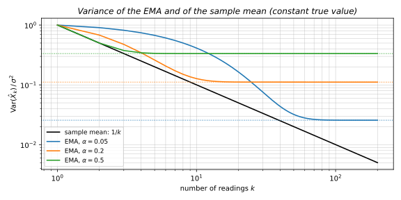

```{marimo-config}
---
pyproject: |-
  dependencies = [
      "marimo>=0.25.1",
      "matplotlib==3.11.2",
      "numpy==2.5.3",
  ]
---
```

```{marimo} python
:name: imports
:include: false

import marimo as mo
import numpy as np
import matplotlib.pyplot as plt
import math
from textwrap import dedent
from pathlib import Path
```

```{marimo} python
:name: display_settings
:include: false

plt.style.use("default")

def graphic(x):
    return mo.Html(dedent(f'''\
        <div class="graphic">
            {mo.as_html(x)}
        </div>
        '''))
```

```{marimo} python
:include: false
IMAGES_DIR = Path(__file__).parent.parent / "notebooks" / "public"
IMAGES_DIR.mkdir(parents=True, exist_ok=True)
```

:::{seealso icon=false} 🔗 **Prerequisites**
- [Introduction](introduction_v2.md): the cumulative average and the {term}`exponential moving average` with first-measurement initialization.
- [Chapter 3](ch3_sets_for_probability_v2.md): finite sums; {term}`absolute value` and the triangle inequality; the Archimedean property.
- [Chapter 4](ch4_probability_spaces_v2.md): monotonicity, countable additivity, continuity from below; {term}`independent events`; {term}`almost surely`.
- [Chapter 5](ch5_random_variables_v2.md): {term}`random variables <random variable>` and the theorem on building them; {term}`discrete <discrete random variable>` and {term}`continuous <continuous random variable>` random variables, PMFs, densities, and sums over countable sets; the {term}`uniform <uniform distribution>` and {term}`normal <normal distribution>` distributions and the density of $aX + b$; {term}`joint densities <joint density>` and {term}`marginal densities <marginal density>`; {term}`independence <independent random variables>` and the factorization criteria; linear combinations of independent normals; the standard {term}`measurement-noise <measurement noise>` model.
- [Appendix C: Sequences and Limits](appendix_c_calculus_v2.md) and [Appendix C: Series](appendix_c_calculus_v2.md): limits, absolutely convergent and nonnegative series (rearranging, grouping, and multiplying them), the geometric series.
- [Appendix C: Derivatives](appendix_c_calculus_v2.md) and [Appendix C: The Mean Value Theorem and Extrema](appendix_c_calculus_v2.md): the extreme value theorem and the fact that the derivative vanishes at an interior extremum.
- [Appendix C: The Fundamental Theorem of Calculus](appendix_c_calculus_v2.md) (substitution, integration by parts), [Appendix C: Exponential and Logarithm](appendix_c_calculus_v2.md), [Appendix C: Improper Integrals](appendix_c_calculus_v2.md), and [Appendix C: Multiple Integrals](appendix_c_calculus_v2.md) (Fubini's theorem).
:::
  
The Introduction made two promises it could not yet keep. First, that averaging $k$ noisy readings gives a better estimate than any single reading. Second, that the EMA's $\alpha$ trades noise against lag: a small $\alpha$ smooths the noise but responds slowly when the true value moves. This chapter keeps both promises with theorems.

The tools are the *expected value* of a random variable, its probability-weighted average, and the *variance*, its expected squared distance from that average. With them we can say precisely what makes an estimate good (small bias and small variance), prove that the average of $k$ readings has variance $\sigma^2/k$, and compute the EMA's bias and variance exactly. The result is a formula for the EMA's mean squared error as a function of $\alpha$, with a best $\alpha$ in between the extremes.

:::{attention icon=false} 🗝️ **Key Idea**
Averaging $k$ measurements with uncorrelated, zero-mean noise divides the noise variance by $k$. An EMA instead keeps a fixed amount of noise, $\sigma^2\alpha/(2-\alpha)$, in exchange for tracking a moving value with a lag of $(1-\alpha)/\alpha$ steps. Choosing $\alpha$ is a trade-off between these two errors.
:::

:::{tip icon=false} **How the proofs in this chapter are organized**
The general definition of the expected value is a Lebesgue integral, and every theorem in this chapter holds for all random variables for which the expectations involved exist. We prove each theorem completely for random variables that are discrete or have a (joint) density, which covers every example in this book, and we link to a proof of the general case.
:::
  
## Expected Value

Suppose a crude scale's noise $V$ takes the values $-1$, $0$, and $+1$ lb with probabilities $\tfrac14$, $\tfrac12$, $\tfrac14$. Over many readings we would expect about a quarter to be 1 lb low, half to be exact, and a quarter to be 1 lb high, so the average error should be about
$$(-1)\cdot\tfrac14 + 0 \cdot \tfrac12 + (+1)\cdot\tfrac14 = 0 \text{ lb}.$$
A second scale's noise $W$ takes the values $-1$, $0$, $+2$ lb with the same probabilities. Its most likely error is still $0$, but its average error should be about $(-1)\cdot\tfrac14 + 0 + 2\cdot\tfrac14 = \tfrac14$ lb: it reads high *on average*. The probability-weighted average of a random variable's values is its expected value. (That the average of many readings really approaches this number is a theorem, the law of large numbers, proved later in this chapter.)

::::{admonition icon=false} 📖 **Definition**
:::{glossary}
Expected value
: Let $X$ be a {term}`random variable`.

  - If $X$ is {term}`discrete <discrete random variable>`, with $\mathbb P(X \in C) = 1$ for a {term}`countable` set $C$, the expected value of $X$ *exists* iff $\sum_{x \in C} |x|\, p_X(x) < \infty$, and then
    $$\mathbb E[X] := \sum_{x \in C} x\, p_X(x).$$
  - If $X$ is {term}`continuous <continuous random variable>` with density $f_X$, the expected value of $X$ *exists* iff $\int_{-\infty}^{\infty} |x|\, f_X(x)\,dx < \infty$, and then
    $$\mathbb E[X] := \int_{-\infty}^{\infty} x\, f_X(x)\,dx.$$

  The expected value is also called the *expectation* or the *mean* of $X$. When it exists we say $X$ has *finite mean*.
:::
::::

**Remarks.**

- *The definition is unambiguous.* No random variable is both discrete and continuous ([Chapter 5](ch5_random_variables_v2.md)). In the discrete case the value does not depend on the choice of $C$, because $p_X(x) = 0$ outside every such $C$. In the continuous case, two densities of the same $X$ can differ only where one of them is discontinuous, which for the densities in this book means at finitely many points in any bounded interval, and that does not change an integral.
- *Why absolute convergence?* A sum over a countable set has no preferred order. If $\sum |x|\,p_X(x) = \infty$, a series like $\sum x\, p_X(x)$ can converge to different values in different orders (Riemann's rearrangement theorem, [Appendix C: Series](appendix_c_calculus_v2.md)), and an integral $\int_{-\infty}^\infty x f_X(x)\,dx$ needs both $\int_0^\infty$ and $\int_{-\infty}^0$ to converge separately. Absolute convergence rules out both problems.
- *The general definition.* Some random variables are neither discrete nor continuous (Chapter 5's saturated scale reading). For every random variable, $\mathbb E[X] := \int_\Omega X\,d\mathbb P$, the Lebesgue integral of $X$ with respect to $\mathbb P$, which exists iff $\int_\Omega |X|\,d\mathbb P < \infty$ and agrees with both formulas above ([Wikipedia: Expected value](https://en.wikipedia.org/wiki/Expected_value), [Wikipedia: Lebesgue integration](https://en.wikipedia.org/wiki/Lebesgue_integration)).

**Examples.**

- The two crude scales: $\mathbb E[V] = 0$ and $\mathbb E[W] = \tfrac14$ lb.
- *Indicators.* For an event $A$, $\mathbf 1_A$ takes the value $1$ with probability $\mathbb P(A)$ and $0$ otherwise, so $\mathbb E[\mathbf 1_A] = 1 \cdot \mathbb P(A) + 0 \cdot (1 - \mathbb P(A)) = \mathbb P(A)$. Every probability is an expected value.
  
:::{important icon=false} 📐 **Theorem (Means of the Uniform and Normal Distributions)**
If $X \sim \mathcal U(a, b)$, then $\mathbb E[X] = \frac{a + b}{2}$. If $X \sim \mathcal N(\mu, \sigma^2)$, then $\mathbb E[X] = \mu$.
:::

:::{admonition icon=false} ✍️ **Proof**
*Uniform.* $|x| f_X(x)$ is bounded and vanishes outside $[a, b]$, so its integral is finite, and
$$\mathbb E[X] = \int_a^b \frac{x}{b - a}\,dx = \frac{b^2 - a^2}{2(b - a)} = \frac{a + b}{2}.$$

*Normal.* First let $Z \sim \mathcal N(0, 1)$. An antiderivative of $z e^{-z^2/2}$ is $-e^{-z^2/2}$, so $\int_0^M z\varphi(z)\,dz = \frac{1}{\sqrt{2\pi}}\big(1 - e^{-M^2/2}\big) \to \frac{1}{\sqrt{2\pi}}$ as $M \to \infty$. Since $\varphi$ is symmetric, $\int_{-\infty}^\infty |z|\varphi(z)\,dz = \frac{2}{\sqrt{2\pi}} < \infty$, and $\int_{-\infty}^\infty z\varphi(z)\,dz = \int_0^\infty z\varphi(z)\,dz - \int_0^\infty z\varphi(z)\,dz = 0$. For $X \sim \mathcal N(\mu, \sigma^2)$, substitute $x = \mu + \sigma z$:
$$\int_{-\infty}^\infty |x|\,\varphi_{\mu,\sigma}(x)\,dx = \int_{-\infty}^\infty |\mu + \sigma z|\,\varphi(z)\,dz \le |\mu| + \sigma \int_{-\infty}^\infty |z|\,\varphi(z)\,dz < \infty,$$
$$\mathbb E[X] = \int_{-\infty}^\infty (\mu + \sigma z)\,\varphi(z)\,dz = \mu \cdot 1 + \sigma \cdot 0 = \mu. \qquad \blacksquare$$
:::

So the parameter $\mu$ of [Chapter 5](ch5_random_variables_v2.md) is the mean of $\mathcal N(\mu, \sigma^2)$, and the standard measurement-noise model's $V_k \sim \mathcal N(0, \sigma^2)$ has mean $0$. This is the "zero-mean noise" assumption the Introduction relied on.

**A distribution with no mean.** Let $h(x) := \frac{1}{2(1 + |x|)^2}$. It is a PDF: it is positive and continuous, and $\int_0^\infty (1 + x)^{-2}\,dx = \big[-(1+x)^{-1}\big]_0^\infty = 1$, so $\int_{-\infty}^{\infty} h = 2 \cdot \tfrac12 \cdot 1 = 1$. Let $X$ have density $h$. For $x \ge 1$ we have $1 + x \le 2x$, so $\frac{x}{(1 + x)^2} \ge \frac{1}{4x}$ and
$$\int_1^M \frac{x}{(1+x)^2}\,dx \ge \frac14 \ln M \to \infty.$$
So $\int |x|\, h(x)\,dx = \infty$ and $X$ has **no** expected value, even though $h$ is symmetric about $0$ and every truncated integral $\int_{-M}^{M} x\,h(x)\,dx$ equals $0$. The trouble is the tails: $h$ decays only like $1/x^2$, so values far from $0$ are rare but not rare enough. Densities like this one are called *heavy-tailed*, and they model sensors with occasional wild readings. We will see that averaging fails for them.
  
## The Law of the Unconscious Statistician

To compute $\mathbb E[X^2]$ from the definition, we would first need the distribution of the new random variable $X^2$. The following theorem says we never have to: we can weight $g(x)$ by the distribution of $X$ directly. It is called the *law of the unconscious statistician* (LOTUS), because it is so often used without noticing that it needs proof.

:::{important icon=false} 📐 **Theorem (LOTUS)**
Let $X_1, \ldots, X_n$ be random variables on the same probability space and $g : \mathbb R^n \to \mathbb R$ a function such that $Y := g(X_1, \ldots, X_n)$ is a random variable (for example, any continuous $g$).

1. *(Discrete.)* Suppose $\mathbb P(X_i \in C_i) = 1$ with each $C_i$ countable, let $C := C_1 \times \cdots \times C_n$, and let $p(x_1, \ldots, x_n) := \mathbb P(X_1 = x_1, \ldots, X_n = x_n)$. Then $\mathbb E[Y]$ exists iff $\sum_{\mathbf c \in C} |g(\mathbf c)|\, p(\mathbf c) < \infty$, and then
$$\mathbb E[g(X_1, \ldots, X_n)] = \sum_{\mathbf c \in C} g(\mathbf c)\, p(\mathbf c).$$
2. *(Densities.)* If $X_1, \ldots, X_n$ have joint density $f$ (for $n = 1$, a density $f_{X_1}$), then $\mathbb E[Y]$ exists iff $\int_{\mathbb R^n} |g|\,f < \infty$, and then
$$\mathbb E[g(X_1, \ldots, X_n)] = \int_{\mathbb R^n} g(x_1, \ldots, x_n)\, f(x_1, \ldots, x_n)\,dx_1 \cdots dx_n.$$
:::

:::{admonition icon=false} ✍️ **Proof**
*Part 1.* Write $\mathbf X := (X_1, \ldots, X_n)$. The set $C$ is countable ([Chapter 3](ch3_sets_for_probability_v2.md)), and $\mathbb P(\mathbf X \notin C) \le \sum_i \mathbb P(X_i \notin C_i) = 0$ by the union bound. Let $D := g[C]$, the image of $C$. It is countable: enumerate $C$, and send each $y \in D$ to the index of the first element of $C$ that $g$ maps to $y$; this is an injection into $\mathbb N$. Off the null event $\{\mathbf X \notin C\}$, $Y$ takes values in $D$, so $Y$ is discrete. For $y \in D$, the event $\{Y = y\} \cap \{\mathbf X \in C\}$ is the disjoint union of the events $\{\mathbf X = \mathbf c\}$ over the $\mathbf c \in C$ with $g(\mathbf c) = y$, and the rest of $\{Y = y\}$ has probability $0$. By countable additivity,
$$p_Y(y) = \sum_{\mathbf c \in C,\ g(\mathbf c) = y} p(\mathbf c).$$
The sets $\{\mathbf c \in C : g(\mathbf c) = y\}$, for $y \in D$, partition $C$. A series of nonnegative terms may be grouped arbitrarily ([Appendix C: Series](appendix_c_calculus_v2.md)), so
$$\sum_{y \in D} |y|\, p_Y(y) = \sum_{y \in D}\ \sum_{g(\mathbf c) = y} |g(\mathbf c)|\, p(\mathbf c) = \sum_{\mathbf c \in C} |g(\mathbf c)|\, p(\mathbf c).$$
Hence $\mathbb E[Y]$ exists iff the right side is finite. In that case the series is absolutely convergent, so the same regrouping without absolute values is allowed and gives $\mathbb E[Y] = \sum_{\mathbf c \in C} g(\mathbf c)\, p(\mathbf c)$.

*Part 2.* Not given here. For $n = 1$ and $g$ affine it follows from Chapter 5's density of $aX + b$ by a substitution, but in general $Y$ need not be discrete or continuous, and the proof needs the Lebesgue integral ([Wikipedia: Law of the unconscious statistician](https://en.wikipedia.org/wiki/Law_of_the_unconscious_statistician)). $\blacksquare$
:::

For example, for the crude scale, $\mathbb E[V^2] = (-1)^2 \cdot \tfrac14 + 0 + 1^2 \cdot \tfrac14 = \tfrac12$; and for $U \sim \mathcal U(0, 1)$, $\mathbb E[U^2] = \int_0^1 u^2\,du = \tfrac13$.
  
## Linearity

The single most useful property of expectation is that it respects sums, *with no independence assumption at all*.

:::{important icon=false} 📐 **Theorem (Linearity and Positivity of Expectation)**
Let $X_1, \ldots, X_n$ be random variables on the same probability space with finite means, and let $a_1, \ldots, a_n, b \in \mathbb R$.

1. *(Linearity.)* $\sum_i a_i X_i + b$ has finite mean, and $\mathbb E\big[\sum_{i=1}^n a_i X_i + b\big] = \sum_{i=1}^n a_i\,\mathbb E[X_i] + b$.
2. *(Positivity.)* If $Y \ge 0$ has finite mean, then $\mathbb E[Y] \ge 0$. Consequently, if $X \le Y$ and both have finite means, then $\mathbb E[X] \le \mathbb E[Y]$.
:::

:::{admonition icon=false} ✍️ **Proof**
*Part 1, discrete case.* Use the notation of LOTUS part 1, with $g(\mathbf x) := \sum_i a_i x_i + b$. First, summing the joint PMF over all coordinates except the $i$-th gives the PMF of $X_i$: $\{X_i = x\}$ differs from the disjoint union of the events $\{\mathbf X = \mathbf c\}$ over $\mathbf c \in C$ with $c_i = x$ only by a null event. So $\sum_{\mathbf c \in C} |c_i|\,p(\mathbf c) = \sum_{x \in C_i} |x|\,p_{X_i}(x) < \infty$. By the triangle inequality,
$$\sum_{\mathbf c \in C} |g(\mathbf c)|\,p(\mathbf c) \le \sum_{i} |a_i| \sum_{\mathbf c \in C} |c_i|\, p(\mathbf c) + |b| \sum_{\mathbf c \in C} p(\mathbf c) < \infty,$$
so $\mathbb E[g(\mathbf X)]$ exists by LOTUS. Splitting the absolutely convergent series term by term gives $\sum_i a_i \mathbb E[X_i] + b$.

*Part 1, density case.* Same computation with LOTUS part 2: integrating $|x_i|\,f(\mathbf x)$ over all variables except $x_i$ first (Fubini) gives $\int |x_i|\, f_{X_i}(x_i)\,dx_i$, by the definition of the marginal density, which is a density of $X_i$ ([Chapter 5](ch5_random_variables_v2.md)).

*Part 2.* If $Y$ is discrete, then $p_Y(y) \le \mathbb P(Y < 0) = 0$ for $y < 0$, so every term of $\sum y\,p_Y(y)$ is $\ge 0$. If $Y$ has a density $f_Y$, then $\int_{-M}^0 f_Y = \mathbb P(-M < Y \le 0) = \mathbb P(Y = 0) = 0$ for every $M > 0$, so $\big|\int_{-M}^0 y\,f_Y(y)\,dy\big| \le M\int_{-M}^0 f_Y = 0$ and $\mathbb E[Y] = \int_0^\infty y\,f_Y(y)\,dy \ge 0$. More generally, if $Y = g(\mathbf X)$ with $g \ge 0$ and $\mathbf X$ as in either case of LOTUS, LOTUS writes $\mathbb E[Y]$ as a sum or integral of nonnegative terms. If $X \le Y$, then $Y - X \ge 0$, so $\mathbb E[Y] - \mathbb E[X] = \mathbb E[Y - X] \ge 0$ by part 1.

For general random variables, both parts are basic properties of the Lebesgue integral ([Wikipedia: Expected value](https://en.wikipedia.org/wiki/Expected_value)). $\blacksquare$
:::

Linearity already explains part of the Introduction. If every reading is $Z_i = x + V_i$ with $\mathbb E[V_i] = 0$, then $\mathbb E[Z_i] = x$, and the average of $k$ readings has $\mathbb E\big[\tfrac1k\sum Z_i\big] = \tfrac1k \sum \mathbb E[Z_i] = x$: averaging does not move the estimate off target. It does not yet say the average is *closer* to $x$; for that we need variance.

## Independence and Products

Products are different from sums: $\mathbb E[XY] \ne \mathbb E[X]\,\mathbb E[Y]$ in general (take $Y = X = \mathbf 1_A$ with $0 < \mathbb P(A) < 1$: then $\mathbb E[XY] = \mathbb P(A) \ne \mathbb P(A)^2$). Independence is what makes them factor.

:::{important icon=false} 📐 **Theorem (Expectation of a Product)**
If $X$ and $Y$ are independent with finite means, then $XY$ has finite mean and $\mathbb E[XY] = \mathbb E[X]\,\mathbb E[Y]$.
:::

:::{admonition icon=false} ✍️ **Proof**
*Discrete case.* Let $\mathbb P(X \in C) = \mathbb P(Y \in D) = 1$ with $C, D$ countable. By the factorization criterion, $\mathbb P(X = x, Y = y) = p_X(x)\,p_Y(y)$. By LOTUS with $g(x, y) = xy$, and because a double series of nonnegative terms that factors is the product of the two series ([Appendix C: Series](appendix_c_calculus_v2.md)),
$$\sum_{x \in C}\sum_{y \in D} |xy|\, p_X(x)\,p_Y(y) = \Big(\sum_{x \in C} |x|\,p_X(x)\Big)\Big(\sum_{y \in D} |y|\,p_Y(y)\Big) < \infty.$$
So the double series is absolutely convergent, and the same factorization without absolute values gives $\mathbb E[XY] = \mathbb E[X]\,\mathbb E[Y]$.

*Density case.* By the factorization criterion, $f_X(x)f_Y(y)$ is a joint density. By LOTUS, $\mathbb E[XY] = \iint xy\,f_X(x)f_Y(y)\,dy\,dx = \int x f_X(x)\,dx \cdot \int y f_Y(y)\,dy$, after first checking the same identity with $|xy|$ to get existence.

General case: [Wikipedia: Independence (probability theory)](https://en.wikipedia.org/wiki/Independence_(probability_theory)). $\blacksquare$
:::

The converse is false: $\mathbb E[XY] = \mathbb E[X]\,\mathbb E[Y]$ does not imply independence. We give a counterexample once we have the right vocabulary, in the section on covariance.
  
## Variance and Standard Deviation

Two scales can both be right on average and still be very different: one scatters its readings within $\pm 0.1$ lb of the truth, the other within $\pm 3$ lb. The expected value cannot tell them apart. We need a number for *spread*, and the natural choice is the expected squared distance from the mean. Squaring (rather than taking the absolute value) is what makes the theory work: squared deviations of independent quantities add (proved below), which is exactly what we need to analyze averaging, and the mean squared error splits cleanly into a bias part and a spread part.

:::{important icon=false} 📐 **Lemma (Finite Second Moment)**
If $\mathbb E[X^2] < \infty$, then $X$ has finite mean, and $(X - c)^2$ has finite mean for every $c \in \mathbb R$. If also $\mathbb E[Y^2] < \infty$, then $XY$ has finite mean.
:::

:::{admonition icon=false} ✍️ **Proof**
For real $x, y, c$: $|x| \le \tfrac12(1 + x^2)$ because $(|x| - 1)^2 \ge 0$; $(x - c)^2 \le 2x^2 + 2c^2$ because $(x + c)^2 \ge 0$; and $|xy| \le \tfrac12(x^2 + y^2)$ because $(|x| - |y|)^2 \ge 0$. Apply LOTUS to each side (or positivity, in general): the sum or integral of the left side is at most that of the right side, which is finite. $\blacksquare$
:::

::::{admonition icon=false} 📖 **Definition**
:::{glossary}
Variance
: Let $X$ be a {term}`random variable` with $\mathbb E[X^2] < \infty$. The variance of $X$ is
  $$\operatorname{Var}(X) := \mathbb E\big[(X - \mathbb E[X])^2\big].$$
:::
::::

::::{admonition icon=false} 📖 **Definition**
:::{glossary}
Standard deviation
: The standard deviation of a {term}`random variable` $X$ with $\mathbb E[X^2] < \infty$ is $\sigma_X := \sqrt{\operatorname{Var}(X)}$, the nonnegative square root of its {term}`variance`.
:::
::::

The variance is measured in squared units (lb²); the standard deviation is back in the units of $X$ (lb), which makes it the number to compare with the readings themselves.

:::{important icon=false} 📐 **Theorem (Properties of Variance)**
Let $\mathbb E[X^2] < \infty$ and $a, b \in \mathbb R$. Then

1. $\operatorname{Var}(X) = \mathbb E[X^2] - (\mathbb E[X])^2$;
2. $\operatorname{Var}(X) \ge 0$;
3. $\operatorname{Var}(aX + b) = a^2\operatorname{Var}(X)$, and hence $\sigma_{aX + b} = |a|\,\sigma_X$.
:::

:::{admonition icon=false} ✍️ **Proof**
Let $\mu := \mathbb E[X]$. (1) Expand $(X - \mu)^2 = X^2 - 2\mu X + \mu^2$ and use linearity: $\mathbb E[X^2] - 2\mu^2 + \mu^2$. (2) Positivity, since $(X - \mu)^2 \ge 0$. (3) By linearity $\mathbb E[aX + b] = a\mu + b$, so $(aX + b) - \mathbb E[aX + b] = a(X - \mu)$; square it and use linearity again. $\blacksquare$
:::

Adding a constant does not change the spread, and scaling by $a$ scales the standard deviation by $|a|$, exactly as the histogram widget of Chapter 5 showed.

:::{important icon=false} 📐 **Theorem (Variances of Common Distributions)**
1. If $X$ is Bernoulli with parameter $p$, then $\operatorname{Var}(X) = p(1 - p)$.
2. If $X \sim \mathcal U(a, b)$, then $\operatorname{Var}(X) = \frac{(b - a)^2}{12}$.
3. If $X \sim \mathcal N(\mu, \sigma^2)$, then $\operatorname{Var}(X) = \sigma^2$, so $\sigma_X = \sigma$.
:::

:::{admonition icon=false} ✍️ **Proof**
1. $X^2 = X$ because $X \in \{0, 1\}$, so $\mathbb E[X^2] = \mathbb E[X] = p$ and $\operatorname{Var}(X) = p - p^2$.
2. $\mathbb E[X^2] = \int_a^b \frac{x^2}{b-a}\,dx = \frac{b^3 - a^3}{3(b-a)} = \frac{a^2 + ab + b^2}{3}$. Subtracting $\big(\frac{a+b}{2}\big)^2$ gives $\frac{4a^2 + 4ab + 4b^2 - 3a^2 - 6ab - 3b^2}{12} = \frac{(b-a)^2}{12}$.
3. First let $Z \sim \mathcal N(0, 1)$. Integrate by parts on $[-M, M]$ with $u = z$ and $dv = z\varphi(z)\,dz$, $v = -\varphi(z)$:
$$\int_{-M}^{M} z^2 \varphi(z)\,dz = \big[-z\varphi(z)\big]_{-M}^{M} + \int_{-M}^{M}\varphi(z)\,dz = -2M\varphi(M) + \int_{-M}^{M}\varphi(z)\,dz.$$
Since $e^{t} \ge 1 + t \ge t$ for $t \ge 0$ ([Appendix C: Exponential and Logarithm](appendix_c_calculus_v2.md)), $e^{M^2/2} \ge M^2/2$, so $0 \le M\varphi(M) \le \frac{2}{M\sqrt{2\pi}} \to 0$. Hence $\mathbb E[Z^2] = 1$ and, since $\mathbb E[Z] = 0$, $\operatorname{Var}(Z) = 1$. For $X \sim \mathcal N(\mu, \sigma^2)$, Chapter 5's affine corollary gives $Z := (X - \mu)/\sigma \sim \mathcal N(0, 1)$, so $\operatorname{Var}(Z) = 1$ by the first case. Since $X = \mu + \sigma Z$, part 3 of the previous theorem gives $\operatorname{Var}(X) = \sigma^2$. $\blacksquare$
:::

So the parameters of $\mathcal N(\mu, \sigma^2)$ are its mean and variance, which justifies the notation. In the standard measurement-noise model, each $V_k$ has mean $0$ and variance $\sigma^2$; Chapter 7 will call this variance $R$. The crude scale's noise $V$ has $\operatorname{Var}(V) = \mathbb E[V^2] - 0^2 = \tfrac12$ lb².
  
## Covariance and Correlation

A person swaying on a scale makes consecutive readings err in the same direction. To describe how two random variables vary *together*, replace one of the two factors $(X - \mathbb E X)$ in the variance by the other variable's deviation.

::::{admonition icon=false} 📖 **Definition**
:::{glossary}
Covariance
: The covariance of {term}`random variables <random variable>` $X$ and $Y$ on the same probability space with $\mathbb E[X^2], \mathbb E[Y^2] < \infty$ is
  $$\operatorname{Cov}(X, Y) := \mathbb E\big[(X - \mathbb E[X])(Y - \mathbb E[Y])\big].$$
:::
::::

The finite-second-moment lemma guarantees the expectation exists. Positive covariance means $X$ and $Y$ tend to be above their means together; negative covariance means one tends to be above when the other is below.

:::{important icon=false} 📐 **Theorem (Properties of Covariance)**
For random variables with finite second moments and $a, b, c \in \mathbb R$:

1. $\operatorname{Cov}(X, Y) = \mathbb E[XY] - \mathbb E[X]\,\mathbb E[Y]$;
2. $\operatorname{Cov}(X, X) = \operatorname{Var}(X)$ and $\operatorname{Cov}(X, Y) = \operatorname{Cov}(Y, X)$;
3. $\operatorname{Cov}(aX + bY + c, W) = a\operatorname{Cov}(X, W) + b\operatorname{Cov}(Y, W)$, and likewise in the second argument.
:::

:::{admonition icon=false} ✍️ **Proof**
Let $\mu := \mathbb E[X]$, $\nu := \mathbb E[Y]$. (1) $(X - \mu)(Y - \nu) = XY - \nu X - \mu Y + \mu\nu$; linearity gives $\mathbb E[XY] - \mu\nu$. (2) Immediate from the definition. (3) By linearity, $(aX + bY + c) - \mathbb E[aX + bY + c] = a(X - \mu) + b(Y - \nu)$; multiply by $W - \mathbb E[W]$ and use linearity. The second argument follows by symmetry. $\blacksquare$
:::

Covariance has units (lb² for two readings in lb), so its size is hard to judge alone. Dividing by the standard deviations makes it dimensionless.

::::{admonition icon=false} 📖 **Definition**
:::{glossary}
Correlation coefficient
: The correlation coefficient of {term}`random variables <random variable>` $X$ and $Y$ with finite, positive {term}`variances <variance>` is
  $$\rho(X, Y) := \frac{\operatorname{Cov}(X, Y)}{\sigma_X\,\sigma_Y}.$$
:::
::::

:::{important icon=false} 📐 **Theorem (Cauchy–Schwarz Inequality)**
If $X$ and $Y$ have finite second moments, then $|\operatorname{Cov}(X, Y)| \le \sigma_X\sigma_Y$. Hence $-1 \le \rho(X, Y) \le 1$ whenever $\rho$ is defined.
:::

:::{admonition icon=false} ✍️ **Proof**
For every $t \in \mathbb R$, bilinearity gives
$$0 \le \operatorname{Var}(Y - tX) = \operatorname{Var}(Y) - 2t\operatorname{Cov}(X, Y) + t^2\operatorname{Var}(X).$$
If $\operatorname{Var}(X) = 0$, this says $2t\operatorname{Cov}(X,Y) \le \operatorname{Var}(Y)$ for every $t$, which forces $\operatorname{Cov}(X, Y) = 0$ (otherwise take $t$ large with the sign of the covariance), and the inequality holds. If $\operatorname{Var}(X) > 0$, choose $t = \operatorname{Cov}(X, Y)/\operatorname{Var}(X)$ to get $0 \le \operatorname{Var}(Y) - \operatorname{Cov}(X, Y)^2/\operatorname{Var}(X)$, which rearranges to $\operatorname{Cov}(X, Y)^2 \le \operatorname{Var}(X)\operatorname{Var}(Y)$. $\blacksquare$
:::

The $t$ chosen in the proof is the slope of the best straight-line prediction of $Y$ from $X$, an idea Chapters 7 and 8 develop. One can also show that $|\rho| = 1$ exactly when $Y$ is almost surely an affine function of $X$. So $\rho$ measures how close $X$ and $Y$ are to a *linear* relationship, and only that.

::::{admonition icon=false} 📖 **Definition**
:::{glossary}
Uncorrelated
: {term}`Random variables <random variable>` $X$ and $Y$ with finite second moments are uncorrelated iff $\operatorname{Cov}(X, Y) = 0$. A family of random variables is *pairwise uncorrelated* iff every two distinct members are uncorrelated.
:::
::::

:::{important icon=false} 📐 **Theorem (Independent Implies Uncorrelated)**
If $X$ and $Y$ are independent with finite second moments, they are uncorrelated.
:::

:::{admonition icon=false} ✍️ **Proof**
By the theorem on products, $\mathbb E[XY] = \mathbb E[X]\,\mathbb E[Y]$, so $\operatorname{Cov}(X, Y) = 0$ by part 1 of the properties of covariance. $\blacksquare$
:::

**Uncorrelated does not imply independent.** Let $X$ take the values $-1, 0, 1$ with probability $\tfrac13$ each, and let $Y := X^2$. Then $\mathbb E[X] = 0$ and $\mathbb E[XY] = \mathbb E[X^3] = \tfrac13(-1 + 0 + 1) = 0$, so $\operatorname{Cov}(X, Y) = 0$. But $X$ and $Y$ are far from independent; $Y$ is a function of $X$:
$$\mathbb P(X = 0, Y = 0) = \mathbb P(X = 0) = \tfrac13 \ne \tfrac19 = \mathbb P(X = 0)\,\mathbb P(Y = 0).$$
Covariance only detects linear relationships, and the relationship $Y = X^2$ is symmetric, so it has no linear trend. This distinction matters in Chapter 7, whose optimal-gain theorem needs only that the prediction error and the measurement noise are *uncorrelated*, a weaker and more easily checked assumption than independence.
  
## Variance of Sums

:::{important icon=false} 📐 **Theorem (Variance of a Linear Combination)**
Let $X_1, \ldots, X_n$ have finite second moments and $a_1, \ldots, a_n \in \mathbb R$. Then
$$\operatorname{Var}\Big(\sum_{i=1}^n a_i X_i\Big) = \sum_{i=1}^n\sum_{j=1}^n a_i a_j \operatorname{Cov}(X_i, X_j) = \sum_{i=1}^n a_i^2 \operatorname{Var}(X_i) + 2\sum_{i < j} a_i a_j \operatorname{Cov}(X_i, X_j).$$
:::

:::{admonition icon=false} ✍️ **Proof**
Let $Y_i := X_i - \mathbb E[X_i]$. By linearity, $\sum_i a_i X_i - \mathbb E\big[\sum_i a_i X_i\big] = \sum_i a_i Y_i$. Expanding the square of a finite sum, $\big(\sum_i a_i Y_i\big)^2 = \sum_i\sum_j a_i a_j Y_i Y_j$, and each $Y_iY_j$ has finite mean by the finite-second-moment lemma. Linearity gives $\operatorname{Var}\big(\sum_i a_i X_i\big) = \sum_i\sum_j a_i a_j\,\mathbb E[Y_iY_j] = \sum_i\sum_j a_i a_j\operatorname{Cov}(X_i, X_j)$. The second form separates the terms with $i = j$ from the pairs $i \ne j$, which appear twice by symmetry. $\blacksquare$
:::

:::{important icon=false} 📐 **Corollary (Bienaymé)**
If $X_1, \ldots, X_n$ are pairwise uncorrelated (in particular, if they are independent) with finite second moments, then
$$\operatorname{Var}\Big(\sum_{i=1}^n a_i X_i\Big) = \sum_{i=1}^n a_i^2\operatorname{Var}(X_i).$$
:::

For uncorrelated quantities, variances add, while standard deviations do not: two independent readings with $\sigma = 1$ lb have a sum with variance $2$ lb² and standard deviation $\sqrt 2 \approx 1.41$ lb, not $2$ lb. Errors partly cancel. If instead the two readings were perfectly correlated ($\rho = 1$), the cross term would add $2\sigma^2$ and the sum would have variance $4$ lb²: no cancellation at all. This is the whole mechanism behind averaging.

## Estimators

We can now say what it means for an estimate to be good. In the setting of this book, measurements depend on an unknown true value $x$: for example $Z_i = x + V_i$ for fixed noise random variables $V_1, V_2, \ldots$. Each possible value of $x$ gives different random variables $Z_i$, and a good recipe for estimating $x$ must work whatever $x$ is.

::::{admonition icon=false} 📖 **Definition**
:::{glossary}
Estimator
: Let $Z_1, \ldots, Z_k$ be {term}`random variables <random variable>` whose values depend on an unknown real number $x$. An estimator of $x$ from $Z_1, \ldots, Z_k$ is a random variable of the form $\hat X = g(Z_1, \ldots, Z_k)$, where $g : \mathbb R^k \to \mathbb R$ is a Borel function that is the same for every possible value of $x$.
:::
::::

The function $g$ is the recipe; it may use the measurements but not the unknown $x$. The estimator $\hat X$ is the random variable obtained by applying the recipe to the random measurements, and its value $\hat x = g(z_1, \ldots, z_k)$ on the readings actually observed is an {term}`estimate`. A {term}`filter` produces a sequence of estimators $\hat X_1, \hat X_2, \ldots$, one per time step. When the true value changes over time, $\hat X_k$ estimates $x_k$, and everything below applies with $x$ replaced by $x_k$.

::::{admonition icon=false} 📖 **Definition**
:::{glossary}
Estimator bias
: The bias of an {term}`estimator` $\hat X$ of $x$ with finite mean is $b(\hat X) := \mathbb E[\hat X] - x$.
:::
::::

::::{admonition icon=false} 📖 **Definition**
:::{glossary}
Unbiased
: An {term}`estimator` $\hat X$ of $x$ is unbiased iff its {term}`bias <estimator bias>` is $0$ for every possible value of $x$.
:::
::::

::::{admonition icon=false} 📖 **Definition**
:::{glossary}
Mean squared error
: The mean squared error of an {term}`estimator` $\hat X$ of $x$ with $\mathbb E[\hat X^2] < \infty$ is $\operatorname{MSE}(\hat X) := \mathbb E\big[(\hat X - x)^2\big]$.
:::
::::

The bias and the MSE are functions of the unknown $x$, because the distribution of $\hat X$ depends on $x$.

:::{important icon=false} 📐 **Theorem (Bias–Variance Decomposition)**
If $\mathbb E[\hat X^2] < \infty$, then $\operatorname{MSE}(\hat X) = b(\hat X)^2 + \operatorname{Var}(\hat X)$.
:::

:::{admonition icon=false} ✍️ **Proof**
Let $b := b(\hat X)$. Then $\hat X - x = (\hat X - \mathbb E[\hat X]) + b$, so
$$(\hat X - x)^2 = (\hat X - \mathbb E[\hat X])^2 + 2b\,(\hat X - \mathbb E[\hat X]) + b^2.$$
By linearity, the expectation of the middle term is $2b\,(\mathbb E[\hat X] - \mathbb E[\hat X]) = 0$, leaving $\operatorname{Var}(\hat X) + b^2$. $\blacksquare$
:::

Two extreme estimators of a weight $x$ from scale readings $Z_i = x + V_i$, with $\mathbb E[V_i] = 0$ and $\operatorname{Var}(V_i) = \sigma^2$, show both terms at work:

- The constant $\hat X := 155$ ignores the data. Its variance is $0$, but its bias is $155 - x$, so it is not unbiased, and its MSE $(155 - x)^2$ is excellent only for someone who happens to weigh 155 lb.
- The first reading $\hat X := Z_1$ is unbiased ($\mathbb E[Z_1] = x$ for every $x$), but its MSE is $\operatorname{Var}(Z_1) = \sigma^2$, no matter how many readings are available.

:::{attention icon=false} 🗝️ **Key Idea**
The mean squared error of an estimator is its squared bias plus its variance. Every filter design is a way of keeping both small, and usually reducing one increases the other.
:::
  
## The Sample Mean

::::{admonition icon=false} 📖 **Definition**
:::{glossary}
Sample mean
: The sample mean of {term}`random variables <random variable>` $X_1, \ldots, X_k$ on the same probability space is
  $$\bar X_k := \frac1k \sum_{i=1}^{k} X_i.$$
:::
::::

The Introduction computed the sample mean of the readings recursively: for $k \ge 2$, $\bar X_k = \bar X_{k-1} + \frac1k\big(X_k - \bar X_{k-1}\big)$, which follows by writing $k\bar X_k = (k-1)\bar X_{k-1} + X_k$. That cumulative average is the sample mean.

:::{important icon=false} 📐 **Theorem (Mean and Variance of the Sample Mean)**
Let $X_1, \ldots, X_k$ have a common mean $\mu$. Then $\mathbb E[\bar X_k] = \mu$. If, in addition, they are pairwise uncorrelated with a common variance $\sigma^2$, then
$$\operatorname{Var}(\bar X_k) = \frac{\sigma^2}{k}, \qquad \sigma_{\bar X_k} = \frac{\sigma}{\sqrt k}.$$
:::

:::{admonition icon=false} ✍️ **Proof**
By linearity, $\mathbb E[\bar X_k] = \frac1k\sum_{i=1}^k \mu = \mu$. By Bienaymé's corollary with every $a_i = \frac1k$, $\operatorname{Var}(\bar X_k) = \sum_{i=1}^k \frac{1}{k^2}\sigma^2 = \frac{\sigma^2}{k}$. $\blacksquare$
:::

:::{important icon=false} 📐 **Corollary (Averaging Measurements)**
Let $Z_i = x + V_i$ for $i = 1, \ldots, k$, where the noise values $V_i$ are pairwise uncorrelated with mean $0$ and variance $\sigma^2$ (for example, the standard measurement-noise model with a constant true value). Then the sample mean $\bar Z_k$ is an unbiased estimator of $x$ with
$$\operatorname{MSE}(\bar Z_k) = \operatorname{Var}(\bar Z_k) = \frac{\sigma^2}{k}.$$
If the noise is i.i.d. $\mathcal N(0, \sigma^2)$, then exactly $\bar Z_k \sim \mathcal N(x, \sigma^2/k)$.
:::

:::{admonition icon=false} ✍️ **Proof**
$\mathbb E[Z_i] = x$, $\operatorname{Var}(Z_i) = \operatorname{Var}(V_i) = \sigma^2$, and $\operatorname{Cov}(Z_i, Z_j) = \operatorname{Cov}(V_i, V_j) = 0$ for $i \ne j$, since adding constants changes neither variances nor covariances. The theorem gives $\mathbb E[\bar Z_k] = x$ for every $x$ and $\operatorname{Var}(\bar Z_k) = \sigma^2/k$; the bias–variance decomposition gives the MSE. The normal case is Chapter 5's corollary on linear combinations of independent normals. $\blacksquare$
:::

This is the promise of the Introduction, now a theorem. With the canonical scale ($\sigma = 1$ lb, 30 readings in 3 s), the cumulative average after 3 s has standard deviation $1/\sqrt{30} \approx 0.18$ lb, and about 95% of the time it lands within $\pm 0.37$ lb of the true weight. The improvement is slow, though: the standard deviation falls like $1/\sqrt k$, so halving it takes four times as many readings.

:::{attention icon=false} 🗝️ **Key Idea**
Averaging $k$ readings whose noise is uncorrelated with mean $0$ and variance $\sigma^2$ gives an unbiased estimate with variance $\sigma^2/k$. Only three assumptions are used: zero mean (for unbiasedness), equal variances, and zero covariances (for the variance). Neither independence nor normality is needed.
:::
  
## The Law of Large Numbers

A small variance should mean the estimate is *probably* close to the truth. Two inequalities make that precise for every distribution, with no normality assumption.

:::{important icon=false} 📐 **Theorem (Markov's Inequality)**
If $X \ge 0$ has finite mean and $a > 0$, then $\mathbb P(X \ge a) \le \dfrac{\mathbb E[X]}{a}$.
:::

:::{admonition icon=false} ✍️ **Proof**
*Discrete case.* $p_X(x) = 0$ for $x < 0$, so every term of $\mathbb E[X] = \sum_{x \in C} x\,p_X(x)$ is nonnegative. Dropping the terms with $x < a$ and then replacing $x$ by $a$ in the rest,
$$\mathbb E[X] \ge \sum_{x \in C,\ x \ge a} x\,p_X(x) \ge a \sum_{x \in C,\ x \ge a} p_X(x) = a\,\mathbb P(X \ge a).$$

*Density case.* As in the proof of positivity, $\int_{-\infty}^0 x f_X(x)\,dx = 0$, so
$$\mathbb E[X] = \int_0^\infty x f_X(x)\,dx \ge \int_a^\infty x f_X(x)\,dx \ge a\int_a^\infty f_X(x)\,dx = a\,\mathbb P(X \ge a).$$

*General case.* $a\mathbf 1_{\{X \ge a\}} \le X$ pointwise, so $a\,\mathbb P(X \ge a) = \mathbb E[a\mathbf 1_{\{X \ge a\}}] \le \mathbb E[X]$ by positivity. $\blacksquare$
:::

:::{important icon=false} 📐 **Theorem (Chebyshev's Inequality)**
If $\mathbb E[X^2] < \infty$ and $\varepsilon > 0$, then $\mathbb P\big(|X - \mathbb E[X]| \ge \varepsilon\big) \le \dfrac{\operatorname{Var}(X)}{\varepsilon^2}$.
:::

:::{admonition icon=false} ✍️ **Proof**
Let $\mu := \mathbb E[X]$ and $Y := (X - \mu)^2 \ge 0$, so $\mathbb E[Y] = \operatorname{Var}(X)$ and $\{|X - \mu| \ge \varepsilon\} = \{Y \ge \varepsilon^2\}$. Markov's inequality with $a = \varepsilon^2$ gives the result. (If $X$ is discrete, so is $Y$. If $X$ has density $f_X$, the density-case argument of Markov's inequality applies directly, via LOTUS: $\mathbb P(|X - \mu| \ge \varepsilon) = \int_{|x - \mu| \ge \varepsilon} f_X \le \int_{|x-\mu| \ge \varepsilon} \frac{(x - \mu)^2}{\varepsilon^2} f_X \le \frac{1}{\varepsilon^2}\int_{-\infty}^\infty (x - \mu)^2 f_X$, where the region $|x - \mu| \ge \varepsilon$ is the union of two rays.) $\blacksquare$
:::

With $\varepsilon = t\sigma_X$, Chebyshev says that *every* distribution with a variance puts at most $1/t^2$ of its probability $t$ or more standard deviations from its mean. For a normal distribution the truth is much smaller (at $t = 2$: $0.046$ versus the bound $0.25$), but Chebyshev's bound needs no knowledge of the distribution's shape. Applied to the sample mean, it gives the theorem that justifies averaging.

:::{important icon=false} 📐 **Theorem (Weak Law of Large Numbers)**
Let $X_1, X_2, \ldots$ be pairwise uncorrelated with a common mean $\mu$ and a common variance $\sigma^2 < \infty$. Then for every $\varepsilon > 0$ and every $k \ge 1$,
$$\mathbb P\big(|\bar X_k - \mu| \ge \varepsilon\big) \le \frac{\sigma^2}{k\varepsilon^2}, \qquad \text{and hence} \qquad \lim_{k \to \infty} \mathbb P\big(|\bar X_k - \mu| \ge \varepsilon\big) = 0.$$
:::

:::{admonition icon=false} ✍️ **Proof**
By the theorem on the sample mean, $\mathbb E[\bar X_k] = \mu$ and $\operatorname{Var}(\bar X_k) = \sigma^2/k$. Chebyshev's inequality gives the bound. Since $0 \le \mathbb P(|\bar X_k - \mu| \ge \varepsilon) \le \sigma^2/(k\varepsilon^2)$ and the right side tends to $0$, the squeeze theorem ([Appendix C: Sequences and Limits](appendix_c_calculus_v2.md)) gives the limit. $\blacksquare$
:::

The law is a statement about probabilities: for large $k$, all but a tiny fraction of the possible sample paths have a sample mean within $\varepsilon$ of $\mu$. The *strong* law of large numbers says more: for an i.i.d. sequence with finite mean, $\bar X_k \to \mu$ as $k \to \infty$ almost surely ([Wikipedia: Law of large numbers](https://en.wikipedia.org/wiki/Law_of_large_numbers)).

:::{important icon=false} 📐 **Corollary (Relative Frequencies Converge)**
Let $A_1, A_2, \ldots$ be events that are pairwise independent, each with probability $p$, and let $F_k := \frac1k\sum_{i=1}^k \mathbf 1_{A_i}$ be the relative frequency of occurrence among the first $k$. Then for every $\varepsilon > 0$,
$$\mathbb P(|F_k - p| \ge \varepsilon) \le \frac{p(1-p)}{k\varepsilon^2} \le \frac{1}{4k\varepsilon^2} \to 0.$$
:::

:::{admonition icon=false} ✍️ **Proof**
Each $\mathbf 1_{A_i}$ is Bernoulli with parameter $p$, so it has mean $p$ and variance $p(1 - p)$. For $i \ne j$, $\mathbf 1_{A_i}\mathbf 1_{A_j} = \mathbf 1_{A_i \cap A_j}$, so $\operatorname{Cov}(\mathbf 1_{A_i}, \mathbf 1_{A_j}) = \mathbb P(A_i \cap A_j) - p^2 = 0$ by independence of the events. Apply the weak law to $X_i := \mathbf 1_{A_i}$. Finally, $p(1-p) \le \tfrac14$ because $\tfrac14 - p + p^2 = (p - \tfrac12)^2 \ge 0$. $\blacksquare$
:::

This proves what [Chapter 4](ch4_probability_spaces_v2.md)'s coin experiment showed: the fraction of heads converges to the probability of heads. It also explains Chapter 5's histogram widget, in which the fraction of readings falling in each bin approached the bin's probability as $n$ grew.

:::{important icon=false} 📐 **Corollary (Zero Variance Means Constant)**
If $\mathbb E[X^2] < \infty$, then $\operatorname{Var}(X) = 0$ if and only if $X = \mathbb E[X]$ {term}`almost surely`.
:::

:::{admonition icon=false} ✍️ **Proof**
Let $\mu := \mathbb E[X]$. ($\Leftarrow$) If $\mathbb P(X = \mu) = 1$, then $X$ is discrete with $C = \{\mu\}$, and LOTUS gives $\operatorname{Var}(X) = (\mu - \mu)^2 \cdot 1 = 0$. ($\Rightarrow$) Chebyshev gives $\mathbb P(|X - \mu| \ge \tfrac1n) \le 0$ for every $n \ge 1$. The events $\{|X - \mu| \ge \tfrac1n\}$ increase with $n$, and their union is $\{X \ne \mu\}$ by the Archimedean property, so continuity from below gives $\mathbb P(X \ne \mu) = 0$. $\blacksquare$
:::

The widget below runs 2,000 independent simulated experiments. In each, the scale takes up to 400 readings of a true weight, and we track the sample mean of the noise, $\bar V_k = \bar Z_k - x$. The normal and uniform noise options have mean $0$ and variance $1$ lb²; the heavy-tailed option has the density $h$ from the start of the chapter, and no mean at all. The left panel shows how the 2,000 sample means after $k$ readings are spread; the right panel shows, for every $k$, the fraction of experiments whose sample mean missed by $\varepsilon$ or more, together with Chebyshev's bound $\sigma^2/(k\varepsilon^2)$. Try all three noise options.

```{marimo} python
:include: false
_rng = np.random.default_rng(6)
_m, _kmax = 2000, 400
_u = np.clip(_rng.random((_m, _kmax)), 1e-12, 1 - 1e-12)
_heavy = np.where(_u < 0.5, 1 - 1 / (2 * _u), 1 / (2 * (1 - _u)) - 1)
_noise = {
    "Normal, variance 1": _rng.standard_normal((_m, _kmax)),
    "Uniform, variance 1": np.sqrt(3) * (2 * _rng.random((_m, _kmax)) - 1),
    "Heavy-tailed (density h, no mean)": _heavy,
}
avg_running_means = {
    _name: np.cumsum(_v, axis=1) / np.arange(1, _kmax + 1) for _name, _v in _noise.items()
}
```

```{marimo} python
:hide-code: true

avg_dist_dropdown = mo.ui.dropdown(
    options=list(avg_running_means.keys()), value="Normal, variance 1", label="noise distribution"
)
avg_k_slider = mo.ui.slider(1, 400, 1, value=10, label=r"number of readings $k$", show_value=True)
avg_eps_slider = mo.ui.slider(0.05, 1.0, 0.05, value=0.25, label=r"tolerance $\varepsilon$ (lb)", show_value=True)
```

```{marimo} python
:hide-code: true

_name = avg_dist_dropdown.value
_k = avg_k_slider.value
_eps = avg_eps_slider.value
_means = avg_running_means[_name]
_heavy = _name.startswith("Heavy")
_ks = np.arange(1, _means.shape[1] + 1)
_miss = np.mean(np.abs(_means) >= _eps, axis=0)
_at_k = _means[:, _k - 1]

_fig, (_ax1, _ax2) = plt.subplots(1, 2, figsize=(10, 3.8))
_ax1.hist(_at_k, bins=np.linspace(-4, 4, 81), density=True, color="C1", alpha=0.6,
          label=f"sample means after k = {_k}")
if not _heavy:
    _xs = np.linspace(-4, 4, 600)
    _s = 1 / math.sqrt(_k)
    _ax1.plot(_xs, np.exp(-_xs**2 / (2 * _s**2)) / (_s * math.sqrt(2 * math.pi)), color="black",
              linewidth=1.2, label=r"$\mathcal{N}(0, 1/k)$ density")
_ax1.axvspan(-4, -_eps, color="0.85", zorder=0)
_ax1.axvspan(_eps, 4, color="0.85", zorder=0, label=r"miss by $\geq\varepsilon$")
_ax1.set_xlim(-4, 4)
_ax1.set_xlabel(r"sample mean of the noise, $\bar V_k$ (lb)")
_ax1.set_ylabel("density (1/lb)")
_ax1.set_title("Spread of the sample mean", style="italic")
_ax1.legend(loc="upper right", fontsize=8)
_ax1.grid(visible=True, alpha=0.9, linewidth=0.4)

_ax2.plot(_ks, _miss, color="C1", linewidth=1.5, label="fraction of experiments that miss")
if not _heavy:
    _ax2.plot(_ks, np.minimum(1, 1 / (_ks * _eps**2)), color="black", linestyle="--", linewidth=1.2,
              label=r"Chebyshev bound $\sigma^2/(k\varepsilon^2)$")
_ax2.axvline(_k, color="0.4", linestyle=":", linewidth=1)
_ax2.set_xscale("log")
_ax2.set_ylim(-0.02, 1.02)
_ax2.set_xlabel("number of readings $k$")
_ax2.set_ylabel(r"$P(|\bar V_k| \geq \varepsilon)$")
_ax2.set_title("Probability of missing by at least ε", style="italic")
_ax2.legend(loc="upper right", fontsize=8)
_ax2.grid(visible=True, alpha=0.9, linewidth=0.4)
_fig.tight_layout()
_plot = graphic(_fig)
plt.close(_fig)

if _heavy:
    _txt = (f"After k = {_k} readings, {100 * _miss[_k - 1]:.1f}% of experiments miss by at least "
            f"{_eps:.2f} lb. There is no Chebyshev bound: this noise has no variance (not even a mean).")
else:
    _txt = (f"After k = {_k} readings, {100 * _miss[_k - 1]:.1f}% of experiments miss by at least "
            f"{_eps:.2f} lb; Chebyshev guarantees at most {100 * min(1, 1 / (_k * _eps**2)):.1f}%.")
mo.vstack([avg_dist_dropdown, avg_k_slider, avg_eps_slider, _plot, mo.md(_txt)])
```

For normal and uniform noise, the fraction of misses falls to $0$ as $k$ grows, always below Chebyshev's bound, and the histogram of sample means narrows like $1/\sqrt k$. For uniform noise the histogram also looks normal for moderate $k$, a first glimpse of the central limit theorem (Chapter 8). For the heavy-tailed noise, the fraction of misses levels off instead of going to $0$: the sample mean of a few hundred readings is about as unreliable as that of a few dozen, because an occasional huge reading drags the average away and new readings never fully dilute it.

:::{caution icon=false} ⚠️ **Assumptions and Failure Modes**
The averaging theorems use three assumptions about the noise. Here is what happens when each fails.

- **Zero mean.** If the noise has mean $\beta \ne 0$ (a scale that reads high), then $\mathbb E[\bar Z_k] = x + \beta$ and the weak law says $\bar Z_k$ converges to $x + \beta$: averaging converges, confidently, to the wrong answer. Readings alone cannot reveal $\beta$; it takes calibration against a known weight (Chapter 11).
- **Uncorrelated noise.** Suppose every pair of noise values has correlation $\rho > 0$, as when a swaying person makes consecutive readings err together. The variance-of-sums theorem gives
$$\operatorname{Var}(\bar Z_k) = \frac{1}{k^2}\Big(k\sigma^2 + k(k-1)\rho\sigma^2\Big) = \frac{\sigma^2}{k} + \frac{k-1}{k}\rho\sigma^2 \to \rho\sigma^2,$$
so averaging stalls at a floor of $\rho\sigma^2$ no matter how many readings are taken.
- **Finite variance.** Chebyshev needs a variance. The weak law still holds for i.i.d. noise with a finite mean but no variance (Khinchin's theorem; see [Wikipedia: Law of large numbers](https://en.wikipedia.org/wiki/Law_of_large_numbers)), but with no mean at all, as for density $h$, the sample mean does not converge (widget).
- **Constant truth.** If the true value $x_k$ changes, the sample mean estimates the average $\frac1k\sum_{i \le k} x_i$, not the current value $x_k$. For a person gaining weight, the cumulative average lags further and further behind. This is the reason to use an EMA, which is the subject of the rest of the chapter.
:::
  
## The EMA as an Estimator

For the rest of the chapter, let $Z_k = x_k + V_k$, where the noise values $V_1, V_2, \ldots$ are pairwise uncorrelated with mean $0$ and variance $\sigma^2$; the standard measurement-noise model is a special case. The Introduction's {term}`exponential moving average` with first-measurement initialization is the sequence of estimators
$$\hat X_1 := Z_1, \qquad \hat X_k := \hat X_{k-1} + \alpha\big(Z_k - \hat X_{k-1}\big) = (1 - \alpha)\hat X_{k-1} + \alpha Z_k \quad (k \ge 2),$$
for a fixed $\alpha \in (0, 1]$. (With $\alpha = 1$ it simply reports the latest reading.) Each $\hat X_k$ is a weighted sum of the readings so far.

:::{important icon=false} 📐 **Lemma (EMA Weights)**
For every $k \ge 1$, $\hat X_k = \sum_{i=1}^k w_{k,i} Z_i$ with
$$w_{k,1} = (1 - \alpha)^{k-1}, \qquad w_{k,i} = \alpha(1 - \alpha)^{k-i} \quad (2 \le i \le k),$$
and $\sum_{i=1}^k w_{k,i} = 1$.
:::

:::{admonition icon=false} ✍️ **Proof**
Induction on $k$. For $k = 1$, $\hat X_1 = Z_1$ and $w_{1,1} = (1-\alpha)^0 = 1$. If the claim holds for $k - 1$, then
$$\hat X_k = (1 - \alpha)\sum_{i=1}^{k-1} w_{k-1,i} Z_i + \alpha Z_k.$$
The coefficient of $Z_1$ is $(1 - \alpha)(1 - \alpha)^{k-2} = (1-\alpha)^{k-1}$; for $2 \le i \le k - 1$ it is $(1 - \alpha)\,\alpha(1 - \alpha)^{k-1-i} = \alpha(1-\alpha)^{k-i}$; and for $i = k$ it is $\alpha = \alpha(1 - \alpha)^0$. The weights sum to $(1 - \alpha)\cdot 1 + \alpha = 1$. $\blacksquare$
:::

The newest reading gets weight $\alpha$, and each older reading's weight shrinks by the factor $1 - \alpha$ per step: the weights decay exponentially, which is where the name comes from.

:::{important icon=false} 📐 **Theorem (EMA of a Constant Value)**
If $x_k = x$ for every $k$, then for every $k \ge 1$ the EMA $\hat X_k$ is an unbiased estimator of $x$, and
$$\operatorname{Var}(\hat X_k) = \sigma^2\Big[(1-\alpha)^{2(k-1)} + \alpha^2\,\frac{1 - (1-\alpha)^{2(k-1)}}{1 - (1-\alpha)^2}\Big] = \sigma^2\,\frac{\alpha + 2(1 - \alpha)^{2k-1}}{2 - \alpha}.$$
This is nonincreasing in $k$, and as $k \to \infty$ it converges to $\sigma^2\,\dfrac{\alpha}{2 - \alpha}$.
:::

:::{admonition icon=false} ✍️ **Proof**
By the lemma and linearity, $\mathbb E[\hat X_k] = \sum_i w_{k,i}\,x = x$ for every $x$. By Bienaymé's corollary, $\operatorname{Var}(\hat X_k) = \sigma^2\sum_i w_{k,i}^2$. Let $r := (1 - \alpha)^2$, so $0 \le r < 1$. Then
$$\sum_{i=1}^k w_{k,i}^2 = r^{k-1} + \alpha^2\sum_{i=2}^{k} r^{k-i} = r^{k-1} + \alpha^2\sum_{j=0}^{k-2} r^{j} = r^{k-1} + \alpha^2\,\frac{1 - r^{k-1}}{1 - r}$$
by the finite geometric sum ([Appendix C: Series](appendix_c_calculus_v2.md)), which is the first form. Since $1 - r = \alpha(2 - \alpha)$, the factor $\frac{\alpha^2}{1-r}$ equals $\frac{\alpha}{2-\alpha}$, and
$$r^{k-1} + \frac{\alpha}{2-\alpha}\big(1 - r^{k-1}\big) = \frac{\alpha}{2-\alpha} + r^{k-1}\,\frac{2(1-\alpha)}{2-\alpha} = \frac{\alpha + 2(1-\alpha)^{2k-1}}{2-\alpha}.$$
Since $0 \le 1 - \alpha < 1$, the powers $(1 - \alpha)^{2k-1}$ are nonincreasing in $k$ and tend to $0$ ([Appendix C: Sequences and Limits](appendix_c_calculus_v2.md)). $\blacksquare$
:::

At $k = 1$ the formula gives $\sigma^2$, the variance of a single reading, and the variance then falls toward its floor $\sigma^2\alpha/(2-\alpha)$. Unlike the sample mean's $\sigma^2/k$, the floor is not zero: old readings are gradually forgotten, so the EMA never accumulates more than a fixed amount of information. Its floor equals the variance of a sample mean of $(2 - \alpha)/\alpha$ readings, so an EMA behaves in the long run like an average over its last $(2-\alpha)/\alpha$ readings. For the Introduction's $\alpha = 0.05$ that is $39$ readings, or $3.9$ s at 10 samples/s. After the Introduction's 30 readings, the EMA with $\alpha = 0.05$ has standard deviation about $0.27$ lb, against $0.18$ lb for the cumulative average.

:::{important icon=false} 📐 **Corollary (For a Constant Value, Averaging Beats the EMA)**
If $x_k = x$ for every $k$, then $\operatorname{Var}(\hat X_k) \ge \sigma^2/k = \operatorname{Var}(\bar Z_k)$ for every $k \ge 1$ and every $\alpha$, with equality only if all the weights $w_{k,i}$ equal $\frac1k$.
:::

:::{admonition icon=false} ✍️ **Proof**
For any weights with $\sum_{i=1}^k w_i = 1$,
$$\sum_{i=1}^k\Big(w_i - \frac1k\Big)^2 = \sum_{i=1}^k w_i^2 - \frac2k\sum_{i=1}^k w_i + \frac{k}{k^2} = \sum_{i=1}^k w_i^2 - \frac1k,$$
so $\sum_i w_i^2 \ge \frac1k$, with equality iff every $w_i = \frac1k$. Multiply by $\sigma^2$ and use the theorem. $\blacksquare$
:::

Chapter 7 proves a stronger statement: when combining a running estimate with each new reading, the gains $1/k$ of the cumulative average are the best possible for a constant value. So why did the Introduction use an EMA at all? Because real true values move.
  


```{marimo} python
:include: false
_k = np.arange(1, 201)
_fig, _ax = plt.subplots(figsize=(8, 4))
_ax.plot(_k, 1 / _k, color="black", linewidth=1.6, label=r"sample mean: $1/k$")
for _a, _col in ((0.05, "C0"), (0.2, "C1"), (0.5, "C2")):
    _v = (_a + 2 * (1 - _a) ** (2 * _k - 1)) / (2 - _a)
    _ax.plot(_k, _v, color=_col, linewidth=1.6, label=rf"EMA, $\alpha = {_a}$")
    _ax.axhline(_a / (2 - _a), color=_col, linestyle=":", linewidth=1)
_ax.set_xscale("log")
_ax.set_yscale("log")
_ax.set_xlabel("number of readings $k$")
_ax.set_ylabel(r"$\mathrm{Var}(\hat X_k)\,/\,\sigma^2$")
_ax.set_title("Variance of the EMA and of the sample mean (constant true value)", style="italic")
_ax.legend(loc="lower left", fontsize=9)
_ax.grid(visible=True, which="both", alpha=0.9, linewidth=0.4)
_fig.tight_layout()
_fig.savefig(IMAGES_DIR / "ch6_ema_variance_v2.svg")
plt.close(_fig)
```

### Tracking a Ramp: Lag

Let the true value change at a constant rate: $x_k = x_0 + ck$ for a slope $c$ (in lb per step). In the bulking example, $c = 0.2$ lb/day.

:::{important icon=false} 📐 **Theorem (EMA on a Ramp)**
If $x_k = x_0 + ck$ for every $k$, then for every $k \ge 1$ the bias of $\hat X_k$ as an estimator of $x_k$ is
$$b_k := \mathbb E[\hat X_k] - x_k = -c\,\frac{1 - \alpha}{\alpha}\Big(1 - (1 - \alpha)^{k-1}\Big),$$
its variance is the same as for a constant value, and
$$\operatorname{MSE}(\hat X_k) = c^2\,\frac{(1-\alpha)^2}{\alpha^2}\Big(1 - (1-\alpha)^{k-1}\Big)^2 + \sigma^2\,\frac{\alpha + 2(1-\alpha)^{2k-1}}{2 - \alpha}.$$
As $k \to \infty$, $b_k \to -c\,\frac{1-\alpha}{\alpha}$ and
$$\operatorname{MSE}(\hat X_k) \to \operatorname{MSE}_\infty(\alpha) := c^2\,\frac{(1-\alpha)^2}{\alpha^2} + \sigma^2\,\frac{\alpha}{2-\alpha}.$$
:::

:::{admonition icon=false} ✍️ **Proof**
Let $m_k := \mathbb E[\hat X_k]$. Taking expectations in the EMA recursion (linearity) gives $m_1 = x_1$ and $m_k = (1-\alpha)m_{k-1} + \alpha x_k$: the mean is the EMA of the noise-free truth. So $b_1 = 0$, and for $k \ge 2$,
$$b_k = (1 - \alpha)m_{k-1} + \alpha x_k - x_k = (1-\alpha)(m_{k-1} - x_k) = (1-\alpha)(b_{k-1} + x_{k-1} - x_k) = (1-\alpha)(b_{k-1} - c).$$
Let $e := -c(1-\alpha)/\alpha$. It satisfies the same recursion, $e = (1-\alpha)(e - c)$, because $(1-\alpha)(e - c) = e - \alpha e - (1-\alpha)c = e + (1-\alpha)c - (1-\alpha)c = e$. Subtracting, $b_k - e = (1-\alpha)(b_{k-1} - e)$, so by induction $b_k - e = (1-\alpha)^{k-1}(b_1 - e) = -(1-\alpha)^{k-1}e$, which is the formula for $b_k$.

For the variance, $\hat X_k - m_k = \sum_i w_{k,i}(Z_i - x_i) = \sum_i w_{k,i}V_i$, exactly as for a constant value, so the variance is unchanged. The bias–variance decomposition gives the MSE, and $(1-\alpha)^{k-1} \to 0$ gives the limits. $\blacksquare$
:::

The limit has a simple meaning. In the long run $\mathbb E[\hat X_k] \approx x_k - c\frac{1-\alpha}{\alpha} = x_0 + c\big(k - \frac{1-\alpha}{\alpha}\big)$: on average the EMA reports the value the truth had $\frac{1-\alpha}{\alpha}$ steps ago. That delay is the EMA's *lag*. With $\alpha = 0.2$ the lag is $4$ days, so the bulker's EMA reads $0.8$ lb low; with $\alpha = 0.05$ on the 10 samples/s scale the lag is $19$ samples, almost 2 s. The same number of steps measures how slowly the EMA absorbs a sudden jump: after a jump, its noise-free error shrinks by the factor $1 - \alpha$ per step, and $0.95^{19} \approx 0.38$. That is why a scale with a small $\alpha$ feels sluggish when you step on it.

### The Lag–Noise Trade-off

In the long-run MSE, the first term (squared lag) falls as $\alpha$ grows and the second (noise) rises. Neither extreme is good, and there is a best compromise.

:::{important icon=false} 📐 **Theorem (Optimal Steady-State α for a Ramp)**
Let $c \ne 0$ and $\sigma > 0$, and put $\lambda := c^2/\sigma^2$. Then $\operatorname{MSE}_\infty$ has exactly one minimizer $\alpha^*$ on $(0, 1]$. It lies strictly between $0$ and $1$ and is the unique solution in $(0, 1)$ of
$$\alpha^3 = \lambda\,(1 - \alpha)(2 - \alpha)^2.$$
In particular, $\alpha^*$ depends on the slope and the noise only through the ratio $\lambda = c^2/\sigma^2$.
:::

:::{admonition icon=false} ✍️ **Proof**
Write $M := \operatorname{MSE}_\infty$. Its formula defines a differentiable function on $(0, 2)$ ([Appendix C: Derivatives](appendix_c_calculus_v2.md)), with
$$M'(\alpha) = -2c^2\,\frac{1 - \alpha}{\alpha^3} + \frac{2\sigma^2}{(2 - \alpha)^2},$$
using $\frac{(1-\alpha)^2}{\alpha^2} = \big(\frac1\alpha - 1\big)^2$ and $\frac{d}{d\alpha}\frac{\alpha}{2-\alpha} = \frac{2}{(2-\alpha)^2}$.

*Not at $\alpha = 1$.* $M(1) = \sigma^2$ and $M'(1) = 2\sigma^2 > 0$. Since the difference quotient $\frac{M(\alpha) - M(1)}{\alpha - 1}$ tends to $2\sigma^2 > 0$ as $\alpha \to 1^-$, it is positive for some $\alpha_0 < 1$, and then $M(\alpha_0) < M(1) = \sigma^2$ because $\alpha_0 - 1 < 0$.

*Not near $0$.* $M(\alpha) \ge c^2(1-\alpha)^2/\alpha^2 \to \infty$ as $\alpha \to 0^+$, so there is a $\delta \in (0, \alpha_0)$ with $M(\alpha) > \sigma^2$ for all $\alpha \in (0, \delta]$.

*Existence.* By the extreme value theorem ([Appendix C: The Mean Value Theorem and Extrema](appendix_c_calculus_v2.md)), the continuous $M$ attains a minimum on $[\delta, 1]$ at some $\alpha^*$. Then $M(\alpha^*) \le M(\alpha_0) < \sigma^2$, which rules out $\alpha^* = 1$ and $\alpha^* = \delta$, and makes $\alpha^*$ a minimizer on all of $(0, 1]$, since $M > \sigma^2$ on $(0, \delta]$.

*The equation and uniqueness.* At an interior minimum the derivative vanishes ([Appendix C: The Mean Value Theorem and Extrema](appendix_c_calculus_v2.md)), and $M'(\alpha) = 0$ rearranges to $\alpha^3 = \lambda(1-\alpha)(2-\alpha)^2$. On $(0, 1)$ the left side is strictly increasing and the right side is strictly decreasing (a product of positive, strictly decreasing factors), so the equation has at most one solution. Every minimizer lies in $(0, 1)$ and solves it, so the minimizer is unique. $\blacksquare$
:::

For the bulking example ($c = 0.2$ lb/day, $\sigma = 1$ lb, so $\lambda = 0.04$), solving the cubic numerically gives $\alpha^* \approx 0.396$ and $\operatorname{MSE}_\infty(\alpha^*) \approx 0.340$ lb², a root mean squared error of about $0.58$ lb. Compare $1$ lb² for the raw readings ($\alpha = 1$) and $3.29$ lb² for the sluggish $\alpha = 0.1$. If the truth is constant ($c = 0$), the theorem does not apply: $\operatorname{MSE}_\infty = \sigma^2\alpha/(2-\alpha)$ keeps decreasing as $\alpha \to 0$, which is the steady-state view of the fact that, for a constant value, one should average everything.

The widget below puts the whole analysis together. The left panel plots the exact bias², variance, and MSE of $\hat X_k$ against $\alpha$ for your choice of slope, noise, and step $k$, with the steady-state MSE dotted. The right panel shows one sample path. With the default settings it is the book's 28-day bulking data set (seed 2, readings rounded to 0.1 lb). Below the plots, a Monte Carlo simulation of 4,000 independent runs checks the formulas. The code for the EMA and for the formulas is:

```{marimo} python
:echo: true
def ema(z, alpha):
    """EMA with first-measurement initialization along the last axis of z."""
    est = np.empty(np.shape(z), dtype=float)
    est[..., 0] = z[..., 0]
    for k in range(1, np.shape(z)[-1]):
        est[..., k] = est[..., k - 1] + alpha * (z[..., k] - est[..., k - 1])
    return est

def ema_ramp_theory(alpha, c, sigma, k):
    """Exact bias, variance, and MSE of the k-th EMA estimate on a ramp of slope c."""
    bias = -c * (1 - alpha) / alpha * (1 - (1 - alpha) ** (k - 1))
    var = sigma**2 * (alpha + 2 * (1 - alpha) ** (2 * k - 1)) / (2 - alpha)
    return bias, var, bias**2 + var
```

```{marimo} python
:include: false
ema_mc_noise = np.random.default_rng(7).standard_normal((4000, 120))
ema_path_noise = np.random.default_rng(2).normal(0, 1, 120)
```

```{marimo} python
:hide-code: true

ema_alpha_slider = mo.ui.slider(0.02, 1.0, 0.01, value=0.2, label=r"$\alpha$", show_value=True)
ema_c_slider = mo.ui.slider(0.0, 0.5, 0.05, value=0.2, label=r"slope $c$ (lb/day)", show_value=True)
ema_sigma_slider = mo.ui.slider(0.2, 3.0, 0.1, value=1.0, label=r"noise $\sigma$ (lb)", show_value=True)
ema_k_slider = mo.ui.slider(2, 120, 1, value=28, label=r"day $k$", show_value=True)
```

```{marimo} python
:hide-code: true

_a = ema_alpha_slider.value
_c = ema_c_slider.value
_s = ema_sigma_slider.value
_k = ema_k_slider.value

_alphas = np.linspace(0.01, 1.0, 400)
_b, _v, _m = ema_ramp_theory(_alphas, _c, _s, _k)
_m_inf = _c**2 * (1 - _alphas) ** 2 / _alphas**2 + _s**2 * _alphas / (2 - _alphas)
_a_best = _alphas[np.argmin(_m)]

_days = np.arange(1, _k + 1)
_truth = 155 + _c * (_days - 1)
_z_path = np.round(_truth + _s * ema_path_noise[:_k], 1)
_est_path = ema(_z_path, _a)

_z_mc = 155 + _c * (_days - 1) + _s * ema_mc_noise[:, :_k]
_err = ema(_z_mc, _a)[:, -1] - _truth[-1]
_bias_th, _var_th, _mse_th = ema_ramp_theory(_a, _c, _s, _k)

_fig, (_ax1, _ax2) = plt.subplots(1, 2, figsize=(11, 4))
_ax1.plot(_alphas, _b**2, color="C2", linestyle="--", linewidth=1.4, label="bias²")
_ax1.plot(_alphas, _v, color="C0", linestyle="-.", linewidth=1.4, label="variance")
_ax1.plot(_alphas, _m, color="C1", linewidth=2.2, label=f"MSE at day {_k}")
_ax1.plot(_alphas, _m_inf, color="0.45", linestyle=":", linewidth=1.4, label="steady-state MSE")
_ax1.axvline(_a, color="black", linewidth=1, label=f"your α = {_a:.2f}")
_ax1.plot([_a_best], [np.min(_m)], "o", color="C1", markersize=7,
          label=f"best α at day {_k} ≈ {_a_best:.2f}")
_ax1.set_ylim(0, 2.2 * _s**2)
_ax1.set_xlim(0, 1)
_ax1.set_xlabel(r"$\alpha$")
_ax1.set_ylabel("lb²")
_ax1.set_title("Error of the EMA estimate versus α", style="italic")
_ax1.legend(loc="upper right", fontsize=8)
_ax1.grid(visible=True, alpha=0.9, linewidth=0.4)

_ax2.plot(_days, _truth, color="black", linewidth=1.4, label="true weight")
_ax2.plot(_days, _z_path, "o", markerfacecolor="none", markeredgecolor="black", markersize=5,
          label="measurements")
_ax2.plot(_days, _est_path, color="C1", linewidth=2, label=f"EMA, α = {_a:.2f}")
_ax2.set_xlabel("day $k$")
_ax2.set_ylabel("weight (lb)")
_ax2.set_title("One sample path", style="italic")
_ax2.legend(loc="upper left", fontsize=8)
_ax2.grid(visible=True, alpha=0.9, linewidth=0.4)
_fig.tight_layout()
_plot = graphic(_fig)
plt.close(_fig)

_lines = [
    f"Day {_k}, α = {_a:.2f}: theory versus 4,000 simulated runs.",
    "",
    "| | bias (lb) | variance (lb²) | MSE (lb²) |",
    "|---|---|---|---|",
    f"| exact formula | {_bias_th:+.3f} | {_var_th:.3f} | {_mse_th:.3f} |",
    f"| Monte Carlo | {np.mean(_err):+.3f} | {np.var(_err):.3f} | {np.mean(_err**2):.3f} |",
]
mo.vstack([ema_alpha_slider, ema_c_slider, ema_sigma_slider, ema_k_slider, _plot, mo.md("\n".join(_lines))])
```

Things to try:

- With the defaults, the MSE at day 28 is smallest near $\alpha \approx 0.4$. Drag $\alpha$ down to $0.05$: the EMA's path becomes smooth but falls far behind the rising truth (bias dominates). Drag it up to $1$: the EMA follows every noisy reading (variance dominates).
- Raise the noise $\sigma$ and the best $\alpha$ moves left; raise the slope $c$ and it moves right. Only the ratio $c^2/\sigma^2$ matters for the steady state.
- Set $c = 0$. The bias vanishes for every $\alpha$, and the best $\alpha$ at day $k$ is small but not zero: a tiny $\alpha$ keeps almost all the weight on the first reading, $(1-\alpha)^{k-1} \approx 1$. This start-up effect is why the exact curve and the steady-state curve differ for small $k$.
- The Monte Carlo row should agree with the exact row to within simulation error (for the variance, a few percent with 4,000 runs). The exact formulas need only uncorrelated, zero-mean noise with variance $\sigma^2$; the simulation happens to use normal noise.

:::{caution icon=false} ⚠️ **Assumptions and Failure Modes**
The EMA formulas rest on these assumptions:

- **First-measurement initialization.** With zero initialization ($\hat X_0 = 0$), the weights sum to $1 - (1-\alpha)^k$, so for a constant value the bias is $-x(1-\alpha)^k$. For a 155 lb person, $\alpha = 0.05$, and 30 readings, that is about $-33$ lb.
- **A ramp.** The bias formula is exact only for $x_k = x_0 + ck$. After a sudden step (stepping onto the scale), the noise-free error shrinks by the factor $1 - \alpha$ per step; if the rate itself changes (a diet change, or a person who speeds up), the lag changes with it, and for an accelerating truth it grows without bound.
- **Uncorrelated noise.** For correlated noise, $\operatorname{Var}(\hat X_k) = \sum_i\sum_j w_{k,i}w_{k,j}\operatorname{Cov}(V_i, V_j)$, which is larger than the formula above when the correlations are positive.
- **Known $c$ and $\sigma$.** The best $\alpha$ depends on $c^2/\sigma^2$, which is rarely known in advance and can change over time. The Kalman filter of Chapter 9 sets its gain from explicitly modeled noise levels, and Chapter 9 shows that its steady state is exactly an EMA.
- **MSE as the criterion.** Minimizing MSE weighs a squared lag and a squared noise equally. An application that cares more about responsiveness, or about the worst case, would choose a different $\alpha$.
:::
  
## Summary

- The {term}`expected value` of a random variable is the probability-weighted average of its values, defined by a sum (discrete) or an integral (continuous) when that converges absolutely. Some heavy-tailed distributions have none. LOTUS computes $\mathbb E[g(X)]$ from the distribution of $X$.
- Expectation is linear, with no independence needed; for independent random variables, $\mathbb E[XY] = \mathbb E[X]\,\mathbb E[Y]$.
- The {term}`variance` $\mathbb E[(X - \mathbb E X)^2]$ and {term}`standard deviation` measure spread; $\operatorname{Var}(aX + b) = a^2\operatorname{Var}(X)$. For $\mathcal N(\mu, \sigma^2)$ the mean is $\mu$ and the variance $\sigma^2$.
- {term}`Covariance` and the {term}`correlation coefficient` measure linear co-variation. Independent implies {term}`uncorrelated`, not conversely. Variances of uncorrelated random variables add.
- An {term}`estimator` is a recipe applied to random measurements. Its {term}`mean squared error` is squared {term}`bias <estimator bias>` plus variance.
- The {term}`sample mean` of $k$ readings with uncorrelated, zero-mean noise is {term}`unbiased` with variance $\sigma^2/k$. Chebyshev's inequality turns this into the weak law of large numbers: averages converge to the mean.
- The EMA with first-measurement initialization has variance $\sigma^2\frac{\alpha + 2(1-\alpha)^{2k-1}}{2-\alpha} \to \sigma^2\frac{\alpha}{2-\alpha}$ and, on a ramp of slope $c$, a lag of $\frac{1-\alpha}{\alpha}$ steps. Its steady-state MSE $c^2\frac{(1-\alpha)^2}{\alpha^2} + \sigma^2\frac{\alpha}{2-\alpha}$ has a unique best $\alpha$, which depends only on $c^2/\sigma^2$.

## What's Next

The EMA blends the previous estimate and the new reading with a *fixed* weight. Both inputs are noisy, and their noise levels change from step to step: early on, the previous estimate is based on few readings, later on many. [Chapter 7](ch7_optimal_alpha_v2.md) asks for the weight that minimizes the mean squared error of the blend, given the variance of each input. The answer is a simple formula, it reproduces the $1/k$ gains of the cumulative average for a constant value, and it is the heart of the Kalman filter.