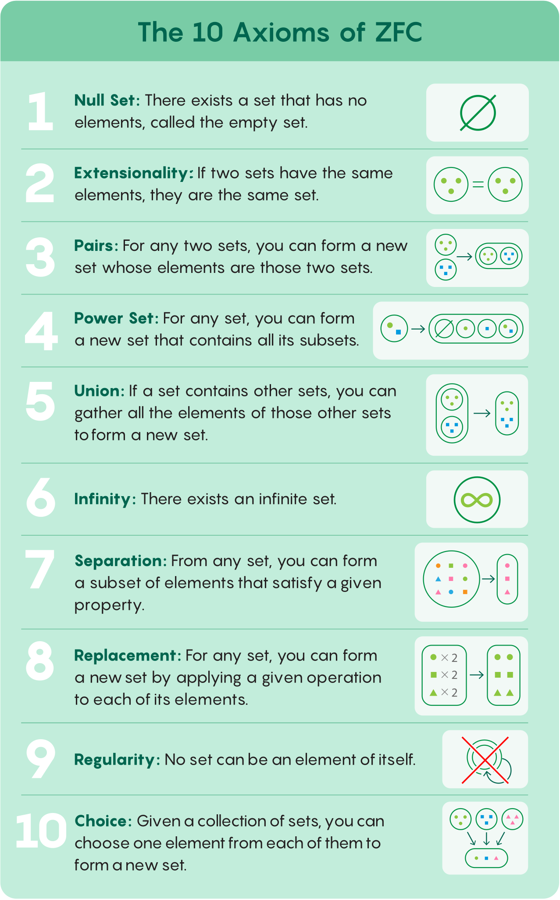

```{marimo-config}
:eval: false
---
width: medium
---
```

```{marimo} python
import marimo as mo
```

```{marimo} python
:hide-code: true
:include: false

_foobar = 0

mo.md(r"""
> If we think about learning as a bridge, every step is needed, right? You can't skip a step to get across, you have to have every single foundational piece. And so the more general skills you have, the more gaps you can fill when someone provides incomplete information... All of us provide incomplete information, right? Otherwise, we'd literally have to start at zero and start at goooo gaga and then go all the way to coding AI, right? It's just we don't have the time to do it.
>
> – Alex Hormozi, $100M Virtual Implementation Workshop ([9:58](https://www.youtube.com/watch?v=eV3BTnlc_tI&list=PLCGQSFOSt3B0&t=9m58s))

After developing some general intuition for filters, we will define zero using set theory and discussing the structure of mathematical language. Then we will use these foundations to build up to coding signal filters.
""")
```

You may dismiss this as overly constraining:

*But words often have different meanings based on context! If I wait 5 hours at the doctor's office, we would agree this is a "long" wait. If the doctor says my new-born child will live a "long" life, then 5 hours would be quite dissapointing. Doesn't that mean the definition of "long" is actually more fluid and context based, rather than a strict set of requirements?*

Not so fast! This just means that "5 hours" is not the correct requirement for the term "long". Something like "lasting over a greater period of time than usual" would work for both our scenarios. Furthermore, we can make requirements that have multiple ways of being satisfied, i.e. "Adjective: lasting over a greater period of time, or greater distance than usual OR Verb: to have a deep desire for something".

In general, if a word takes on different meanings based on context, then
  
A **Boolean variable**[^george-boole] represents a truth value: either **True** or **False**. In the lingo, we say that if $A$ is a boolean variable, then it **evaluates** to $T$ (true) or $F$ (false). We can create **boolean expressions** by combining boolean variables with the following **connective operators**[^connectives]:

[^george-boole]: Named after British mathematician George Boole.

[^connectives]: This is not an exhaustive list of all connectives, but it includes the most common ones which are useful for building our notion of set theory.
  
::::{admonition icon=false} 📖 **Definition**
:::{glossary}
Statement
: Any finite string of symbols (most statements are meaningless, such as $a \forall)6!$").
:::
::::
  
| Symbol | Read as | TeX command |
| :--- | :--- | :--- |
| $\in$ | **"is an element of"** / **"is in"** | `\in` |
| $\forall$ | **"for all"** / **"for every"** | `\forall` |
| $\exists$ | **"there exists"** | `\exists` |
| $\exists!$ | **"there exists a unique"** | `\exists!` |
| $\land$ | **"and"** (Conjunction) | `\wedge` or `\land` |
| $\lor$ | **"or"** (Disjunction) | `\vee` or `\lor` |
| $\neg$ | **"not"** (Negation) | `\neg` or `\lnot` |
| $\rightarrow$ | **"implies"** / **"if... then..."** | `\rightarrow` or `\to` |
  
As well as the following abbreviations:

| Symbol | Read as | Abbreviation for | TeX command |
| :--- | :--- | :--- | :--- |
| $x \notin S$ | "$x$ is **not in** $S$" | $\neg(x \in S)$ | `\notin` |
| $S_1 \subseteq S_2$ | "$S_1$ is a **subset** of $S_2$" | $\forall x(x \in S_1 \rightarrow x \in S_2)$ | `\subseteq` |
| $a \leftrightarrow b$ | "$a$ **if and only if** $b$" (Biconditional) | $(a \rightarrow b) \land (b \rightarrow a)$ | `\leftrightarrow` |
  
| Axiom | Statement |
| :-----: | :---------: |
| Null Set | $\exists S[\forall x(x \notin S)]$ |
| Extensionality | $[(S_1 \subseteq S_2) \land (S_2 \subseteq S_1)] \rightarrow (S_1 = S_2)$ |
| Pairs | $\forall S_1 \forall S_2(\exists S_3[(S_1 \in S_3) \land (S_2 \in S_3)])$ |
| Power Set | $\forall S_1 \exists S_2[\forall x(x \subseteq S_1 \rightarrow x \in S_2)]$ |
| Union | $\forall S_1 \exists S_2[\forall S_3 \forall x([S_3 \in S_1 \land x \in S_3] \rightarrow x \in S_2)]$ |
| Infinity | $\exists S_1[(\emptyset \in S_1) \land \forall x(x \in S_1 \rightarrow \exists S_2[(x \in S_2) \land (S_2 \in S_1)])]$ |
| Separation | I don't know |
| Replacement | I don't know |
| Regularity | $\forall S(S \notin S)$ |
| Choice | I don't know |
  
| Axiom | Statement |
| :-----: | :---------: |
| Null Set | *Write here* |
| Extensionality | *Write here* |
| Pairs | *Write here* |
| Power Set | *Write here* |
| Union | *Write here* |
| Infinity | *Write here* |
| Separation | *Write here* |
| Replacement | *Write here* |
| Regularity | *Write here* |
| Choice | *Write here* |
  
Here is summary of the ZFC axioms from [quanta magazine](https://www.quantamagazine.org/why-maths-final-axiom-proved-so-controversial-20260429/):
