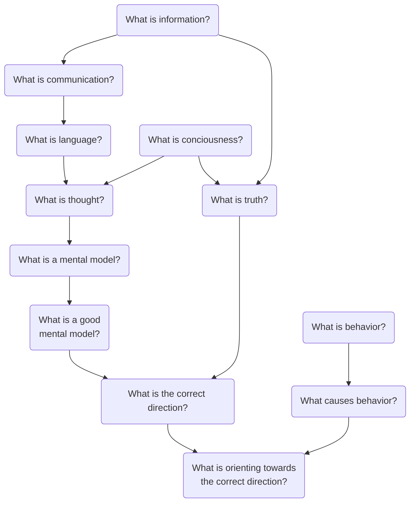
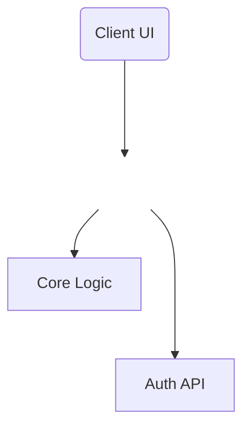

Here, I have taken the liberty to write about ideas which—while not directly pertinant to signal filters—have inspired much of my approach towards writing this site as well as thinking in general.
# The Importance of Rigor in Definitions
I have a fondness for self-referential ideas—especially ones which remain nevertheless usesful, instead of collapsing under the weight of their own circular reasoning. Here is one of my favorites:

::::{admonition icon=false} 📖 **Definition**  
:::{glossary}  
Definition  
: (Of a term) a set of requirements which are necessary and sufficient to be in the category labeled by the term.  
:::  
::::  

In other words, if you have a set of requirements which are necessary and sufficient to meet the category of any term, then you have a definition of the term (the set of requirements for the term "definition" has only one element, as do many other definitions) *and* any definition of any term must be a set of requirements which are necessary and sufficient for memebership of that term's category.

You may dismiss this as overly constraining:  
*Not everything is not always this clear cut and there are many gray areas where words have different meanings based on context. If I say I waited 5 hours at the doctor's office we would I agree I had a "long" wait, but if the doctor says my new-born child will live a "long" life, then 5 hours would be quite dissapointing.*

Not so fast. 

Throughout life, change is constant. This fact is directly observable within one's own present experience; thoughts, sensations, and emotions are continually appearing, evolving, and dissapearing from awareness. As a consequence of this constant change, any effort made towards improving one's experience is an effort to guide the way it changes. In the space of all possible experiences, any effort towards improving one's experience must 1) identify the desired direction to go 2) set course to move in that direction. If a mental model is to have an effect on one's life, then the quality of the mental model may be judged based on how well it accomplishes these tasks.

:::{note}
The task of a mental model is two-fold:

1. **Determine** the correct direction
2. **Orient towards** the correct direction

The quality of a mental model is based on how well it accomplishes these components. In other words, a **better** model will **determine** and **orient** more effectively, while a **worse** model will **determine** and **orient** less effectively.
:::

Mental models are lenses through which to view the world. When analyzing the world through a model, the model becomes the structure of thought and perception. Therefore, to communicate a model is not only to communicate a thought, but to communicate the structure for thought itself. To do this in writing, it is worth considering the strengths and limitations of language in general. This will begin our inquiry, which will build up by addressing questions such as

- What is language?
- What is information?
- What is communication?
- What is thought?
- What is a mental model?
- What is truth?
- What is the correct direction?
- What is behaviour?
- Why do behaviors happen?
- What does it mean to orient?

Firstly, we will adress language through the lens of a chunking/linking protocol to transfer information. Next we will adress human behavior though the lens of reinforcement learning. Finally, we will address human experience through the lens of non-duality. 

# Introduction

Throughout life, change is constant. This fact is directly observable within one's own present experience; thoughts, sensations, and emotions are continually appearing, evolving, and dissapearing from awareness. As a consequence of this constant change, any effort made towards improving one's experience is an effort to guide the way it changes. In the space of all possible experiences, any effort towards improving one's experience must 1) identify the desired direction to go 2) set course to move in that direction. If a mental model is to have an effect on one's life, then the quality of the mental model may be judged based on how well it accomplishes these tasks.

The task of a mental model is two-fold:

1. **Determine** the correct direction
2. **Orient towards** the correct direction

The quality of a mental model is based on how well it accomplishes these components. In other words, a **better** model will **determine** and **orient** more effectively, while a **worse** model will **determine** and **orient** less effectively.

Mental models are lenses through which to view the world. When analyzing the world through a model, the model becomes the structure of thought and perception. Therefore, to communicate a model is not only to communicate a thought, but to communicate the structure for thought itself. To do this in writing, it is worth considering the strengths and limitations of language in general. This will begin our inquiry, which will build up by addressing the following questions:



# Outline


- Logic
    - Deductive resoning vs teleological reasoning (explaining life via predictive model vs purpose) and the direction of causality
    - Causality as sufficiency, definitions as bidirectionality (necessary + sufficient)
- Existence
    - Conciousness
        - Descartes' "I think therefore I am" is a common starting point, but perhaps "thinking" implies something more complex than is necessarying for being (more on the definition of "thought" later). More generally "I experience therefore I am".
    - The Physical World
        - abstraction of experience to represent replicable and predictive experiences

## Logic

Deductive reasoning is reasoning in which the premises are intended to make the conclusion necessarily true: if the premises are true, the conclusion cannot be false. For example,

$$\begin{align*}
\textbf{Premise 1:}&\text{ All humans are mortal.} \\
\textbf{Premise 2:}&\text{ Socrates is human.} \\
\textbf{Conclusion:}&\text{ Therefore, Socrates is mortal.} \\
\end{align*}$$

More formally, this could be written as:
$$\begin{align*}
\textbf{Premise 1: }&\forall x\,(\text{Human}(x) \implies \text{Mortal}(x)). \\
\textbf{Premise 2: }&\text{Human}(\text{Socrates}). \\
\textbf{Conclusion: }&\therefore \text{Mortal}(\text{Socrates}). \\
\end{align*}$$

Even more formally:
$$\forall x\,(\text{Human}(x) \implies \text{Mortal}(x)), \quad \text{Human}(\text{Socrates}) \vdash \text{Mortal}(\text{Socrates}).$$

## Existence

### Conciousness

### Physical World




test

# Freewrite

I was 16 when I was first introduced to the idea of mindfulness in any meaningful way besides "just sit there and be present"[^present]. I was participating in a guided meditation activity...

"for most people you'll start out feeling like you are inside your body," said the guide,

*duh, where else would I be,* I thought,

"especially behind their eyes,"

*well my brain is behind my eyes and that certainly seems like an important part of me,*

"looking out at a world that is other than what you are,"

*no shit, sherlock,*

"but if you look closely, you'll notice that the feeling of having a body, of having a head, of breathing, of color and light in the visual field, of hearing sounds—all these perceptions are arising in the the same space of conscious experience in the mind"

*huh, so this guy's saying that instead of experience happening in the body, it's the perception of the body that's happening in experience...*

[^present]: I've always had the tendency to take things literally[^hattl], and as such found "be present" a strangely confusing command—as if it were possible to be in any time *other* than the present.

[^hattl]: To the point that I was nicknamed "Hattl"—an acronym for "he always takes things literally".

```{marimo} python
:hide-code: true
:eval: false
import schemdraw
from schemdraw import flow
from textwrap import dedent

def graphic(x):
    return mo.Html(
        dedent(f'''\
        <style>
            .dark .graphic {{ 
                filter: invert(1) hue-rotate(180deg); 
            }}
        </style>
        <div class="graphic">
            {mo.as_html(x)}
        </div>
        ''')
    )
```

```{marimo} python
:hide-code: true
schemdraw.use("svg")

# with schemdraw.Drawing(show=False) as _d:
#     _d.config(fontsize=12)

#     flow.Start().label("Force is applied to\nthe scale's platform").drop("S")
#     flow.Arrow().down(1).label(
#         "Tensed/compressed\nstrain gaugues", loc="bottom"
#     )
#     flow.RoundBox().label(
#         "Loadcell measures force\nvia strain gauge resistance"
#     )
#     flow.Arrow().down(1).label(
#         "Continuous\nanalog voltage", loc="bottom"
#     )
#     flow.RoundBox().label("ADC samples\nthe voltage signal")
#     flow.Line().down(1).label(
#         "Sequence of digital\nmeasurements", loc="bottom", ofst=(0, 0.25)
#     )
#     flow.Line().right(3.5)
#     flow.Line().up(5)
#     flow.Arrow().right(1)
#     flow.RoundBox().label("Filter removes\nnoise from the\nmeasurements").drop("S")
#     flow.Arrow().down(1).label("Weight estimate", loc="bottom")
#     flow.Terminal().label("Scale reading")

# graphic(_d)
```

```{marimo} python
with schemdraw.Drawing(show=False) as _d:
    _d.config(fontsize=12)

    flow.RoundBox().label("Force is applied to\nthe scale's platform").drop("S")
    flow.Process().label("Body")

graphic(_d)
```
*graphic showing hierarchy of experiential abstraction*

# Preface

As a passionate nerd, I've made a bit of a hobby out of collecting mental models. It isn't a physical collection—more of a set of lenses through which I could look at the world. Much like a sneaker collection however, there are some I use everyday, some I use only occasionally, and some that look super cool, but are quite uncomfortable once I put them on. This essay is a combination of my all-time favorites, layered together to create a mental map & compass for myself. In other words, a way to both determine my correct direction, and orient myself towards it.

## What is information
Information is defined in terms of events that transfer it. Specifically, the information of an event is the negative log of the event's likelyhood, given some probability distribution. Said more generally, the less likely an event in a given context, the more information it contains. As an example, imagine looking for a suspect in a room of 100 people. If 95 are wearing hats and we are told the suspect is wearing a hat, that doesn't help much. However, if only 5 people are wearing hats we are told the suspect is wearing a hat, that gives a lot of information! The reason is that in the second case, the likelyhood that a randomly picked person would have a hat was very low. In general then, we have information when we (a) establish a context (b) limit the number of remaining possibilities within that context. The more limited the possibilities, the more information we have.  

***Sidenote:** This is often measured in Shannon's where we use $-\log_2(p)$, such that information of a coinflip with probability $p=1/2$ is $(-\log_2(1/2))=1$ Shannon of information.*

**Key Points:**
- Information requires an event and a probability distribution (or context).
- The less likely the event, the more information it contains.

## Transferring information
Consider the example from the the section above, only this time we don't know that there's a suspect or that we're looking for anyone. Now if we are told the suspect is wearing a hat it becomes difficult to calculate the information transferred because we did not establish a clear context. At most we might infer some context by assuming that the suspect is in the room with us, in which case likelyhood of each hat-wearer around us being a suspect jumps from "average incidence of suspects in public" to "average incidence of suspects in public + (1/number of hat-wearers in the room)". More likely though, we are confused as to why we're being told about hats and suspects, and our behaviour is unaffected. We must have a probability distribution before an event can contain information. This is the plight of attempting to transfer information without first establishing context. Everytime a jargon-heavy lecture falls on layman ears or a social cue is misinterpereted, this is what's happening. The reason "it's Greek to me" signifies a lack of understanding is not because Greek lacks meaningful content--it's because foreigners lack the context necessary for it's interperetation. Therefore, effective transfer of information must begin with precise establishment of context. In language this context is structured through definitions.

**Key Points:**
- Events are common; when we lack information it is often because we lack context.
- Definitions are the context required for language to have information. 

## Definitions and chunking
The process of grouping pieces of information together into meaningful units is called chunking (each group being a "chunk"). When we are born, we lack all semantic context for interpereting the information of words. Our only context is through sensory experience. Therefore, when we learn our first words, we do so by associating them to groups of similar experiences (chunks). For example, if we repeatedly hear "food" before recieving it, we associate the word with the experience of the object and its uses (eating it in this case). Just as we chunk experiences of nouns and their uses, we also chunk experinces of adjectives like "cold", verbs like "go", and interjections like "uh-oh!". Then when we hear "food", we understand the word through the category of experiences and objects we have chunked in memory. As we hear more words and become familiar with more objects and experieces, we build more informed responses to the words we hear. This ability to understand words is called *receptive language* and often begins in 6-9 month-olds. Once we develop the motor skill for speaking, *expressive language* begins around 18-24 months. 

***Sidenote:** As an example of the fact our fundamental understanding of language is through sensory experiences and objects, nearly all babies' first words come from four of the nine lexical categories (noun, verb, adjective, interjection), while the remaining five (adverb, preposition, conjunction, determiner, pronoun) are learned later. This is because the later five categories are used for linking, as discussed in the next section.*

**Key Points:**
- Chunks are grouped pieces of information.
- Chunks can be nested: they can contain other chunks.
- Words are labeled chunks.
- The foundation of language is built by defining words through chunked experience.
- Later, words are defined through other words. These nested chunk words may be referred to as "bundled terms", while the process of grouping multiple chunks into one chunk may be referred to as "chunking up" or "going up a layer of abstraction".

## Your task
Please address the tension between a "chunking up" progression vs. a "chunking down" progression within the context of cognitive psychology, information theory, or any other field of research you deem relevant to the topic.

Framing the question:
- *Chunking down*  
Infants begin with the simplest category groups of experience: a binary ("bad and crying" vs. "good and not crying"). Rather than grouping multiple categories into one (chunking up), they then add more categories within the binary (chunk down). For example, the general "blue" will likely be understood before the specific "cyan".
- *Chunking up*  
Contrary to the natural language strategy above where infants start with the general and move towards the specific, people learning programming languages tend to start with the specific and move towards the more abstract. For example, an individual learning python might start by learning the data types like int, str, float, etc, then learn functions which use those data types, then learn classes which use functions. In this case, rather than adding complexity through granularity, we are adding complexity though layers of abstraction. At first glance this may seem like a difference between technical language vs. natural language, but the same thing appears in natural language as well. As we devlop a more complex understanding of the world, we begin to use more bundled terms to describe our understanding. For example, we might describe someone as "charismatic" to mean many things: they smile when initiating eye contact, they use someone's name when greeting them, they ask questions to learn about others, they realate to other's experiences, etc.

Questions:
- Since progressions are clearly possible in both chunking directions (up and down), what are the determining factors for whether a chunking up (starting specific then building layers of abstraction) or chunking down (starting general and increasing granularity) approach will work best in a given domain? Phrased differently, what domain characteristics make some domains more suited to chunking up (such as programming) others are more suited to chunking down (such as learning to speak as an infant), that we could apply as a litmus test to any arbitrary domain to determine whether a chunk up or chunk down strategy is best.
- What are the fields of study which address these questions and already have literature and frameworks for this?
- Is it even accurate that natural language is more suited to chunking down and programming is more suited to chunking up or is that a false assumption?

## Scentences and linking

## What is reinforcement learning

## Exploration vs exploitation

## Reward function vs loss function
In reinforcement learning, a higher reward indicates a better behavior. the agent tries to increase a cummulative reward over time, where feedback is often delayed and sparse. no "correct action" given, feedback only after acting, must infer which actions caused reward. “Here is the correct answer—reduce your error.”

## Defining the loss function
in supervised learning, a lower loss indicates a better behavior. the model tries to reduce prediction error. feedback is immediate and dense. you are told the correct answer, supervised signal exists for each example, direct mapping of input to target. “Try things; I’ll tell you how good they were later.”

## Defining the reward function


